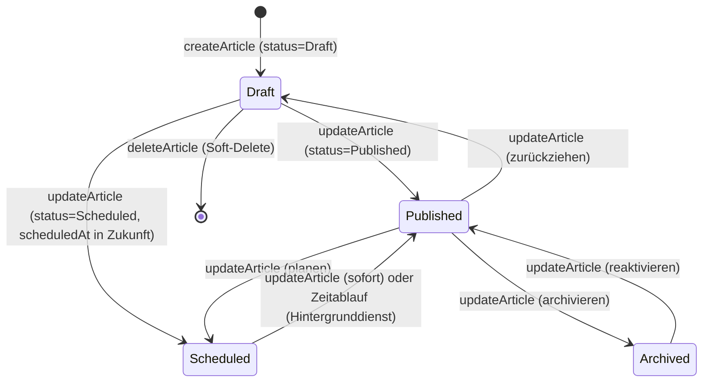

# API-Funktion von Mentalversagen

**Die Management-API des Mentalversagen-Blogs: Zweck, Konfiguration, Client-Tools, Skripte und KI-Agenten-Einsatz.**

| | |
|---|---|
| Basis-URL (Produktion) | `https://mentalversagen.de/api/v1` |
| Basis-URL (lokal) | `http://localhost:5080/api/v1` |
| Authentifizierung | Header `X-Api-Key: <Key>` (statischer Key der Installation) |
| OpenAPI-Spec | `https://mentalversagen.de/swagger/v1/swagger.json` |
| Interaktive Oberfläche | `https://mentalversagen.de/swagger` (nur wenn `Api__SwaggerUiEnabled=true`) |
| Format | JSON (camelCase), Fehler als `application/problem+json` (RFC 7807) |
| Limit | 60 Anfragen/Minute pro Client-IP (konfigurierbar) |

> Diese Anleitung richtet sich an Menschen **und** an KI-Agenten. Jedes Kapitel
> enthält kopierfertige Befehle, vollständige Feldtabellen und Regeln, an denen
> sich ein Agent orientieren kann. Die Kurzfassung für Agenten steht in
> [Kapitel 6.4](#64-skill--system-prompt-zum-kopieren).

---

## Inhalt

1. [Schnellstart](#1-schnellstart)
2. [Warum ein Blog eine API braucht](#2-warum-ein-blog-eine-api-braucht)
3. [Die Management-API im Überblick](#3-die-management-api-im-überblick)
4. [Betriebs- und Webserver-Konfiguration](#4-betriebs--und-webserver-konfiguration)
5. [Client-Tools](#5-client-tools)
6. [Skriptnutzung (Python, PowerShell, Bash)](#6-skriptnutzung-python-powershell-bash)
7. [Nutzung mit KI-Agenten (Hermes & Co.)](#7-nutzung-mit-ki-agenten-hermes--co)
8. [Bonus: öffentliche Lese-Endpunkte ohne Key](#8-bonus-öffentliche-lese-endpunkte-ohne-key)
9. [Troubleshooting](#9-troubleshooting)
10. [Checklisten](#10-checklisten)
11. [Anhang](#11-anhang)

---

## 1. Schnellstart

```bash
# 1) Key erzeugen (32 Byte Hex = 64 Zeichen)
openssl rand -hex 32

# 2) In der .env hinterlegen (NIEMALS committen)
echo "Api__Key=<der Key>" >> .env

# 3) API-Autoren-ID ermitteln (UUID eines Author/Admin-Kontos)
docker exec blogcms-postgres psql -U blogcms -d blogcms \
  -c "select \"Id\", \"Email\", \"Role\" from \"AspNetUsers\" where \"Role\" in ('Author','Admin');"

# 4) App neu starten, damit die Konfiguration greift
docker compose --profile app up -d --build

# 5) Verbindungstest
curl -s -o /dev/null -w "%{http_code}\n" \
  -H "X-Api-Key: <KEY>" https://mentalversagen.de/api/v1/articles?pageSize=1
# Erwartung: 200  (401 = Key falsch/fehlend, 503 = Api__AuthorId fehlt)
```

> **Fail-Closed:** Ohne `Api__Key` ist die gesamte Management-API geschlossen —
> jeder Aufruf antwortet mit `401`. Es gibt keinen „offenen" Zustand.

---

## 2. Warum ein Blog eine API braucht

### 2.1 Der Grund in einem Satz

> Eine API verwandelt die Redaktion des Blogs von einer *Oberfläche* in eine *Schnittstelle*: Was ein Mensch in der Web-Oberfläche anklickt, kann ein Skript, ein CI-Job oder ein KI-Agent genauso tun — nur schneller, wiederholbar und ohne Browser.

### 2.2 Praktische Anwendungsfälle

| Anwendungsfall | Wie die API hilft |
|---|---|
| **KI als Redaktionsschreiber** | Recherche-Agent erzeugt Markdown, legt Entwurf an, redigiert, legt zur Freigabe vor |
| **Veröffentlichen im Zeitplan** | `status=Scheduled` + `scheduledAt` — ohne Bodenpersonal am Bildschirm |
| **Pipeline: Quelle → Entwurf** | RSS-/Datenquellen werden automatisch zu Entwürfen; ein Mensch prüft und veröffentlicht |
| **Massenaktionen** | Tags/Hashtags ergänzen, alle Beiträge einer Kategorie archivieren, Titel korrigieren |
| **Migration & Import** | Alte Beiträge aus Markdown-Dateien oder einem anderen CMS in einem Skript-Durchlauf einspielen |
| **Qualitätssicherung** | CI-Job prüft alle veröffentlichten Beiträge auf Pflichtfelder, Länge,Slug-Format, Vorschaubild |
| **Statistik & Monitoring** | `listArticles` + Filter liefert den Bestand; ein externer Cron-Job meldet „3 Entwürfe älter als 30 Tage" |
| **Reproduzierbarkeit & Audits** | Der Weg eines Artikels (Entwurf → Veröffentlichung → Planung) ist über die API nachvollziehbar und skriptbar |
| **Backup/Spiegelung** | Vollständiger Inhalt (inkl. Markdown-Quelltext) lässt sich maschinell sichern und wiederherstellen |
| **Agenten mit Werkzeugen** | Ein KI-Agent bekommt die API als Werkzeug und arbeitet damit wie ein Redakteur — nur schneller |

### 2.3 Was die API bewusst **nicht** kann

Damit keine Erwartungen aufgebaut werden, die später enttäuschen:

- **Keine Benutzerverwaltung.** Konten, Rollen, Passwörter laufen ausschließlich über die Web-Oberfläche.
- **Keine Kommentare, Bewertungen, Meldungen, Newsletter-Abonnenten, Spenden, Mitgliedschaften.** Diese Bereiche haben bewusst keine Management-API.
- **Kein Datei-Upload über die Management-API.** Der JSON-Workflow kennt keine Binärdaten. Titelbilder kommen über `titleImageUrl` (externe URL) oder `uploadedImageIds` (bereits im Medienspeicher vorhandene Bilder). Der Upload-Endpoint `/api/media/upload` ist eine **AJAX-Schnittstelle des Editors** (Session-Cookie + Anti-Forgery-Token), kein API-Key-Endpoint.
- **Keine Bildbearbeitung, kein Rendern.** Der Markdown-Quelltext wird geliefert, gerendert wird er beim Lesen der Web-Seite.
- **Kein Schreiben von Kommentaren.** Kommentare laufen über die Benutzeroberfläche.
- **Kein Health-/Status-Endpoint** im Sinne von `/health` — geprüft wird über einen echten API-Aufruf (siehe [4.6](#46-prüfbefehle)).

---

## 3. Die Management-API im Überblick

### 3.1 Endpunkte

Alle Endpunkte liegen unter `/api/v1/articles` und benötigen den Header `X-Api-Key`.

| Methode | Pfad | operationId | Zweck | Antwort |
|---|---|---|---|---|
| `GET` | `/api/v1/articles` | `listArticles` | Artikel auflisten (inkl. Entwürfe, geplante, archivierte) | `200` PagedResponse |
| `GET` | `/api/v1/articles/{id}` | `getArticle` | Einzelnen Artikel inkl. Markdown-Quelltext lesen | `200` ArticleReadModel |
| `POST` | `/api/v1/articles` | `createArticle` | Artikel anlegen | `201` + `Location`-Header |
| `PUT` | `/api/v1/articles/{id}` | `updateArticle` | Artikel **vollständig** überschreiben (auch Statuswechsel) | `200` ArticleReadModel |
| `DELETE` | `/api/v1/articles/{id}` | `deleteArticle` | Artikel löschen (Soft-Delete) | `204` leer |

**Query-Parameter von `listArticles`:**

| Parameter | Typ | Standard | Bedeutung |
|---|---|---|---|
| `status` | `Draft` \| `Scheduled` \| `Published` \| `Archived` | alle | Statusfilter |
| `query` | string | – | Suche in Titel, Slug und Kurzbeschreibung |
| `page` | int (1-basiert) | `1` | Seitennummer |
| `pageSize` | int (max. 50) | `20` | Elemente pro Seite |

**Antwortform der Liste** (`PagedResponse<ArticleReadModel>`):

```json
{
  "items": [ { "id": "…", "title": "…", "…": "…" } ],
  "total": 42,
  "page": 1,
  "pageSize": 20
}
```

> `total` ist die Gesamtzahl **passender** Artikel, nicht die der Seite. Für
> vollständige Durchläufe alle Seiten durchlaufen (`ceil(total / pageSize)`).

### 3.2 Authentifizierung im Detail

- **Header:** `X-Api-Key: <Key>` — der Key wird bei **jedem** Request mitgeschickt.
- **Fail-Closed:** Ist `Api__Key` nicht gesetzt, antwortet jeder Aufruf mit `401` und der Server loggt eine Warnung. Die API öffnet sich also nie versehentlich.
- **Vergleich ohne Timing-Lecks:** Der Key wird intern per SHA-256 gehasht und mit `CryptographicOperations.FixedTimeEquals` verglichen — Länge und Zeichenpositionen des Keys werden nicht nach außen gespiegelt.
- **Der Key wird nie geloggt** — weder im Erfolgs- noch im Fehlerfall.
- **Key-Rotation:** Key in der `.env`/Container-Umgebung ändern und die App neu starten. Es gibt nur einen Key pro Installation; für mehrere Clients denselben Key verwenden oder je Client eine eigene Installation betreiben.
- **Kein Cookie, kein Bearer, kein OAuth** — bewusst der einfachste Mechanismus, den jeder Client (curl, Skript, MCP-Server) bedienen kann.

### 3.3 Datenmodell

**Schreibmodell (`ArticleWriteModel`) — Body von `POST` und `PUT`:**

| Feld | Typ | Pflicht | Bedeutung / Regeln |
|---|---|---|---|
| `title` | string | **ja** | Titel; wird getrimmt. Leer → 400 |
| `slug` | string \| null | nein | URL-Abschnitt. Leer → wird aus dem Titel generiert |
| `excerpt` | string \| null | bei `Published`/`Scheduled` | Teaser/Kurzbeschreibung |
| `contentMarkdown` | string | bei `Published`/`Scheduled` | Artikelinhalt in Markdown (Quelltext) |
| `category` | enum | ja | `Politik` \| `Satire` \| `Verschwoerungstheorien` |
| `accessLevel` | enum | ja | `Public` \| `Registered` \| `Premium` |
| `status` | enum | ja | `Draft` \| `Published` \| `Scheduled` \| `Archived` |
| `scheduledAt` | datetime \| null | bei `Scheduled` | ISO-8601, **UTC**, muss in der Zukunft liegen |
| `titleImageUrl` | string \| null | bei `Published`/`Scheduled` | externe Bild-URL (Alternativ: `uploadedImageIds`) |
| `videoUrl` | string \| null | nein | YouTube/Vimeo/X/TikTok; wird zu oEmbed eingebettet |
| `tags` | string[] | nein | Schlagwörter für die Filterung |
| `hashtags` | string[] | nein | Hashtags **ohne** führendes `#` |
| `uploadedImageIds` | uuid[] | nein | IDs bereits hochgeladener Bilder, die zugeordnet werden |

**Lesemodell (`ArticleReadModel`) — Antwort von `GET`/`POST`/`PUT`:**

| Feld | Typ | Bedeutung |
|---|---|---|
| `id` | uuid | stabile Referenz für Folge-Requests |
| `title`, `slug`, `excerpt`, `contentMarkdown` | string | wie geschrieben; `contentMarkdown` ist der **Quelltext** |
| `category`, `accessLevel`, `status` | enum | Klartextwerte |
| `scheduledAt`, `publishedAt` | datetime \| null | ISO-8601 UTC |
| `titleImageUrl`, `videoUrl` | string \| null | Medienreferenzen |
| `tags`, `hashtags` | string[] | gespeicherte Namen |
| `mediaIds` | uuid[] | dem Artikel zugeordnete Medien |
| `authorId` | uuid | Autor (bei API-Anlage der konfigurierte API-Benutzer) |
| `createdAt`, `updatedAt` | datetime | Zeitstempel |

**Konventionen für alle Clients:**

- Feldnamen sind **camelCase**.
- Enums sind **Klartextstrings** (`"Published"`), keine Zahlen.
- Zeitpunkte sind **ISO-8601 in UTC** (`"2026-12-24T18:00:00Z"`).
- Unbekannte Felder im Request werden ignoriert; fehlende Felder beim `PUT` werden **geleert** (Voll-Update!).

### 3.4 Statuswerte und Übergänge



| Status | Bedeutung | Anforderungen |
|---|---|---|
| `Draft` | Entwurf | darf unvollständig sein (nur `title` nötig) |
| `Published` | sofort veröffentlicht | `excerpt`, `contentMarkdown` + Titelbild-Quelle |
| `Scheduled` | zeitgesteuert veröffentlicht | wie `Published` + `scheduledAt` in der Zukunft |
| `Archived` | archiviert (nicht öffentlich) | — |

> **Voll-Update beachten:** `PUT` überschreibt *alle* Felder. Wer nur den Status
> ändern will, muss denselben Body erneut senden, inklusive `excerpt`,
> `contentMarkdown`, `titleImageUrl`, `tags`, `hashtags`. Sonst werden diese
> Felder geleert und die Veröffentlichung scheitert mit 400.

### 3.5 Validierungsregeln (Quelle: `ArticleValidator`)

| Regel | Feld in `errors[]` | Auslöser |
|---|---|---|
| Titel erforderlich | `Title` | `title` leer |
| Kurzbeschreibung nötig | `Excerpt` | Status `Published`/`Scheduled` und `excerpt` leer |
| Inhalt nötig | `ContentMarkdown` | Status `Published`/`Scheduled` und `contentMarkdown` leer |
| Titelbild-Quelle nötig | `ImageUpload` | Status `Published`/`Scheduled` und weder `titleImageUrl` noch `uploadedImageIds` noch vorhandenes Bild |
| Zukunftszeitpunkt nötig | `ScheduledAt` | Status `Scheduled` und `scheduledAt` fehlt oder liegt in der Vergangenheit |

Diese Regeln gelten **identisch** für die Web-Oberfläche und die API — ein per
API veröffentlichter Artikel durchläuft dieselbe Fachlogik.

### 3.6 Fehlerformat

Alle Fehler kommen als `application/problem+json` (RFC 7807):

```json
{
  "type": "https://mentalversagen.de/problems/validation-error",
  "title": "Die Eingaben sind ungültig.",
  "status": 400,
  "detail": "…",
  "errors": [
    { "field": "ImageUpload", "message": "Bitte eine Titelbild-URL angeben oder ein Bild hochladen (FeatureFix1 BR-022)." },
    { "field": "Excerpt", "message": "Für die Veröffentlichung ist eine Kurzbeschreibung erforderlich (FeatureFix1 BR-023)." }
  ]
}
```

`errors[]` ist **nur bei 400** vorhanden und nennt die korrigierbaren Felder
direkt — die wichtigste Information für automatisierte Clients.

| Status | `type` | Bedeutung | Typische Reaktion |
|---|---|---|---|
| `400` | `validation-error` | Eingaben ungültig | `errors[]` auswerten, Felder korrigieren, erneut senden |
| `401` | `unauthorized` | Key fehlt/ungültig | Key prüfen; `Api__Key` in der Konfiguration setzen |
| `404` | `not-found` | Artikel-ID unbekannt | `listArticles` erneut abfragen |
| `429` | `rate-limit` | Limit überschritten | warten (60 s-Fenster) und mit Backoff wiederholen |
| `503` | `not-configured` | `Api__AuthorId` fehlt | Konfiguration ergänzen, App neu starten |
| `500` | `internal-error` | Serverfehler | Log prüfen, später erneut versuchen |

### 3.7 Rate-Limit

- **Fixed Window** pro Client-IP: 60 Anfragen pro Minute (Standard, `Api__RateLimitPerMinute`).
- Die Drosselung greift **vor** der Authentifizierung — ein falscher Key verbraucht also dasselbe Kontingent.
- Antwort: `429` mit `Retry-After` (Windows-Fenster) und ProblemDetails-Body.
- **Für Agenten wichtig:** bei 429 nicht sofort wiederholen, sondern 60 s warten oder exponentiell backoffen.

### 3.8 OpenAPI-Spec

Die maschinenlesbare Spec ist **immer** erreichbar (unabhängig von `Api__SwaggerUiEnabled`):

```
GET https://mentalversagen.de/swagger/v1/swagger.json
```

Sie enthält: sprechende `operationId`s (`listArticles`, `getArticle`, `createArticle`, `updateArticle`, `deleteArticle`), alle Feldbeschreibungen inkl. Formatangaben aus den XML-Kommentaren, das Sicherheitsschema (`ApiKey` im Header `X-Api-Key`) und einen Kurzleitfaden für KI-Clients. Enums erscheinen als Klartextwerte.

---

## 4. Betriebs- und Webserver-Konfiguration

### 4.1 Konfigurationsvariablen

| Variable | Standard | Bedeutung |
|---|---|---|
| `Api__Key` | *(leer)* | Statischer API-Key. **Leer = API geschlossen (Fail-Closed)** |
| `Api__AuthorId` | *(leer)* | UUID des Autors (Rolle `Author` oder `Admin`), dem API-Anlagen zugeordnet werden. Fehlt → `POST` antwortet 503, `GET`/`PUT`/`DELETE` funktionieren |
| `Api__RateLimitPerMinute` | `60` | Anfragen pro Minute pro Client-IP |
| `Api__SwaggerUiEnabled` | `false` | interaktive Oberfläche unter `/swagger` (in `Development` immer aktiv) |
| `Site__PublicBaseUrl` | *(leer)* | feste öffentliche Adresse (z. B. `https://mentalversagen.de`) für Feed und E-Mail-Links; leer = aus dem Request ableiten |
| `Site__UseForwardedHeaders` | `true` | `X-Forwarded-Proto/Host` des Proxys auswerten |
| `Site__KnownProxies` | *(leer)* | vertrauenswürdige Proxy-IPs (Komma-getrennt) |

> Alle Variablen werden per `__` (Doppel-Unterstrich) auf die Konfigurationssektion
> abgebildet: `Api__Key` → `Api:Key`, `Site__PublicBaseUrl` → `Site:PublicBaseUrl`.
> Reale Umgebungsvariablen (Docker) haben Vorrang vor der lokalen `.env`.

### 4.2 Key erzeugen und verwalten

```bash
# Erzeugen (64 Hex-Zeichen = 32 Byte Entropie)
openssl rand -hex 32

# Prüfen der Länge (muss >= 32 Zeichen sein, sonst Warnung im Log)
echo -n "$API_KEY" | wc -c
```

- Key **niemals** committen, **niemals** in Chat/Issue/Tickets, **niemals** in Logs.
- Ablage: `.env` (git-ignoriert) oder Secret-Store/Env des Hosts. `.env.example` enthält bewusst **keinen** Key.
- Rotation: Key in der `.env` ersetzen → Container/Prozess neu starten. Der alte Key ist sofort ungültig.
- Für getrennte Clients (z. B. Prod-Agent und Testskript) empfiehlt sich eine **eigene Installation** je Key, da pro Installation nur ein Key gilt.

### 4.3 Docker Compose

```yaml
services:
  app:
    profiles: ["app"]
    build:
      context: .
      dockerfile: Dockerfile
    container_name: blogcms-app
    restart: unless-stopped
    depends_on:
      postgres:
        condition: service_healthy
    environment:
      ConnectionStrings__DefaultConnection: "Host=postgres;Port=5432;Database=blogcms;Username=blogcms;Password=${POSTGRES_PASSWORD:-blogcms_dev_password}"
      ASPNETCORE_ENVIRONMENT: ${ASPNETCORE_ENVIRONMENT:-Production}
      # --- Management-API ---
      Api__Key: ${Api__Key:?Api__Key muss gesetzt sein}
      Api__AuthorId: ${Api__AuthorId:-}
      Api__RateLimitPerMinute: ${Api__RateLimitPerMinute:-60}
      Api__SwaggerUiEnabled: ${Api__SwaggerUiEnabled:-false}
      # --- öffentliche Adresse (Feed, E-Mail-Links) ---
      Site__PublicBaseUrl: ${Site__PublicBaseUrl:-https://mentalversagen.de}
      Site__UseForwardedHeaders: "true"
    ports:
      - "127.0.0.1:8080:8080"   # nur lokal binden → kein Direktzugriff aus dem Internet
```

Der Container lauscht intern auf `http://+:8080` (siehe `Dockerfile`). Für
Produktion **nicht** auf `0.0.0.0` freigeben, sondern den Port nur an den Proxy
binden und `Site__KnownProxies` setzen.

### 4.4 nginx als Reverse Proxy

```nginx
server {
    listen 80;
    server_name mentalversagen.de;
    return 301 https://$host$request_uri;
}

server {
    listen 443 ssl http2;
    server_name mentalversagen.de;

    ssl_certificate     /etc/letsencrypt/live/mentalversagen.de/fullchain.pem;
    ssl_certificate_key /etc/letsencrypt/live/mentalversagen.de/privkey.pem;

    # Große Markdown-Bodies erlauben (Artikeltexte, Bulk-Imports)
    client_max_body_size 5m;

    location / {
        proxy_pass http://127.0.0.1:8080;
        proxy_http_version 1.1;
        proxy_set_header Host              $host;
        proxy_set_header X-Real-IP         $remote_addr;
        proxy_set_header X-Forwarded-For   $proxy_add_x_forwarded_for;
        proxy_set_header X-Forwarded-Proto $scheme;
        proxy_set_header X-Forwarded-Host  $host;
        proxy_read_timeout 60s;
    }

    # Optional: zusätzliche Drosselung direkt am Proxy (Defense in Depth)
    location /api/v1/ {
        limit_req zone=api burst=20 nodelay;
        proxy_pass http://127.0.0.1:8080;
        proxy_set_header Host              $host;
        proxy_set_header X-Forwarded-For   $proxy_add_x_forwarded_for;
        proxy_set_header X-Forwarded-Proto $scheme;
        proxy_set_header X-Forwarded-Host  $host;
    }
}
```

```nginx
# /etc/nginx/conf.d/ratelimit.conf
limit_req_zone $binary_remote_addr zone=api:10m rate=30r/m;
```

**Wichtig für den API-Key:**

- Der Key wird **im Header** übertragen, nicht in der URL — Proxy-Logs
  (`$request`) enthalten ihn daher **nicht**. Deshalb sollte die
  Standard-Logformatierung beibehalten werden.
- Falls Request-Header protokolliert werden (`$http_x_api_key`), **muss** der
  Key maskiert werden:

```nginx
log_format api_safe '$remote_addr - $remote_user [$time_local] "$request" '
                     '$status $body_bytes_sent "$http_referer" '
                     '"$http_user_agent" "key=$http_x_api_key"';
# bzw. im Log-Format statt $http_x_api_key einfach "[redacted]" einsetzen
```

### 4.5 Caddy als Alternative (TLS und Forwarded-Header automatisch)

```caddyfile
mentalversagen.de {
    reverse_proxy 127.0.0.1:8080 {
        # Caddy setzt X-Forwarded-For/-Proto/-Host automatisch
    }

    # Optional: harte Begrenzung der API
    @api path /api/v1/*
    rate_limit @api {
        zone mentalversagen_api
        rate 30r/m
    }
}
```

### 4.6 Prüfbefehle

```bash
# 1) API erreichbar? (401 = Key fehlt/falsch, 200 = ok)
curl -s -o /dev/null -w "%{http_code}\n" -H "X-Api-Key: $API_KEY" \
  https://mentalversagen.de/api/v1/articles?pageSize=1

# 2) Fail-Closed nachweisen (Key absichtlich falsch)
curl -s -H "X-Api-Key: falsch" https://mentalversagen.de/api/v1/articles | jq .

# 3) Autor-ID gesetzt? (POST ohne 503 prüfen)
curl -s -o /dev/null -w "%{http_code}\n" -X POST \
  -H "X-Api-Key: $API_KEY" -H "Content-Type: application/json" \
  -d '{"title":"Prüfentwurf","status":"Draft","category":"Politik","accessLevel":"Public"}' \
  https://mentalversagen.de/api/v1/articles
# 201 = ok, 503 = Api__AuthorId fehlt, 400 = Validierung

# 4) Spec erreichbar?
curl -s -o /dev/null -w "%{http_code}\n" https://mentalversagen.de/swagger/v1/swagger.json

# 5) Server-Log auf Warnungen prüfen
docker logs blogcms-app 2>&1 | grep -iE "api|forwarded" | tail -20
```

Typische Log-Meldungen beim Start:

| Log-Meldung | Bedeutung | Reaktion |
|---|---|---|
| `Management-API: kein Api:Key konfiguriert — /api/v1 bleibt ... geschlossen` | Key fehlt | `Api__Key` setzen |
| `der konfigurierte Api:Key ist kürzer als 32 Zeichen` | Key zu kurz | neuen Key erzeugen |
| `Api:AuthorId ist nicht konfiguriert` | Anlegen per API nicht möglich | `Api__AuthorId` setzen |
| `API-Zugriff verweigert: ungültiger API-Key` | Client sendet falschen Key | Key im Client korrigieren |

### 4.7 Sicherheits-Checkliste Produktion

- [ ] `Api__Key` gesetzt, ≥ 32 Zeichen, nur in `.env`/Secret-Store
- [ ] `Api__AuthorId` zeigt auf ein `Author`/`Admin`-Konto
- [ ] App-Port nur an `127.0.0.1` gebunden, öffentlich nur über TLS-Proxy
- [ ] `Site__PublicBaseUrl` gesetzt (Feed- und E-Mail-Links stimmen)
- [ ] `Site__KnownProxies` gesetzt, wenn die App direkt erreichbar wäre
- [ ] HTTPS erzwungen (HTTP → 301), HSTS aktiv
- [ ] Proxy-Logs maskiert `X-Api-Key` (falls überhaupt Header gelogt werden)
- [ ] `Api__SwaggerUiEnabled` in Produktion bewusst entschieden (Spec bleibt ohnehin erreichbar)
- [ ] Rate-Limit aktiv (App 60/min, optional Proxy zusätzlich)
- [ ] Backups: `.env` getrennt vom Datenbank-Backup sichern (Key-Verlust = API-Verlust)
- [ ] Key-Rotation im Kalender (z. B. quartalsweise)

---

## 5. Client-Tools

### 5.1 curl

```bash
export API_URL="https://mentalversagen.de/api/v1"
export API_KEY="<KEY>"

# Liste (Entwürfe, Seite 1)
curl -s -H "X-Api-Key: $API_KEY" "$API_URL/articles?status=Draft&page=1&pageSize=20"

# Liste als formatiertes JSON
curl -s -H "X-Api-Key: $API_KEY" "$API_URL/articles" | jq '.total, (.items[] | {id, title, status})'

# Einzelnen Artikel lesen (inkl. Markdown)
curl -s -H "X-Api-Key: $API_KEY" "$API_URL/articles/<ID>" | jq -r '.contentMarkdown'

# Anlegen (Entwurf)
curl -s -X POST "$API_URL/articles" \
  -H "X-Api-Key: $API_KEY" \
  -H "Content-Type: application/json" \
  -d '{
        "title": "Ein API-Beitrag",
        "excerpt": "Kurzer Teaser.",
        "contentMarkdown": "# Überschrift\n\nText in **Markdown**.",
        "category": "Politik",
        "accessLevel": "Public",
        "status": "Draft",
        "tags": ["Innenpolitik"],
        "hashtags": ["DeepDive"]
      }' | jq '{id, slug, status}'

# Voll-Update: erst lesen, dann modifiziert zurückschreiben
ARTICLE=$(curl -s -H "X-Api-Key: $API_KEY" "$API_URL/articles/<ID>")
jq '.status = "Published"' <<<"$ARTICLE" \
  | curl -s -X PUT "$API_URL/articles/<ID>" \
      -H "X-Api-Key: $API_KEY" -H "Content-Type: application/json" -d @- | jq '{id, status, publishedAt}'

# Löschen (Soft-Delete)
curl -s -o /dev/null -w "%{http_code}\n" -X DELETE -H "X-Api-Key: $API_KEY" "$API_URL/articles/<ID>"
```

### 5.2 HTTPie (lesbarere Syntax)

```bash
pipx install httpie
export API_KEY="<KEY>"

http GET https://mentalversagen.de/api/v1/articles status==Draft pageSize==5 X-Api-Key:$API_KEY
http POST https://mentalversagen.de/api/v1/articles X-Api-Key:$API_KEY \
    title="Ein Beitrag" excerpt="Teaser" contentMarkdown="# Text" \
    category=Politik accessLevel=Public status=Draft
```

### 5.3 Swagger UI (interaktiv im Browser)

Wenn `Api__SwaggerUiEnabled=true` (oder in `Development`):

```
https://mentalversagen.de/swagger
```

- **Authorize**-Button anklicken → Key eintragen → alle Requests sind direkt ausführbar.
- Ideal zum Testen einzelner Requests und zum Nachsehen der Felddefinitionen.

### 5.4 Postman

1. **Import der Spec:** `File → Import → Link` → `https://mentalversagen.de/swagger/v1/swagger.json` (oder Upload der JSON-Datei).
2. **Environment anlegen** (z. B. „Produktion“):
   | Variable | Wert |
   |---|---|
   | `baseUrl` | `https://mentalversagen.de/api/v1` |
   | `apiKey` | `<KEY>` |
3. **Collection-Ebene** → *Authorization* → *API Key* → Header `X-Api-Key`, Value `{{apiKey}}`.
4. Requests anpassen: `{{baseUrl}}/articles?status=Draft&pageSize=20`.
5. **Tests-Skript** (optional) für einen Smoke-Test:

```javascript
pm.test("Status 200", () => pm.response.to.have.status(200));
const body = pm.response.json();
pm.environment.set("firstArticleId", body.items[0].id);
```

### 5.5 Bruno

1. `bruno init` → neue Collection; **Import** der OpenAPI-Spec (`bruno import openapi <url>` oder über die GUI).
2. **Environment** anlegen: `baseUrl`, `apiKey` — im Bruno ist der Ordner `Environments/` und die Datei `local.bru` mit

```
vars {
  baseUrl: https://mentalversagen.de/api/v1
  apiKey: <KEY>
}
```

3. In den Requests den Header `X-Api-Key: {{apiKey}}` setzen; `{{baseUrl}}` in der URL verwenden.
4. Bruno-Dateien können committet werden — **ohne** den echten Key (`.env`-Variante nutzen).

### 5.6 Insomnia

1. `Insomnia → New Request` bzw. **Import → OpenAPI** mit der Spec-URL.
2. **Environment:** `base_url`, `api_key` anlegen (oder „Base Environment" mit Shared-Environments).
3. Header `X-Api-Key: {{api_key}}` im Request-Header-Tab setzen.
4. Template-Requests anlegen (`GET {{base_url}}/articles/{{article_id}}`).

### 5.7 Client-Bibliotheken (für eigene Programme)

| Sprache | Bibliothek | Installation |
|---|---|---|
| Python | `requests` | `pip install requests` |
| Python (async) | `httpx` | `pip install httpx` |
| JavaScript/TypeScript | `openapi-fetch`, `axios` | `npm i openapi-fetch` |
| Go | `ogen` (OpenAPI-Codegen) | `go install github.com/ogen-go/ogen/cmd/ogen@latest` |
| Java/Kotlin | `openapi-generator` | `openapi-generator-cli generate -i swagger.json -g java` |

---

## 6. Skriptnutzung (Python, PowerShell, Bash)

> Grundregel für alle Skripte: **Key aus der Umgebung**, nie im Quelltext.
> `API_KEY` bzw. `$env:API_KEY` — so bleiben Skripte sharebar und der Key
> landet nicht in Git.

### 6.1 Python mit `requests` — vollständiges Skript

```python
#!/usr/bin/env python3
"""Mentalversagen Management-API: Entwurf anlegen, veröffentlichen, auflisten.

Aufruf:
    export API_KEY=<KEY>
    python3 mv_articles.py list --status Draft
    python3 mv_articles.py create --title "Titel" --excerpt "Teaser" --content-file artikel.md
    python3 mv_articles.py publish <ARTICLE_ID>
"""
from __future__ import annotations

import argparse
import os
import sys
import time

import requests

API_URL = os.environ.get("MV_API_URL", "https://mentalversagen.de/api/v1").rstrip("/")
API_KEY = os.environ.get("API_KEY", "")
TIMEOUT = 30


class ApiError(RuntimeError):
    """Fehler der Management-API inkl. Feldliste."""

    def __init__(self, status: int, payload: dict) -> None:
        self.status = status
        self.payload = payload
        super().__init__(f"HTTP {status}: {payload.get('title', payload)}")


def _headers() -> dict:
    if not API_KEY:
        sys.exit("Fehler: Umgebungsvariable API_KEY fehlt.")
    return {"X-Api-Key": API_KEY, "Accept": "application/json"}


def request(method: str, path: str, **kwargs) -> requests.Response:
    """Führt einen API-Request aus und wirft bei Fehlern ApiError."""
    url = f"{API_URL}{path}"
    headers = {**_headers(), **kwargs.pop("headers", {})}
    payload = kwargs.pop("json", None)
    if payload is not None:
        headers["Content-Type"] = "application/json"

    for attempt in range(3):
        response = requests.request(
            method, url, headers=headers, json=payload, timeout=TIMEOUT, **kwargs
        )

        if response.status_code == 429:            # Rate-Limit: Fenster abwarten
            wait = int(response.headers.get("Retry-After", 60))
            print(f"429 – warte {wait}s …", file=sys.stderr)
            time.sleep(wait)
            continue

        if response.status_code >= 400:
            try:
                body = response.json()
            except ValueError:
                body = {"title": response.text[:200]}
            if response.status_code == 400:
                for error in body.get("errors", []):
                    print(f"  Feldfehler {error.get('field')}: {error.get('message')}",
                          file=sys.stderr)
            raise ApiError(response.status_code, body)

        return response

    raise ApiError(429, {"title": "Rate-Limit nach mehreren Versuchen."})


def cmd_list(args: argparse.Namespace) -> None:
    params = {"page": args.page, "pageSize": args.page_size}
    if args.status:
        params["status"] = args.status
    if args.query:
        params["query"] = args.query

    data = request("GET", "/articles", params=params).json()
    print(f"{data['total']} Treffer, Seite {data['page']}/{data['pageSize']}")
    for item in data["items"]:
        print(f"  {item['id']}  {item['status']:<10} {item['title']}")


def cmd_create(args: argparse.Namespace) -> None:
    content = open(args.content_file, encoding="utf-8").read() if args.content_file else args.content
    payload = {
        "title": args.title,
        "excerpt": args.excerpt,
        "contentMarkdown": content,
        "category": args.category,
        "accessLevel": args.access_level,
        "status": args.status,
    }
    if args.title_image_url:
        payload["titleImageUrl"] = args.title_image_url
    if args.tags:
        payload["tags"] = [t.strip() for t in args.tags.split(",") if t.strip()]
    if args.hashtags:
        payload["hashtags"] = [h.strip().lstrip("#") for h in args.hashtags.split(",") if h.strip()]

    created = request("POST", "/articles", json=payload).json()
    print(f"Angelegt: {created['id']}  slug={created['slug']}  status={created['status']}")


def cmd_publish(args: argparse.Namespace) -> None:
    """Voll-Update: erst lesen, dann mit neuem Status zurückschreiben."""
    article = request("GET", f"/articles/{args.article_id}").json()

    # Für die Veröffentlichung ist eine Titelbild-Quelle Pflicht — sonst
    # antwortet die API mit 400 und benennt das Feld "ImageUpload".
    if not (article.get("titleImageUrl") or article.get("mediaIds")):
        print("Hinweis: Für die Veröffentlichung wird eine Titelbild-Quelle benötigt "
              "(titleImageUrl oder mediaIds) — sonst antwortet die API mit HTTP 400.",
              file=sys.stderr)

    article["status"] = "Published"
    updated = request("PUT", f"/articles/{args.article_id}", json=article).json()
    print(f"Veröffentlicht: {updated['id']}  publishedAt={updated.get('publishedAt')}")


def cmd_delete(args: argparse.Namespace) -> None:
    request("DELETE", f"/articles/{args.article_id}")
    print(f"Gelöscht (Soft-Delete): {args.article_id}")


def main() -> None:
    parser = argparse.ArgumentParser(description="Mentalversagen Management-API")
    sub = parser.add_subparsers(dest="command", required=True)

    p_list = sub.add_parser("list", help="Artikel auflisten")
    p_list.add_argument("--status", choices=["Draft", "Scheduled", "Published", "Archived"])
    p_list.add_argument("--query")
    p_list.add_argument("--page", type=int, default=1)
    p_list.add_argument("--page-size", type=int, default=20)
    p_list.set_defaults(func=cmd_list)

    p_create = sub.add_parser("create", help="Artikel anlegen")
    p_create.add_argument("--title", required=True)
    p_create.add_argument("--excerpt")
    p_create.add_argument("--content")
    p_create.add_argument("--content-file")
    p_create.add_argument("--category", default="Politik",
                           choices=["Politik", "Satire", "Verschwoerungstheorien"])
    p_create.add_argument("--access-level", default="Public",
                           choices=["Public", "Registered", "Premium"])
    p_create.add_argument("--status", default="Draft",
                           choices=["Draft", "Scheduled", "Published", "Archived"])
    p_create.add_argument("--title-image-url")
    p_create.add_argument("--tags")
    p_create.add_argument("--hashtags")
    p_create.set_defaults(func=cmd_create)

    p_publish = sub.add_parser("publish", help="Artikel veröffentlichen")
    p_publish.add_argument("article_id")
    p_publish.set_defaults(func=cmd_publish)

    p_delete = sub.add_parser("delete", help="Artikel löschen")
    p_delete.add_argument("article_id")
    p_delete.set_defaults(func=cmd_delete)

    args = parser.parse_args()
    try:
        args.func(args)
    except ApiError as exc:
        sys.exit(f"Fehlgeschlagen: {exc}")


if __name__ == "__main__":
    main()
```

### 6.2 Python mit `httpx` (asynchron, für Massenläufe)

```python
import asyncio
import os

import httpx

API_URL = os.environ.get("MV_API_URL", "https://mentalversagen.de/api/v1").rstrip("/")
API_KEY = os.environ["API_KEY"]


async def publish(slug: str) -> None:
    async with httpx.AsyncClient(
        base_url=API_URL,
        headers={"X-Api-Key": API_KEY},
        timeout=30.0,
    ) as client:
        # 1) alle Artikel durchsuchen
        page = 1
        while True:
            response = await client.get("/articles", params={"page": page, "pageSize": 50})
            response.raise_for_status()
            data = response.json()
            for article in data["items"]:
                if article["slug"] == slug and article["status"] != "Published":
                    article["status"] = "Published"      # Voll-Update
                    result = await client.put(f"/articles/{article['id']}", json=article)
                    result.raise_for_status()
                    print("veröffentlicht:", article["id"])
            if page * data["pageSize"] >= data["total"]:
                break
            page += 1


asyncio.run(publish("ein-slug"))
```

### 6.3 PowerShell

```powershell
#requires -Version 5.1
<#
    Mentalversagen Management-API für PowerShell.

    Aufruf:
      $env:API_KEY = "<KEY>"
      .\mv-articles.ps1 -Command list -Status Draft
      .\mv-articles.ps1 -Command create -Title "Titel" -Excerpt "Teaser" -ContentFile .\artikel.md
      .\mv-articles.ps1 -Command publish -ArticleId "<ID>"
#>
[CmdletBinding()]
param(
    [Parameter(Mandatory = $true)]
    [ValidateSet('list', 'create', 'publish', 'delete')]
    [string]$Command,

    [ValidateSet('Draft', 'Scheduled', 'Published', 'Archived')]
    [string]$Status,

    [string]$Title,
    [string]$Excerpt,
    [string]$Content,
    [string]$ContentFile,
    [string]$TitleImageUrl,
    [string[]]$Tags,
    [string[]]$Hashtags,
    [string]$ArticleId,
    [string]$Category = 'Politik',
    [string]$AccessLevel = 'Public'
)

$ErrorActionPreference = 'Stop'

$ApiUrl = if ($env:MV_API_URL) { $env:MV_API_URL.TrimEnd('/') } else { 'https://mentalversagen.de/api/v1' }
if (-not $env:API_KEY) { throw 'Umgebungsvariable API_KEY fehlt.' }
$Headers = @{ 'X-Api-Key' = $env:API_KEY; 'Accept' = 'application/json' }

function Invoke-MvApi {
    param(
        [Parameter(Mandatory = $true)][string]$Method,
        [Parameter(Mandatory = $true)][string]$Path,
        [object]$Body
    )

    $params = @{
        Method      = $Method
        Uri         = "$ApiUrl$Path"
        Headers     = $Headers
        TimeoutSec  = 30
    }
    if ($null -ne $Body) {
        $params.Body         = ($Body | ConvertTo-Json -Depth 10)
        $params.ContentType  = 'application/json'
    }

    for ($attempt = 1; $attempt -le 3; $attempt++) {
        try {
            $response = Invoke-RestMethod @params
            return $response
        }
        catch {
            $status = [int]$_.Exception.Response.StatusCode
            $payload = $null
            try { $payload = $_.ErrorDetails.Message | ConvertFrom-Json } catch { }

            if ($status -eq 429) {
                Write-Warning "Rate-Limit erreicht – warte 60 Sekunden …"
                Start-Sleep -Seconds 60
                continue
            }
            if ($status -eq 400 -and $payload.errors) {
                foreach ($error in $payload.errors) {
                    Write-Error ("Feldfehler {0}: {1}" -f $error.field, $error.message)
                }
            }
            else {
                Write-Error ("API-Fehler {0}: {1}" -f $status, $_.Exception.Message)
            }
            throw
        }
    }
    throw 'API nach mehreren Versuchen nicht erreichbar.'
}

switch ($Command) {
    'list' {
        $query = @{}
        if ($Status)    { $query['status']   = $Status }
        if ($ArticleId) { $query['query']    = $ArticleId }
        $qs = if ($query.Count) { '?' + (($query.GetEnumerator() | ForEach-Object { "$($_.Key)=$($_.Value)" }) -join '&') } else { '' }
        $data = Invoke-MvApi -Method Get -Path "/articles$qs"
        Write-Host ("{0} Treffer" -f $data.total)
        $data.items | Format-Table id, status, title -AutoSize
    }

    'create' {
        $markdown = $Content
        if ($ContentFile) { $markdown = Get-Content -Path $ContentFile -Raw -Encoding UTF8 }
        $payload = @{
            title          = $Title
            excerpt        = $Excerpt
            contentMarkdown = $markdown
            category       = $Category
            accessLevel    = $AccessLevel
            status         = if ($Status) { $Status } else { 'Draft' }
        }
        if ($TitleImageUrl) { $payload['titleImageUrl'] = $TitleImageUrl }
        if ($Tags)         { $payload['tags']         = $Tags }
        if ($Hashtags)     { $payload['hashtags']     = ($Hashtags | ForEach-Object { $_ -replace '^#', '' }) }

        $created = Invoke-MvApi -Method Post -Path '/articles' -Body $payload
        Write-Host ("Angelegt: {0} (slug {1})" -f $created.id, $created.slug)
    }

    'publish' {
        if (-not $ArticleId) { throw 'publish benötigt -ArticleId.' }
        $article = Invoke-MvApi -Method Get -Path "/articles/$ArticleId"

        # Für die Veröffentlichung ist eine Titelbild-Quelle Pflicht — sonst
        # antwortet die API mit 400 und benennt das Feld "ImageUpload".
        if (-not $article.titleImageUrl -and -not $article.mediaIds) {
            Write-Warning 'Für die Veröffentlichung wird eine Titelbild-Quelle benötigt (titleImageUrl oder mediaIds) — sonst antwortet die API mit HTTP 400.'
        }

        $article.status = 'Published'          # Voll-Update: alle Felder mitsenden
        $updated = Invoke-MvApi -Method Put -Path "/articles/$ArticleId" -Body $article
        Write-Host ("Veröffentlicht: {0}" -f $updated.id)
    }

    'delete' {
        if (-not $ArticleId) { throw 'delete benötigt -ArticleId.' }
        Invoke-MvApi -Method Delete -Path "/articles/$ArticleId" | Out-Null
        Write-Host ("Gelöscht: {0}" -f $ArticleId)
    }
}
```

### 6.4 Bash

```bash
#!/usr/bin/env bash
set -euo pipefail

API_URL="${MV_API_URL:-https://mentalversagen.de/api/v1}"
: "${API_KEY:?API_KEY muss gesetzt sein}"

api() {
  local method="$1" path="$2" data="${3:-}"
  local args=(-sS -X "$method" "$API_URL$path" -H "X-Api-Key: $API_KEY" -H "Accept: application/json")
  if [[ -n "$data" ]]; then
    args+=(-H "Content-Type: application/json" -d "$data")
  fi
  curl "${args[@]}"
}

# Entwürfe auflisten
api GET "/articles?status=Draft&pageSize=20" | jq -r '.items[] | "\(.id)\t\(.title)"'

# Entwurf anlegen (mit Titelbild-URL, damit später veröffentlicht werden kann)
new_id=$(api POST "/articles" "$(jq -nc --arg t "Titel" \
  '{title:$t, excerpt:"Teaser", contentMarkdown:"# Text", category:"Politik",
    accessLevel:"Public", status:"Draft", titleImageUrl:"https://example.com/bild.jpg"}')" \
  | jq -r '.id')
echo "Angelegt: $new_id"

# Veröffentlichen (Voll-Update: erst lesen, dann vollständig zurückschreiben)
body=$(api GET "/articles/$new_id" | jq '.status = "Published"')
api PUT "/articles/$new_id" "$body" | jq '{id, status, publishedAt}'

# Löschen (Soft-Delete) — Antwortcode ausgeben
curl -sS -X DELETE "$API_URL/articles/$new_id" -H "X-Api-Key: $API_KEY" \
  -o /dev/null -w "%{http_code}\n"
```

### 6.5 Skript-Tipps

| Thema | Empfehlung |
|---|---|
| Key | immer aus Umgebung; in CI als Secret, nie im Repo |
| Voll-Update | vor `PUT` immer `GET` ausführen und das Ergebnis modifizieren |
| Paginierung | `total` auswerten, alle Seiten durchlaufen |
| Idempotenz | Slug/Title vor dem Anlegen prüfen (`?query=`), sonst Duplikate |
| Wiederholungen | bei 429 `Retry-After` beachten; bei 5xx exponentieller Backoff (1s, 2s, 4s) |
| Zeitstempel | `scheduledAt` immer mit `Z` (UTC) senden |
| Dry-Run | Skripte zuerst mit `status=Draft` testen, dann veröffentlichen |
| Logging | Key nie loggen; nur IDs und Titel protokollieren |

---

## 7. Nutzung mit KI-Agenten (Hermes & Co.)

### 7.1 Warum sich diese API für Agenten eignet

1. **Maschinenlesbare Selbstbeschreibung:** Die OpenAPI-Spec enthält alle
   Operationen, Felder, Formate und Fehlerfälle — ein Agent muss nichts raten.
2. **Sprechende `operationId`s** (`createArticle`, `updateArticle`, …) statt
   generischer Namen — Agenten greifen damit stabiler zu.
3. **Fehler sind maschinell verwertbar:** `errors[]` nennt Feld und Meldung, der
   Agent kann gezielt korrigieren statt zu raten.
4. **Klartext-Enums** — kein Zahlenrätsel.
5. **Ein einziger Mechanismus:** statischer Key im Header, den jeder HTTP-Client
   spricht.

### 7.2 Variante A — OpenAPI-MCP-Server (empfohlen)

Der Agent bekommt die API als **MCP-Werkzeuge**. Dafür existiert ein
etabliertes npm-Paket, das jede OpenAPI-Spec als MCP-Server bereitstellt:

```bash
npx -y @ivotoby/openapi-mcp-server \
  --api-base-url https://mentalversagen.de/api/v1 \
  --openapi-spec https://mentalversagen.de/swagger/v1/swagger.json \
  --headers "X-Api-Key:<DEIN_KEY>"
```

Der Server startet im **stdio**-Modus (Prozess wird vom MCP-Client gestartet)
oder per `--transport http --port 3000` als HTTP-Server. Weitere Optionen:
`--name`, `--server-version`, `--host`, `--path`, `--disable-abbreviation`.

**Konfiguration für Hermes Agent** (`~/.hermes/config.yaml`):

```yaml
mcp_servers:
  mentalversagen:
    command: "npx"
    args:
      - "-y"
      - "@ivotoby/openapi-mcp-server"
      - "--api-base-url"
      - "https://mentalversagen.de/api/v1"
      - "--openapi-spec"
      - "https://mentalversagen.de/swagger/v1/swagger.json"
      - "--headers"
      - "X-Api-Key:${MV_API_KEY}"
    env:
      MV_API_KEY: "${env:API_KEY}"     # Wert in ~/.hermes/.env hinterlegen
    enabled: true
    timeout: 120
    connect_timeout: 60
    tools:
      include:
        - listArticles
        - getArticle
        - createArticle
        - updateArticle
        - deleteArticle
```

Nach dem Ändern der Config:

```bash
/reload-mcp        # in der Hermes-Sitzung
```

Die Werkzeuge erscheinen dann als `mcp__mentalversagen__createArticle` usw.

> **Wichtig: Die Spec enthält mehr als die Management-API.** Sie beschreibt alle
> HTTP-Endpunkte der Anwendung — auch die öffentlichen Lese-Endpunkte
> (`/api/articles`, `/api/hashtags`), den RSS-Feed (`/feed`) und die
> **session-geschützten** Editor-Endpunkte `/api/media/upload` und
> `/api/markdown/preview` sowie `/api/stripe/webhook`.
>
> `upload` und `preview` arbeiten **nicht** mit dem API-Key, sondern mit dem
> Login-Cookie der Web-Oberfläche plus Anti-Forgery-Token. Über den MCP-Server
> (der nur den API-Key mitsendet) schlagen sie deshalb fehl. Deshalb in der
> Konfiguration die Tool-Liste auf die fünf Article-Operationen beschränken
> (`tools.include` oben) — dann bekommt der Agent nur nutzbare Werkzeuge.
>
> Die vollständige `operationId`-Liste der Spec lautet: `listArticles`,
> `getArticle`, `createArticle`, `updateArticle`, `deleteArticle` (Management-API)
> sowie `index` (`/api/articles`, `/api/hashtags`), `preview`, `upload` und `post`
> (übrige Endpunkte).

**Sicherere Variante (Key nicht in der Config-Datei):** den Key in
`~/.hermes/.env` ablegen und ausschließlich per `${env:...}` referenzieren —
Hermes löst Umgebungsvariablen in `env`, `headers`, `args` und `url` auf.

**Variante mit festen Proxy-IPs** (`Site__KnownProxies`) und **HTTP-Transport**:

```yaml
mcp_servers:
  mentalversagen:
    url: "http://127.0.0.1:3000/mcp"
    headers:
      X-Api-Key: "${env:API_KEY}"
    transport: streamable-http     # oder: sse
    ssl_verify: true
```

### 7.3 Variante B — Agent mit direktem HTTP-Werkzeug

Wenn der Agent ohnehin ein HTTP-/Fetch-Werkzeug besitzt (Hermes bringt ein
solches mit), genügt die Spec plus ein Prompt — ohne MCP-Server:

1. Spec lokal ablegen: `curl -s https://mentalversagen.de/swagger/v1/swagger.json -o mentalversagen-openapi.json`
2. Dem Agenten die Spec und die Regeln aus [7.5](#75-skill--system-prompt-zum-kopieren) geben.
3. Der Agent ruft die API mit `X-Api-Key` aus der Umgebung an.

### 7.4 Weitere MCP-Server, die sich anbieten

| Server | Nutzen für Mentalversagen |
|---|---|
| `@ivotoby/openapi-mcp-server` | API als Werkzeuge (Variante A) |
| `janwilmake/openapi-mcp-server` | API *erkunden* (Spec-Overview, Endpoint-Listen) statt direkt aufrufen |
| `mcp-openapi-gateway` | mehrere APIs/Specs in einem Gateway bündeln |
| Postman-MCP / Bruno-MCP | bestehende Collections/Requests als Werkzeuge |

### 7.5 Skill-/System-Prompt zum Kopieren

Dieser Text ist als **Skill**, als System-Prompt oder als Projektanweisung für
den Agenten geeignet (einfach in eine `SKILL.md` oder in die
Hermes-Skill-Datei kopieren):

```markdown
# Skill: Mentalversagen Management-API

## Rolle
Du bist Redaktionsassistent für das Blog „Mentalversagen". Du pflegst Artikel
über die Management-API.

## Zugang
- Basis-URL: https://mentalversagen.de/api/v1
- Header bei JEDEM Request: `X-Api-Key: <KEY aus der Umgebung MV_API_KEY>`
- Kein Key in Ausgaben, Logs oder Commit-Messages nennen.
- OpenAPI-Spec: https://mentalversagen.de/swagger/v1/swagger.json

## Feste Regeln
1. NIEMALS `status: "Published"` direkt setzen. Immer erst `Draft` anlegen.
   Veröffentlichen nur, wenn der Nutzer es im aktuellen Gespräch ausdrücklich
   anordnet.
2. `PUT` ist ein Voll-Update: Vor jedem `PUT` zuerst `GET` ausführen, das
   Objekt im Speicher ändern und das vollständige Objekt zurücksenden. Sonst
   werden Tags, Hashtags, Excerpt, Inhalt und Titelbild gelöscht.
3. Für `Published`/`Scheduled` sind Pflicht: `excerpt`, `contentMarkdown` und
   eine Titelbild-Quelle (`titleImageUrl` oder `uploadedImageIds`).
4. `scheduledAt` ist ISO-8601 in UTC mit `Z` und muss in der Zukunft liegen.
5. Enums als Text: Kategorie `Politik` | `Satire` | `Verschwoerungstheorien`,
   Zugriff `Public` | `Registered` | `Premium`,
   Status `Draft` | `Scheduled` | `Published` | `Archived`.
6. Hashtags ohne `#`; Tags als Liste von Namen.
7. Max. 50 Einträge pro Seite; `total` auswerten, um alle Seiten zu lesen.
8. Bei HTTP 400: die Felder aus `errors[]` gezielt korrigieren und erneut
   senden — nicht das ganze Konzept neu erfinden.
9. Bei HTTP 429: `Retry-After` beachten, warten, höchstens 3 Versuche.
10. Bei HTTP 401: Key fehlt/ist falsch → Nutzer informieren, nicht raten.
11. `deleteArticle` nur auf ausdrückliche Anweisung. Es ist ein Soft-Delete,
    der Artikel bleibt in der Datenbank.
12. In der Antwort an den Nutzer immer die `id` und den `slug` des Artikels
    nennen, damit der Beitrag im Browser auffindbar ist.

## Typischer Ablauf
1. `listArticles` (Filter `status=Draft` oder `query=…`) → ID und Slug finden.
2. `getArticle` → aktuellen Inhalt lesen.
3. Entwurf anlegen oder bearbeiten (`status=Draft`).
4. Kurzzusammenfassung + ID/Slug an den Nutzer; Freigabe abwarten.
```

### 7.6 Sicherheits- und Arbeitsregeln für Agenten

| Regel | Begründung |
|---|---|
| Agent erstellt **Entwürfe**, ein Mensch veröffentlicht | verhindert versehentliche Veröffentlichung |
| Key in Umgebungsvariable, nie im Prompt/Chat | Prompt-Inhalte landen in Logs und Kontextfenstern |
| Key pro Umgebung/Agent, nicht im Chat teilen | Minimierung der Reichweite |
| `deleteArticle` nur nach expliziter Anweisung | Soft-Delete ist zwar reversibel, aber der Artikel verschwindet |
| `PUT` nur nach `GET` | verhindert Datenverlust durch Voll-Update |
| Rate-Limit im Blick behalten (60/min) | parallele Agentenläufe können 429 auslösen |
| Auditierbarkeit über die Logs: `"API: Artikel {ArticleId} angelegt/bearbeitet/gelöscht"` | jede Änderung ist nachvollziehbar |
| `approval`-Workflow des Agenten nutzen, wenn verfügbar | Freigabe vor der Aktion |

### 7.7 Fehlerbehandlung im Agenten (Muster)

```text
Wenn die API 400 liefert:
  1. errors[] lesen (Feld + Meldung).
  2. Nur die genannten Felder korrigieren.
  3. Erneut senden (gleiche id, gleiche Operation).
  4. Nach 3 Fehlversuchen: Entwurf sichern (POST als Draft) und den Nutzer
     mit der Fehlermeldung und dem gespeicherten Entwurf informieren.

Wenn die API 429 liefert:
  Retry-After aus dem Header übernehmen, warten, maximal 3 Versuche.

Wenn die API 503 liefert:
  Das bedeutet: Api__AuthorId fehlt in der Server-Konfiguration. Dem Nutzer
  mitteilen, dass Anlegen erst nach Konfigurationsänderung möglich ist.
```

### 7.8 Beispiel-Prompts

```text
"Liste alle Entwürfe der letzten Woche und schlage für jeden eine Überschrift vor."

"Erstelle aus der Datei ./artikel.md einen Entwurf in der Kategorie Politik
mit den Tags innenpolitik, analyse und dem Hashtag DeepDive. Titel:
'Der Titel aus der Datei'. Gib mir danach ID und Slug."

"Veröffentliche den Entwurf <ID> — vorher zeig mir Titel, Kurzbeschreibung und
die ersten 200 Zeichen des Textes zur Freigabe."

"Suche alle veröffentlichten Beiträge mit dem Hashtag Verschwoerungstheorien
und archiviere die älter als 2 Jahre. Liste vorher auf, was du archivieren
würdest, und warte auf meine Bestätigung."
```

---

## 8. Bonus: öffentliche Lese-Endpunkte ohne Key

Diese Endpunkte brauchen **keinen** API-Key und sind frei abrufbar. Sie eignen
sich für Auswertungen, Dashboards und als Lesequelle für Agenten.

| Endpunkt | Zweck | Parameter |
|---|---|---|
| `GET /api/articles` | veröffentlichte Artikel (Raster wie auf der Startseite) | `hashtag`, `query`, `sort`, `dateFrom`, `dateTo`, `page`, `pageSize` (max. 24) |
| `GET /api/hashtags` | alle Hashtags veröffentlichter Beiträge mit Nutzungszahl | – |
| `GET /feed` | RSS 2.0-Feed (letzte 50 Beiträge) | – |

```bash
# Aktuelle Artikel (öffentlich)
curl -s "https://mentalversagen.de/api/articles?sort=Newest&pageSize=5" | jq '.items[] | {title, slug}'

# Hashtags mit Häufigkeit
curl -s https://mentalversagen.de/api/hashtags | jq -r '.[] | "\(.count)\t\(.name)"'

# RSS-Feed
curl -s https://mentalversagen.de/feed | head -20
```

Sortierungen für `/api/articles`: `Newest`, `Oldest`, `MostViewed`,
`LeastViewed`, `MostUpvoted`, `LeastUpvoted`, `MostDownvoted`, `LeastDownvoted`.

---

## 9. Troubleshooting

| Symptom | Ursache | Lösung |
|---|---|---|
| `401` bei jedem Aufruf | `Api__Key` nicht gesetzt oder falsch | Key in `.env`/Container-Umgebung prüfen, App neu starten; Key darf keine Leerzeichen enthalten |
| `401` nur von einem Client | Key im Client falsch/veraltet (Rotation) | Key aktualisieren; `X-Api-Key` prüfen (Groß-/Kleinschreibung des Headers ist egal, der Wert nicht) |
| `400` mit `errors[]` | Pflichtfelder fehlen | Genannte Felder korrigieren; bei `Published`/`Scheduled` braucht es `excerpt`, `contentMarkdown` und Titelbild-Quelle |
| `400` „Titelbild-URL angeben" | `titleImageUrl` fehlt **und** keine Bilder am Artikel | `titleImageUrl` setzen oder `uploadedImageIds` übergeben |
| `400` „zukünftiger Zeitpunkt" | `scheduledAt` fehlt oder liegt in der Vergangenheit | ISO-8601-UTC mit `Z`, in der Zukunft |
| `404` | Artikel-ID falsch oder gelöscht | `listArticles` erneut abfragen; ID ist ein UUID |
| `429` | Rate-Limit überschritten | `Retry-After` beachten, 60 s warten, Backoff |
| `503` | `Api__AuthorId` nicht konfiguriert | UUID eines Author/Admin-Kontos setzen, App neu starten |
| Artikel leer/fehlende Tags nach `PUT` | Voll-Update mit unvollständigem Body | immer vorher `GET`, Objekt modifizieren, vollständig senden |
| `curl: (35)` TLS-Fehler | Zwischenzertifikat / alte CA | CA-Bundle aktualisieren, `curl --cacert` verwenden |
| Feed zeigt `http://app:8080` | öffentliche Adresse wird intern abgeleitet | `Site__PublicBaseUrl` setzen (siehe [`docs/08-oeffentliche-basis-url.md`](docs/08-oeffentliche-basis-url.md)) |
| MCP-Server findet keine Tools | Spec nicht erreichbar oder URL falsch | `curl -s <spec-url> | head` prüfen; `--api-base-url` ohne `/api/v1`-Doppelung |
| Hermes findet den Server nicht | Config nicht neu geladen | `/reload-mcp` in der Sitzung; `~/.hermes/config.yaml` prüfen (YAML-Indentation!) |
| 429 im Agentenlauf | parallele Werkzeugaufrufe | Anzahl paralleler Aufrufe begrenzen, `Retry-After` respektieren |

---

## 10. Checklisten

### 10.1 Go-live der API

- [ ] `openssl rand -hex 32` → Key erzeugt
- [ ] `Api__Key` in `.env` (nicht im Repo!) bzw. Secret-Store
- [ ] `Api__AuthorId` ermittelt und gesetzt
- [ ] `Api__RateLimitPerMinute` bewusst gewählt (Default 60)
- [ ] `Site__PublicBaseUrl` gesetzt, `Site__UseForwardedHeaders=true`
- [ ] App neu gestartet, Log zeigt keine API-Warnungen
- [ ] `curl`-Test: 200 bei `GET /api/v1/articles`
- [ ] `curl`-Test: 401 bei absichtlich falschem Key (Fail-closed belegt)
- [ ] `POST` liefert 201 (nicht 503)
- [ ] Spec erreichbar: `/swagger/v1/swagger.json` → 200
- [ ] Proxy maskiert `X-Api-Key` in Logs
- [ ] Key-Rotation im Kalender

### 10.2 Agent-Einsatz

- [ ] Eigener Key für den Agenten (eigene Installation oder eigene Umgebung)
- [ ] Key nur in der Umgebung, nicht im Prompt/Chat
- [ ] Skill mit den Regeln aus [7.5](#75-skill--system-prompt-zum-kopieren) hinterlegt
- [ ] Agent darf nur Entwürfe anlegen; Veröffentlichung nach Freigabe
- [ ] `deleteArticle` gesperrt oder nur nach Bestätigung
- [ ] Testlauf: Agent legt Entwurf an → Mensch prüft im Admin-Bereich → veröffentlicht manuell
- [ ] Monitoring: App-Log auf `"API: Artikel …"`-Einträge

---

## 11. Anhang

### 11.1 Vollständige Endpunkt-Referenz (Management-API)

| Methode | Route | Auth | Request | Response |
|---|---|---|---|---|
| GET | `/api/v1/articles` | `X-Api-Key` | Query: `status`, `query`, `page`, `pageSize` | `200` `{items[], total, page, pageSize}` |
| GET | `/api/v1/articles/{id}` | `X-Api-Key` | – | `200` ArticleReadModel |
| POST | `/api/v1/articles` | `X-Api-Key` | ArticleWriteModel | `201` + `Location` + ArticleReadModel |
| PUT | `/api/v1/articles/{id}` | `X-Api-Key` | ArticleWriteModel (vollständig) | `200` ArticleReadModel |
| DELETE | `/api/v1/articles/{id}` | `X-Api-Key` | – | `204` leer |

### 11.2 Minimales vollständiges Beispiel (copy & paste)

```bash
export MV_API_URL="https://mentalversagen.de/api/v1"
export API_KEY="<KEY>"

# Entwurf anlegen
ID=$(curl -s -X POST "$MV_API_URL/articles" \
  -H "X-Api-Key: $API_KEY" -H "Content-Type: application/json" \
  -d '{"title":"Testbeitrag","excerpt":"Teaser","contentMarkdown":"# Test\n\nInhalt.","category":"Politik","accessLevel":"Public","status":"Draft","titleImageUrl":"https://example.com/bild.jpg"}' \
  | jq -r .id)

# Veröffentlichen (Voll-Update)
curl -s -X PUT "$MV_API_URL/articles/$ID" \
  -H "X-Api-Key: $API_KEY" -H "Content-Type: application/json" \
  -d "$(curl -s -H "X-Api-Key: $API_KEY" "$MV_API_URL/articles/$ID" | jq '.status="Published"')" \
  | jq '{id, slug, status, publishedAt}'

# Aufräumen
curl -s -o /dev/null -X DELETE -H "X-Api-Key: $API_KEY" "$MV_API_URL/articles/$ID"
```

### 11.3 Weiterführende Dokumente im Projekt

| Dokument | Inhalt |
|---|---|
| [`docs/05-management-api.md`](docs/05-management-api.md) | Kompakte Referenz der Management-API (Endpunkte, Fehler, KI-Tools) |
| [`docs/08-oeffentliche-basis-url.md`](docs/08-oeffentliche-basis-url.md) | Öffentliche Adresse, Reverse Proxy, Forwarded-Header |
| [`plans/api-artikelverwaltung.md`](plans/api-artikelverwaltung.md) | Technischer Plan und Architektur der API |
| [`docs/02-admin-artikelverwaltung.md`](docs/02-admin-artikelverwaltung.md) | Dieselben Workflows in der Web-Oberfläche |
| [`docs/01-rollen-und-admin.md`](docs/01-rollen-und-admin.md) | Rollen (Author/Admin) und die `Api__AuthorId` |
| [`01-Content-Verwaltung.md`](01-Content-Verwaltung.md) | Fachliche Spezifikation des Beitrags-Workflows |
| [`RUNNING.md`](RUNNING.md) | Betrieb, Docker, Konfiguration, Tests |

### 11.4 Code-Referenz im Repository

| Element | Datei |
|---|---|
| Management-API-Controller | [`src/BlogCms.Web/Controllers/ManagementArticlesController.cs`](src/BlogCms.Web/Controllers/ManagementArticlesController.cs) |
| Datenmodelle (Schreiben/Lesen) | [`src/BlogCms.Web/Models/Api/ArticleApiModels.cs`](src/BlogCms.Web/Models/Api/ArticleApiModels.cs) |
| Fehlerformat (RFC 7807) | [`src/BlogCms.Web/Models/Api/ApiProblems.cs`](src/BlogCms.Web/Models/Api/ApiProblems.cs) |
| Key-Authentifizierung | [`src/BlogCms.Web/Security/ApiKeyAuthenticationHandler.cs`](src/BlogCms.Web/Security/ApiKeyAuthenticationHandler.cs) |
| Konfiguration (`Api:*`) | [`src/BlogCms.Web/Configuration/ApiOptions.cs`](src/BlogCms.Web/Configuration/ApiOptions.cs) |
| OpenAPI-Setup (Spec, Security-Schema) | [`src/BlogCms.Web/Configuration/SwaggerSetup.cs`](src/BlogCms.Web/Configuration/SwaggerSetup.cs) |
| Validierungsregeln | [`src/BlogCms.Infrastructure/Content/ArticleValidator.cs`](src/BlogCms.Infrastructure/Content/ArticleValidator.cs) |
| Pipeline (Rate-Limit, Swagger) | [`src/BlogCms.Web/Program.cs`](src/BlogCms.Web/Program.cs) |
| Konfigurationsvorlage | [`.env.example`](.env.example) |

---

*Stand: Oktober 2026 · Teil des Mentalversagen-CMS · Fehler und Anregungen bitte als Issue oder direkt im Projekt dokumentieren.*
