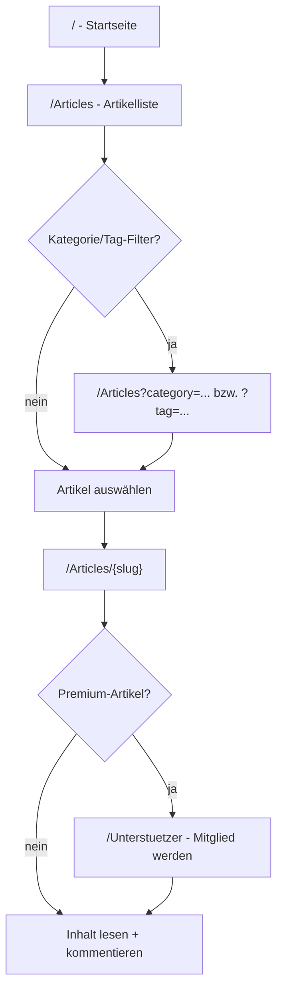

# Blog nutzen (rudimentär)

Kurze Übersicht über die Nutzung des Blogs aus **Leser- und Autorensicht**.
Für das Schreiben/Verwalten von Artikeln siehe
[`02-admin-artikelverwaltung.md`](02-admin-artikelverwaltung.md).

## Grundprinzip

- Artikel werden in **Markdown** verfasst und beim Ausliefern serverseitig
  gerendert und bereinigt (Markdig + HtmlSanitizer).
- Jeder Artikel hat ein **Titelbild**, eine **Kurzbeschreibung**, eine
  **Kategorie** (dynamisch vom Admin gepflegt; ohne Zuordnung `undefined`),
  optionale **Tags** und **Hashtags** sowie einen **Slug** für die URL.
- Nur `Published`-Artikel sind öffentlich sichtbar; geplante Beiträge werden
  automatisch zum festgelegten Zeitpunkt veröffentlicht.
- Artikel besitzen eine **Zugriffsstufe**: `Public` (alle), `Registered` (nur
  angemeldet) oder `Premium` (aktive Berechtigung/Abo; Admin ausgenommen).

## Artikel lesen

| Ziel | URL |
|---|---|
| Startseite | `/` |
| Artikelliste | `/Articles` |
| Einzelner Artikel | `/Articles/{slug}` |
| RSS-Feed (RSS 2.0) | `/feed` |

### Artikelliste (`/Articles`)

- Zeigt die veröffentlichten Artikel, **10 pro Seite**, sortiert nach
  Veröffentlichungsdatum (neueste zuerst; umschaltbar).
- **Freitextsuche:** `/Articles?query={suchbegriff}`
- Filter nach **Kategorie**: `/Suche?category={slug}` (z. B. `satire` oder `undefined`)
- Filter nach **Tag**: `/Articles?tag={tag-slug}`
- Filter nach **Hashtag**: `/Articles?hashtag={hashtag-slug}`
- Filter nach **Autor**, **Zugriffsstufe** und **Veröffentlichungsdatum**.
- **Sortierung** u. a. nach Datum und Bewertung.
- Seitenwechsel über `?pageNumber=2` usw.

### Listen filtern und als Lesezeichen speichern

Die Startseite (`/`) und die Suchseite (`/Suche`) akzeptieren Filter direkt in
der URL. Dadurch lässt sich jede Auswahl als **Lesezeichen** speichern oder als
Link teilen — ohne Login und ohne JavaScript.

| Parameter | Bedeutung | Beispiel |
|---|---|---|
| `categories` | Ein oder mehrere Kategorie-Slugs, kommagetrennt | `categories=politik,satire` |
| `hashtags` | Ein oder mehrere Hashtag-Slugs, kommagetrennt | `hashtags=deepdive,faktencheck` |
| `match` | `any` (Standard) oder `all` | `match=all` |
| `sort` | Sortierung, z. B. `MostViewed` | `sort=MostViewed` |

**Verknüpfung:**

- `match=any` (Standard): Ein Artikel passt, wenn er in **einer** der gewählten
  Kategorien liegt **oder** **einen** der gewählten Hashtags trägt.
- `match=all`: Ein Artikel muss **alle** gewählten Hashtags tragen. Kategorien
  bleiben ODER-verknüpft, weil ein Artikel genau eine Kategorie hat.

**Beispiele:**

```
/                                          → alle Akten
/?categories=politik,satire                → Politik oder Satire
/?hashtags=deepdive,faktencheck            → DeepDive oder Faktencheck
/?categories=politik&hashtags=deepdive     → Politik und DeepDive
/Suche?categories=politik,satire&hashtags=deepdive&match=any&sort=MostViewed
```

**So speicherst du eine Auswahl als Lesezeichen:**

1. Auf der Startseite Kategorie, Hashtag und Sortierung wählen.
2. Auf **„Diese Auswahl als Lesezeichen speichern“** klicken — die aktuelle
   URL wird in die Zwischenablage kopiert.
3. Im Browser ein Lesezeichen anlegen und die kopierte URL einfügen.
4. Beim nächsten Aufruf öffnet sich die Liste direkt mit denselben Filtern.

Die aktiven Filter erscheinen als Chips über der Liste; ein Klick auf **×**
entfernt den jeweiligen Filter, **„Alle Filter entfernen“** setzt die Liste
zurück.

### Kategorie-Farben und Ursprung in Listen

Jeder Beitragseintrag trägt einen **3 px dicken Rahmen** in der Farbe seiner
Kategorie. So ist auf einen Blick erkennbar, ob ein Beitrag zu Politik, Satire,
Verschwörungstheorien oder einer anderen Kategorie gehört. Die Farben pflegt der
Administrator unter `/Admin/Categories`; die Anzahl der Beiträge pro Liste stellt
er unter `/Admin/Settings` ein.

Zusätzlich zeigt ein kleines Icon im Kartenkopf den **Ursprung** des Beitrags:

| Icon | Bedeutung | Hover-Text |
|---|---|---|
| Person | Mensch | „Von einem Menschen erstellt“ |
| Roboter | KI | „Mit künstlicher Intelligenz erstellt“ |
| Person + Funke | Hybrid | „Mensch und KI (Hybrid)“ |

### Artikel-Detailseite (`/Articles/{slug}`)

- Zeigt **Titelbild**, Titel, Autor, Kategorie-Badge, Kurzbeschreibung, Inhalt
  und – falls vorhanden – Bilder und Video-Einbettungen.
- Für `Satire` und `Verschwörungstheorien` erscheint ein Hinweistext
  (Disclaimer).
- **Bewertung:** Angemeldete Nutzer können den Beitrag mit 👍/👎 bewerten
  (änderbar, max. eine Bewertung gleichzeitig); die Summe wird angezeigt.
- Bei `Registered`/`Premium` sehen nicht berechtigte Besucher nur den Teaser
  plus passenden CTA (Anmelden bzw. Mitglied werden).
- Unter dem Artikel befindet sich der **Kommentarbereich** (siehe unten).

### Linklisten (`/LinkLists/{slug}`)

- Redaktionell zusammengestellte, **geordnete** Listen von Beiträgen mit
  anklickbaren Verweisen. Eine Linkliste kann in andere Seiten eingebettet werden.

### RSS-Feed (`/feed`)

- RSS 2.0 über die letzten bis zu **50** veröffentlichten Artikel.
- Einträge enthalten Titel, Link, Kategorie, Datum und den Teaser/Excerpt.
- Als `<link>`/GUID wird `/Articles/{slug}` verwendet.

## Kommentare

Kommentieren erfordert ein **angemeldetes Konto mit bestätigter E-Mail-Adresse**.

- **Hinzufügen:** Auf der Artikeldetailseite (optional mit Bild-Upload).
- **Bearbeiten:** Eigene Kommentare innerhalb des konfigurierten Bearbeitungs-
  fensters (`EditWindowMinutes`).
- **Löschen:** Eigene Kommentare; Moderatoren/Admins können jeden Kommentar
  löschen (Soft-Delete).
- **Bewerten:** Kommentare und Antworten können mit 👍/👎 bewertet werden
  (änderbar, max. eine Bewertung gleichzeitig).
- **Melden:** Kommentare können mit Grund und optionaler Notiz gemeldet werden.
- **Auszeichnen:** Admins (und Autoren für eigene Beiträge) können Kommentare
  hervorheben.

Moderation (Rollen `Moderator`/`Admin`) erfolgt unter `/Moderation`:
offene Meldungen sowie ausstehende/geflaggte Kommentare können dort
**genehmigt**, **abgelehnt** oder Meldungen **verworfen** werden.

> Konfiguration der Kommentare (Modus, Rate-Limit, Bearbeitungsfenster) erfolgt
> über die `Comments`-Sektion in `appsettings.json`.

## Account & Anmeldung

| Aufgabe | URL |
|---|---|
| Registrieren | `/Account/Register` |
| Anmelden / Abmelden | `/Account/Login`, `/Account/Logout` |
| Passwort vergessen | `/Account/ForgotPassword` |
| Eigener Account | `/Account/Manage` |
| E-Mail bestätigen | Link aus der Dev-E-Mail unter `bin/…/App_Data/emails/` |

Neue Konten erhalten die Rolle `Reader` und müssen die E-Mail bestätigen,
bevor sie kommentieren, bewerten oder ein Abo abschließen können. Autor-Rechte
(`Author`) sowie `Moderator`/`Admin` werden — wie in
[`01-rollen-und-admin.md`](01-rollen-und-admin.md) beschrieben — per Rollenzuweisung
vergeben.

### Passwort zurücksetzen

1. Auf `/Account/Login` den Link **„Passwort vergessen?“** wählen.
2. Die E-Mail-Adresse des Kontos eingeben und **„Link anfordern“** klicken.
3. Die E-Mail mit dem Rücksetzungslink öffnen (im Dev-Modus als HTML-Datei unter
   `bin/…/App_Data/emails/`).
4. Über den Link ein neues Passwort vergeben. Der Link ist **24 Stunden gültig**
   und kann nur **einmal** verwendet werden.

Aus Sicherheitsgründen zeigt die Bestätigungsseite immer dieselbe neutrale
Meldung — unabhängig davon, ob die eingegebene Adresse registriert ist. So lassen
sich keine Konten über das Formular ausspähen. Anfragen sind pro IP-Adresse
gedrosselt (5 pro Minute).

## Mitgliedschaft & Premium

| Aufgabe | URL |
|---|---|
| Mitgliedschaft / Übersicht | `/Unterstuetzer` |
| Checkout | `POST /membership/checkout` (Button auf `/Unterstuetzer`) |
| Kundenportal | `/Account/Manage` → „Abo verwalten“ |
| Admin-Abo-Übersicht | `/Admin/Memberships` |
| Spenden | `/Unterstuetzer` (aktuell Platzhalter) |

Beiträge mit `AccessLevel = Registered` sind nur für angemeldete Benutzer lesbar.
Beiträge mit `AccessLevel = Premium` sind für Mitglieder, Admins und
freigeschaltete Benutzer sofort lesbar; für alle anderen erscheint ein Teaser.
Nach `Membership:TeaserDelayDays` wird der Volltext für alle frei. Die Funktion
wird über `Membership:Enabled` aktiviert. Bei deaktivierter Funktion ist
`Premium` nur für Admins sichtbar. Admins haben immer Zugriff.

## Newsletter

| Aufgabe | URL |
|---|---|
| Abonnieren | `/Newsletter/Subscribe` |
| Bestätigen (Double-Opt-in) | Link aus der Bestätigungs-E-Mail |
| Abmelden | `/Newsletter/Unsubscribe` |

Der Newsletter nutzt **Double-Opt-in**; nicht bestätigte Anmeldungen werden nach
`UnconfirmedRetentionDays` Tagen automatisch entfernt.

## Typischer Leser-Flow



## Weiterführend

- Rollen & Admin-Zugang: [`01-rollen-und-admin.md`](01-rollen-und-admin.md)
- Artikel schreiben/verwalten: [`02-admin-artikelverwaltung.md`](02-admin-artikelverwaltung.md)
- Details zu Features: Module 01–05 im Projekt-Root
