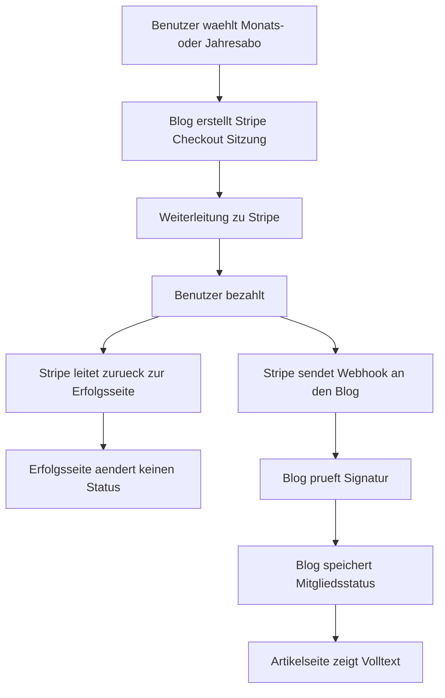

# 11 — Bezahlfunktionen einfach erklärt

Dieses Dokument richtet sich an Menschen, die **nicht** mit Stripe vertraut sind:
Betreiber, Autorinnen und Autoren, Support und alle, die verstehen möchten, wie
die Bezahlfunktionen im Blog funktionieren. Es erklärt die vorhandenen
Funktionen, den Ablauf einer Mitgliedschaft, die Einrichtung im Stripe-Dashboard
und die wichtigsten Begriffe.

Die technische Umsetzung steht in
[`09-mitgliedschaft-stripe.md`](09-mitgliedschaft-stripe.md). Die Abnahmeliste
mit allen Testfällen steht in
[`10-abnahme-mitgliedschaft.md`](10-abnahme-mitgliedschaft.md).

---

## 1. Welche Bezahlfunktionen gibt es?

| Funktion | Aktueller Stand | Was sie macht | Wo im Blog |
|---|---|---|---|
| **Monatsmitgliedschaft** | Über Feature-Flag aktivierbar | Wiederkehrende Zahlung über Stripe Checkout; öffnet Premium-Artikel sofort | `/Unterstuetzer` → „Monatlich unterstützen“ |
| **Jahresmitgliedschaft** | Über Feature-Flag aktivierbar | Wie Monatsmitgliedschaft, aber mit jährlicher Zahlung | `/Unterstuetzer` → „Jährlich unterstützen“ |
| **Kundenportal** | Teil der Mitgliedschaft | Mitglieder verwalten ihr Abo selbst: Zahlungsmittel, Rechnungen, Kündigung | `/Account/Manage` → „Abo verwalten“ |
| **Admin-Freischaltung** | Ohne Zahlung | Admins können einzelne Benutzer kostenlos freischalten, mit optionalem Ablaufdatum | `/Admin/Memberships` |
| **Admin-Abo-Übersicht** | Neu | Status, Tarif, Laufzeit, Kündigung und letzter Sync aller Abos | `/Admin/Memberships` |
| **Einmalige Spende** | Backend vorhanden, UI noch Platzhalter | Einmalige Zahlung ohne Abo; auch anonym möglich | `/Unterstuetzer` (aktuell „bald verfügbar“) |
| **Premium-Artikel / Paywall** | Teil der Mitgliedschaft | Ergebnis der Bezahlfunktion: Teaser für Nicht-Mitglieder, Volltext für Mitglieder | Artikelseite |

**Wichtig:** Es gibt nur noch **eine** Abo-Quelle: `MembershipProfile`. Die
frühere `Subscription`-Tabelle und der alte Abo-Flow wurden entfernt. Alle
Mitgliedschaften laufen über Stripe Checkout, den Webhook und den Sync.

---

## 2. Was ist Stripe?

Stripe ist ein **Zahlungsdienstleister**. Der Blog speichert keine Kreditkarten-
oder Bankdaten. Stattdessen passiert Folgendes:

1. Der Blog erstellt bei Stripe eine **Checkout-Sitzung**.
2. Der Benutzer wird auf eine von Stripe gehostete, sichere Zahlungsseite
   weitergeleitet.
3. Dort gibt er seine Zahlungsdaten ein.
4. Stripe verarbeitet die Zahlung und schickt dem Blog eine **Webhook-
   Nachricht** (eine technische Benachrichtigung).
5. Der Blog prüft die Nachricht und speichert den Mitgliedsstatus.

Vorteile:

- Karten- und Bankdaten berühren nie den Blog-Server.
- Stripe übernimmt die sichere Zahlungsabwicklung.
- Abos, Rechnungen und Kündigungen werden von Stripe verwaltet.
- Der Blog muss keine eigene Zahlungsseite bauen.

Nachteile bzw. Voraussetzungen:

- Es wird ein Stripe-Konto benötigt.
- Stripe berechnet Gebühren pro Transaktion.
- Die Einrichtung im Stripe-Dashboard ist einmalig notwendig.
- Rechtliche Texte (AGB, Widerruf, Datenschutz) müssen geklärt werden.

---

## 3. Der Ablauf einer Mitgliedschaft



### Schritt für Schritt

1. **Benutzer wählt einen Tarif.** Auf `/Unterstuetzer` gibt es die Buttons
   „Monatlich unterstützen“ und „Jährlich unterstützen“.
2. **Blog erstellt die Checkout-Sitzung.** Der Blog teilt Stripe mit, welcher
   Benutzer zahlt, welcher Preis gilt und wohin nach Erfolg oder Abbruch
   weitergeleitet werden soll.
3. **Weiterleitung zu Stripe.** Der Benutzer sieht die Stripe-Zahlungsseite.
4. **Zahlung.** Stripe verarbeitet die Zahlung.
5. **Rückleitung.** Stripe leitet den Benutzer zur Erfolgsseite zurück. Diese
   Seite ändert **absichtlich keinen** Status. Sie ist nur eine Information.
6. **Webhook.** Stripe sendet eine Nachricht an `/webhooks/stripe`. Der Blog
   prüft die Signatur und speichert den Status in `MembershipProfile`.
7. **Zugriff.** Die Artikelseite prüft serverseitig, ob der Benutzer den
   Volltext sehen darf.
8. **Aktualisierung.** Beim Login und über einen Hintergrundjob wird der Status
   regelmäßig mit Stripe abgeglichen.

---

## 4. Was passiert in besonderen Fällen?

| Situation | Verhalten |
|---|---|
| **Zahlung erfolgreich** | Profil wird aktiv; Premium-Artikel sind sofort sichtbar. |
| **Kündigung im Kundenportal** | Zugriff bleibt bis zum Ende der bezahlten Periode plus Kulanzzeit. |
| **Zahlung fehlgeschlagen** | Status wird „Zahlung offen“; Zugriff bleibt während der Kulanzzeit. |
| **Kulanzzeit abgelaufen** | Kein Premium-Zugriff mehr; Artikel zeigen wieder Teaser. |
| **Admin-Freischaltung mit Ablaufdatum** | Zugriff bis einschließlich des gewählten Tages. |
| **Admin entzieht Freischaltung** | Zugriff endet sofort; Audit-Log-Eintrag wird geschrieben. |
| **Webhook geht verloren** | Beim nächsten Login- oder Hintergrundabgleich wird der Status nachgezogen. |
| **Stripe ist nicht erreichbar** | Der letzte bekannte Status bleibt erhalten; Fehler werden geloggt. |
| **Benutzer ist nicht zuordenbar** | Es wird kein Status geändert; der Webhook wird protokolliert. |

---

## 5. Was sieht der Benutzer?

### Auf der Unterstützer-Seite

- Bei aktivierter Funktion: zwei Buttons für Monats- und Jahresmitgliedschaft.
- Bei deaktivierter Funktion: der bisherige Platzhalter „bald verfügbar“.

### Auf der Stripe-Zahlungsseite

- Stripe zeigt Preis, Zahlungsintervall und Zahlungsfelder.
- Der Blog sieht keine Kartendaten.

### Nach der Zahlung

- Der Benutzer landet auf der Erfolgsseite.
- Der Status wird erst durch den Webhook gesetzt, nicht durch die Erfolgsseite.

### Im Konto

- Unter `/Account/Manage` steht der Mitgliedschaftsstatus.
- Bei vorhandenem Stripe-Kunden gibt es den Button „Abo verwalten“.
- Dieser Button öffnet das Stripe-Kundenportal.

### Bei Premium-Artikeln

- Nicht-Mitglieder sehen Titel, Teaser und Bild.
- Ein Hinweis nennt den Zeitpunkt, ab dem der Volltext frei wird.
- Ein Button führt zur Mitgliedschaft.
- Mitglieder und Admins sehen den Volltext sofort.

---

## 6. Was muss der Betreiber einrichten?

### 6.1 Stripe-Konto

1. Stripe-Konto erstellen und Geschäftsdaten verifizieren.
2. Testmodus und Live-Modus unterscheiden lernen.
3. Gegebenenfalls Steuer- und Rechnungsdaten konfigurieren.

### 6.2 Produkt und Preise

1. Im Stripe-Dashboard ein Produkt anlegen, z. B. „Blog-Mitgliedschaft“.
2. Zwei Preise anlegen:
   - monatlich wiederkehrend,
   - jährlich wiederkehrend.
3. Die Preis-IDs kopieren. Sie beginnen mit `price_...`.

### 6.3 Webhook

1. Im Stripe-Dashboard einen Webhook-Endpunkt anlegen:
   `https://<domain>/webhooks/stripe`
2. Folgende Events auswählen:
   - `checkout.session.completed`
   - `customer.subscription.created`
   - `customer.subscription.updated`
   - `customer.subscription.deleted`
   - `invoice.paid`
   - `invoice.payment_failed`
3. Das Signing Secret kopieren. Es beginnt mit `whsec_...`.

### 6.4 Kundenportal

1. Im Stripe-Dashboard das Kundenportal aktivieren.
2. Rückkehr-URL und Branding einstellen.
3. Kündigungsoptionen prüfen.

### 6.5 Konfiguration im Blog

Die Werte werden **nicht** in `appsettings.json` mit echten Werten gespeichert.
Stattdessen User Secrets oder Umgebungsvariablen verwenden:

```bash
dotnet user-secrets set "Membership:Enabled" "true" --project src/BlogCms.Web
dotnet user-secrets set "Membership:SecretKey" "sk_test_..." --project src/BlogCms.Web
dotnet user-secrets set "Membership:WebhookSecret" "whsec_..." --project src/BlogCms.Web
dotnet user-secrets set "Membership:PriceIdMonthly" "price_..." --project src/BlogCms.Web
dotnet user-secrets set "Membership:PriceIdYearly" "price_..." --project src/BlogCms.Web
```

Weitere Werte:

| Einstellung | Bedeutung | Standard |
|---|---|---|
| `Membership:TeaserDelayDays` | Tage bis Premium-Artikel für alle frei werden | `7` |
| `Membership:GracePeriodDays` | Kulanzzeit nach Periodenende | `3` |
| `Membership:SyncOnLoginIfOlderThanHours` | Login-Sync-Schwelle | `24` |
| `Membership:SyncIntervalHours` | Intervall des Hintergrundjobs | `24` |

### 6.6 Testen

1. Testschlüssel (`sk_test_...`) verwenden.
2. Testkarte verwenden, z. B. `4242 4242 4242 4242`.
3. Webhooks lokal mit der Stripe CLI testen.
4. Erst nach erfolgreichem Test auf Live-Schlüssel wechseln.

---

## 7. Testmodus und Live-Modus

Stripe hat zwei getrennte Welten:

| Modus | Schlüssel | Zahlungen | Verwendung |
|---|---|---|---|
| **Testmodus** | `sk_test_...` | Simuliert, kein echtes Geld | Entwicklung und Abnahme |
| **Live-Modus** | `sk_live_...` | Echtes Geld | Produktion |

**Wichtig:** Test- und Live-Daten sind getrennt. Ein Test-Abo erscheint nicht im
Live-Modus und umgekehrt. Testschlüssel niemals in Produktion verwenden.

### Testkarten

- Erfolgreiche Zahlung: `4242 4242 4242 4242`
- Abgelehnte Zahlung: `4000 0000 0000 0002`
- Weitere Testkarten stellt Stripe in der Dokumentation bereit.

### Stripe CLI

Die Stripe CLI kann Webhooks lokal an den Blog weiterleiten:

```bash
stripe listen --forward-to http://localhost:5199/webhooks/stripe
```

Die CLI zeigt ein temporäres `whsec_...`-Secret an. Dieses kann für lokale Tests
verwendet werden.

---

## 8. Sicherheit und Datenschutz

- **Keine Kartendaten im Blog.** Die Zahlungsdaten werden ausschließlich bei
  Stripe eingegeben und verarbeitet.
- **Webhook-Signatur.** Der Blog akzeptiert nur Webhooks mit gültiger Signatur.
- **Keine Geheimnisse im Repository.** Stripe-Schlüssel und Webhook-Secrets
  gehören in User Secrets oder Umgebungsvariablen.
- **Serverseitige Zugriffsprüfung.** Der Volltext wird nur dann in die Antwort
  aufgenommen, wenn der Server den Zugriff erlaubt.
- **Keine Geheimnisse in Logs.** Fehlermeldungen enthalten keine Schlüssel.
- **Datenschutz.** Stripe ist als Zahlungsdienstleister in der
  Datenschutzerklärung zu nennen. Rechtliche Texte sind noch offen.

---

## 9. Begriffe einfach erklärt

| Begriff | Bedeutung |
|---|---|
| **Abo / Subscription** | Wiederkehrende Zahlung, z. B. monatlich oder jährlich. |
| **Checkout** | Von Stripe gehostete Zahlungsseite. |
| **Preis-ID / Price ID** | Eindeutige Kennung eines Preises bei Stripe, beginnt mit `price_...`. |
| **Kunde / Customer** | Stripe-Datensatz zu einer zahlenden Person, beginnt mit `cus_...`. |
| **Abo-ID / Subscription ID** | Eindeutige Kennung eines Abos, beginnt mit `sub_...`. |
| **Webhook** | Automatische Nachricht von Stripe an den Blog, wenn etwas passiert. |
| **Signatur / Webhook-Secret** | Kryptografischer Nachweis, dass ein Webhook wirklich von Stripe kommt. |
| **Kundenportal** | Von Stripe gehostete Seite, auf der Mitglieder ihr Abo verwalten. |
| **Testmodus** | Simulierter Zahlungsverkehr ohne echtes Geld. |
| **Live-Modus** | Echter Zahlungsverkehr. |
| **API-Key** | Geheimer Schlüssel für die Kommunikation mit Stripe. |
| **Kulanzzeit** | Zeitraum nach Periodenende, in dem der Zugriff trotz Kündigung oder Zahlungsfehler bestehen bleibt. |
| **Teaser** | Vorschau eines Artikels ohne Volltext. |
| **Feature-Flag** | Schalter, der eine Funktion ein- oder ausschaltet. |
| **Idempotenz** | Derselbe Webhook kann mehrfach ankommen, wird aber nur einmal verarbeitet. |
| **Stripe CLI** | Kommandozeilenwerkzeug zum Testen von Stripe, inklusive Webhooks. |
| **Testuhr** | Stripe-Funktion, mit der sich Zeitabläufe für Abos simulieren lassen. |

---

## 10. Häufige Fragen

**Warum sehe ich keine Mitgliedschafts-Buttons?**
Die Funktion ist standardmäßig aus. `Membership:Enabled` muss auf `true` gesetzt
sein.

**Warum sehe ich bei einem Premium-Artikel nur den Teaser?**
Du bist kein Mitglied, kein Admin und der Artikel ist noch nicht nach
`TeaserDelayDays` für alle freigegeben.

**Warum wurde mein Status nach der Zahlung nicht aktualisiert?**
Die Erfolgsseite setzt keinen Status. Der Webhook muss ankommen. Prüfe
Webhook-URL, Signatur-Secret und die Stripe-Event-Auswahl.

**Kann ich jemanden kostenlos freischalten?**
Ja, unter `/Admin/Memberships` mit optionalem Ablaufdatum und Notiz.

**Wie kündige ich mein Abo?**
Im Konto unter „Abo verwalten“ oder direkt im Stripe-Kundenportal.

**Wo sehe ich Zahlungen und Rechnungen?**
Im Stripe-Dashboard. Der Blog speichert keine Rechnungen.

**Was passiert mit alten Abos?**
Es gibt keinen separaten alten Abo-Flow mehr. Es gab keine Abonnenten, daher
wurde die alte Tabelle entfernt. Alle Abos liegen jetzt in `MembershipProfile`.

**Kann ich Spenden annehmen?**
Die Backend-Logik für einmalige Spenden existiert, die Oberfläche ist aber noch
ein Platzhalter.

**Was passiert, wenn Stripe ausfällt?**
Der letzte bekannte Status bleibt erhalten. Beim nächsten Sync wird
aktualisiert.

---

## 11. Wo finde ich was im Projekt?

| Thema | Datei |
|---|---|
| Konfiguration | [`MembershipOptions`](../src/BlogCms.Infrastructure/Membership/MembershipOptions.cs) |
| Zugriffsregeln | [`MembershipService`](../src/BlogCms.Infrastructure/Membership/MembershipService.cs) |
| Stripe-Anbindung | [`StripeMembershipService`](../src/BlogCms.Infrastructure/Membership/StripeMembershipService.cs) |
| Checkout/Portal-Endpunkte | [`MembershipController`](../src/BlogCms.Web/Controllers/MembershipController.cs) |
| Webhook-Endpunkt | [`MembershipWebhookController`](../src/BlogCms.Web/Controllers/MembershipWebhookController.cs) |
| Webhook-Verarbeitung | [`MembershipWebhookHandler`](../src/BlogCms.Infrastructure/Membership/MembershipWebhookHandler.cs) |
| Login-/Hintergrund-Sync | [`MembershipSyncService`](../src/BlogCms.Infrastructure/Membership/MembershipSyncService.cs) |
| Admin-Freigaben | [`Admin/Memberships`](../src/BlogCms.Web/Pages/Admin/Memberships/Index.cshtml) |
| Teaser-Ansicht | [`Articles/Details`](../src/BlogCms.Web/Pages/Articles/Details.cshtml) |
| Technische Doku | [`09-mitgliedschaft-stripe.md`](09-mitgliedschaft-stripe.md) |
| Abnahmeliste | [`10-abnahme-mitgliedschaft.md`](10-abnahme-mitgliedschaft.md) |
| Pflichtenheft | [`Pflichtenheft_Blog_Mitgliedschaft.md`](../Pflichtenheft_Blog_Mitgliedschaft.md) |
| Umsetzungsplan | [`plans/stripe-mitgliedschaft.md`](../plans/stripe-mitgliedschaft.md) |

---

## 12. Aktueller Stand und offene Punkte

**Fertig:**

- Mitgliedschafts-Checkout für Monats- und Jahresabo.
- Webhook mit Signaturprüfung und Idempotenz.
- Kundenportal.
- Admin-Freischaltungen mit Audit-Log.
- Admin-Abo-Übersicht mit Status, Tarif, Laufzeit und letztem Sync.
- Teaser- und Wartezeitlogik.
- Login-Sync und Hintergrundabgleich.
- Einzige Abo-Quelle `MembershipProfile`; alter Abo-Flow entfernt.
- 271 automatisierte Tests erfolgreich.

**Offen:**

- Vollständiger Testlauf im echten Stripe-Testmodus mit Stripe CLI und Testuhr.
- Kündigung, fehlgeschlagene Zahlung und verpasster Webhook im echten
  Stripe-Testmodus.
- Rechtliche Texte (AGB, Widerruf, Datenschutz).
- Steuerliche Behandlung.
- Oberfläche für einmalige Spenden.

---

## 13. Checkliste für den Livegang

- [ ] Stripe-Konto verifiziert.
- [ ] Produkt und zwei Preise angelegt.
- [ ] Preis-IDs in der Konfiguration hinterlegt.
- [ ] Webhook-Endpunkt angelegt und Events ausgewählt.
- [ ] Webhook-Secret hinterlegt.
- [ ] Kundenportal im Stripe-Dashboard aktiviert.
- [ ] `Membership:Enabled` auf `true` gesetzt.
- [ ] Testmodus vollständig durchgespielt.
- [ ] Rechtliche Texte veröffentlicht.
- [ ] Live-Schlüssel hinterlegt.
- [ ] Logs und Monitoring geprüft.
- [ ] Rollback-Plan dokumentiert.
