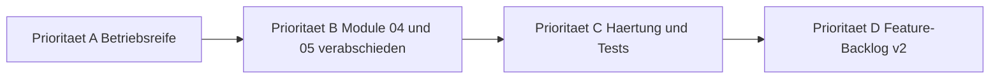

# Analyse: Weiterführung der Programmierung — MentalVersagen / BlogCms

**Stand:** Oktober 2026
**Zweck:** Bestandsaufnahme des Projektzustands und Ableitung priorisierter Handlungsfelder für die weitere Programmierung.
**Basis:** [`feature_implementation1.md`](../feature_implementation1.md), [`plans/backend-refactoring-plan.md`](backend-refactoring-plan.md), [`plans/technische-uebersicht-backend.md`](technische-uebersicht-backend.md), [`DataSchema.md`](../DataSchema.md), Code in [`src/`](../src) und [`tests/`](../tests).

---

## 1. Zusammenfassung (TL;DR)

Das Projekt ist in einem **sehr guten, produktionsnahen Zustand**. Sowohl der Feature-Block [`FeatureFix1.MD`](../FeatureFix1.MD) (Arbeitspakete P1–P15) als auch das umfangreiche [`plans/backend-refactoring-plan.md`](backend-refactoring-plan.md) (Phasen 1–4) sind vollständig umgesetzt. Der Build läuft mit **0 Fehlern / 0 Warnungen**, die Testsuite besteht aus **116/116 grünen xUnit-Tests**. Die nächste Programmier-Phase sollte daher **weniger neue Features** als vielmehr **Betriebsreife, verbleibende Fach-Lücken der Module 04/05 und Härtung** in den Blick nehmen.

---

## 2. Ist-Zustand

### 2.1 Architektur & Code

| Aspekt | Zustand | Referenz |
|---|---|---|
| Schichtenmodell | Sauber getrennt: [`BlogCms.Domain`](../src/BlogCms.Domain/BlogCms.Domain.csproj) (POCOs/Enums) → [`BlogCms.Infrastructure`](../src/BlogCms.Infrastructure/BlogCms.Infrastructure.csproj) (EF Core + Application Services) → [`BlogCms.Web`](../src/BlogCms.Web/BlogCms.Web.csproj) (Razor Pages + API-Controller) | [`plans/technische-uebersicht-backend.md`](technische-uebersicht-backend.md) |
| Build | `dotnet build src/BlogCms.slnx` — **0 Warnungen, 0 Fehler** (verifiziert) | — |
| Tests | `dotnet test` — **116/116 bestanden** (12 Testdateien: Content (18), ArticlePosting (13), FeatureFix1 (11), Comment (10), Captcha (10), Email (8), Payment (7), Newsletter (5), EnvFileLoader (5), MediaUploadLimit (4), ActivityLog (4)) | [`tests/BlogCms.Tests`](../tests/BlogCms.Tests) |
| Tech Debt Marker | **Keine** `TODO`/`FIXME`/`HACK`/`NotImplementedException` im [`src/`](../src) | Suche verifiziert |
| Datenmodell | Mit [`DataSchema.md`](../DataSchema.md) konsistent (`Category`-Tabelle wurde per Migration `20261017073838_RemoveCategoryTable` wieder entfernt) | — |

### 2.2 Abgeschlossene Blöcke

1. **FeatureFix1 (P1–P15):** Rollen (`Author`), Titelbild, Pflicht-Excerpt, Hashtags, geplante Veröffentlichung ( [`ArticleSchedulerService`](../src/BlogCms.Infrastructure/Content/ArticleSchedulerService.cs) ), Zugriffsstufen, Bewertungen, Linklisten, Suche/Filter, RSS — siehe [`feature_implementation1.md`](../feature_implementation1.md).
2. **Backend-Refactoring (Phasen 1–4):** Zweistufige Validierung Entwurf/Veröffentlichung, Cover-Konsolidierung, Zeitzonen-Sicherheit, Preview-Modus (`GetBySlugForPreviewAsync`), serverseitige Admin-Filter, [`/Admin/Users`](../src/BlogCms.Web/Pages/Admin/Users/Index.cshtml), Media-Orphan-Cleanup (`CleanupOrphanedAsync`), Moderations-Cockpit ohne N+1, Rating-Toggle, Netto-Score-Sortierung, Berechtigungsprüfung im [`CommentService`](../src/BlogCms.Infrastructure/Comments/CommentService.cs) — siehe [`plans/backend-refactoring-plan.md`](backend-refactoring-plan.md).
3. **Nebenblöcke:** Markdown-Editor, Bildergalerie, Design-System, Mobile Navigation, Captcha-Fix bei Registrierung, Mailversand-Konzept ( [`docs/04-mailversand.md`](../docs/04-mailversand.md) ) — alle unter [`plans/done/`](done).

### 2.3 Verbleibende Fach-Lücken (aus Pflichtenheft)

| Modell | Offener Punkt | Quelle |
|---|---|---|
| [`04-Monetarisierung.md`](../04-Monetarisierung.md) | **PayPal-Button** für Einzelspenden ist spezifiziert, aber nicht implementiert (nur Stripe) | §2 Spenden |
| [`04-Monetarisierung.md`](../04-Monetarisierung.md) | Akzeptanzkriterien (Webhook-Signaturprüfung, Kündigungs-Flow, Paywall) sind formal noch **unchecked** — fachlich im Code vorhanden, aber nicht abgenommen | §4 |
| [`05-Benutzerverwaltung-Auth.md`](../05-Benutzerverwaltung-Auth.md) | Externe Login-Provider (Google/GitHub) bewusst v1-out-of-scope, Identity-Struktur lässt es offen | §1 |
| [`00-Uebersicht.md`](../00-Uebersicht.md) | **Produktions-Hosting für Postgres** ist noch nicht entschieden | §3 |
| [`00-Uebersicht.md`](../00-Uebersicht.md) | Eigenes Video-Hosting, Mehrsprachigkeit, Native Apps = **bewusst Out of Scope v1** | §5 |

---

## 3. Priorisierte Handlungsfelder für die Weiterführung

### Priorität A — Betriebsreife (Voraussetzung für Launch)

1. **Deployment-Pipeline & Hosting-Entscheidung**
   - Postgres-Hosting festlegen (verwalteter Dienst vs. eigener Container), in [`00-Uebersicht.md`](../00-Uebersicht.md) nachtragen.
   - [`Dockerfile`](../Dockerfile) / [`docker-compose.yml`](../docker-compose.yml) für Produktion schärfen (kein `Development`-Fallback, [`appsettings.json`](../src/BlogCms.Web/appsettings.json) vs. [`appsettings.Development.json`](../src/BlogCms.Web/appsettings.Development.json) strikt trennen).
   - Reverse-Proxy/TLS (z. B. Caddy/Nginx), Health-Checks, automatische EF-Migration beim Start (oder gesonderter Migrationsschritt).
2. **Secrets & Konfiguration**
   - Alle Secrets (SMTP, Stripe, DB, [`CaptchaService`](../src/BlogCms.Infrastructure/Captcha/CaptchaService.cs)) nur noch über Umgebungsvariablen/`.env` ( [` .env.example` ](../.env.example) ist bereits angelegt).
   - Echten SMTP-Versand statt [`LoggingEmailSender`](../src/BlogCms.Infrastructure/Email/LoggingEmailSender.cs) verdrahten; [`docs/04-mailversand.md`](../docs/04-mailversand.md) als Betriebsdoku fortschreiben.
3. **Backup & Recovery**
   - Regelmäßige DB-Dumps (pg_dump) + Medien-Storage-Backup, dokumentiertes Restore-Verfahren.
4. **Monitoring & Logging**
   - Strukturiertes Logging (Serilog o. Ä.), Fehler-Tracking (z. B. Sentry), Health-Endpoint, einfache Metriken (Aufrufe, Registrierungen, Abo-Status).

### Priorität B — Fachliche Vervollständigung (Module 04/05)

1. **PayPal-Spenden-Button** ( [`04-Monetarisierung.md`](../04-Monetarisierung.md) §2) — analog zu [`IStripeService`](../src/BlogCms.Infrastructure/Payments/IStripeService.cs) als [`IPayPalService`](../src/BlogCms.Infrastructure/Payments) mit Dev-Fake kapseln.
2. **Stripe in den Live-Modus überführen** — [`StripeService`](../src/BlogCms.Infrastructure/Payments/StripeService.cs) ist implementiert; es fehlt die Konfiguration echter Keys, Webhook-Endpunkt-URL in Stripe, Signaturprüfung im Produktivbetrieb verifizieren, [`FakeStripeService`](../src/BlogCms.Infrastructure/Payments/FakeStripeService.cs) per Flag sauber abschaltbar machen.
3. **Akzeptanzkriterien [`04-Monetarisierung.md`](../04-Monetarisierung.md) §4 formal abnehmen** und die Checkboxen abhaken (Webhook-Signatur, Kündigungs-Flow, Paywall-Teaser).
4. **Optional (v2):** Externe OAuth-Provider (Google/GitHub) für Login.

### Priorität C — Härtung & Qualität

1. **Integrationstests / UI-Tests** — bisher überwiegend Service-Unit-Tests; Razor-Pages-Flows (Register → Confirm → Login → Comment) als End-to-End absichern (z. B. Playwright oder `WebApplicationFactory`).
2. **Last-/Sicherheitstests** — Rate-Limits ( [`RegistrationThrottle`](../src/BlogCms.Web/Security/RegistrationThrottle.cs), Kommentar-Limits) unter Last verifizieren; Pen-Test-artige Prüfung der Autorisierung (Besitz-Checks, Paywall-Bypass-Versuche).
3. **Observability der Hintergrunddienste** — [`ArticleSchedulerService`](../src/BlogCms.Infrastructure/Content/ArticleSchedulerService.cs), [`NewsletterCleanupService`](../src/BlogCms.Infrastructure/Newsletter/NewsletterCleanupService.cs): Fehler-Alarmierung, Ausführungs-Metriken.
4. **Datenmigrations-Strategie** — Prozess für zukünftige Schema-Änderungen (bisher vier Migrationen, alle lokal angewendet).

### Priorität D — Feature-Backlog (v2, nach Launch)

| Idee | Begründung / Quelle |
|---|---|
| Mehrsprachigkeit | bewusst out-of-scope v1 ( [`00-Uebersicht.md`](../00-Uebersicht.md) §5) |
| Eigenes Video-Hosting | nur externe Embeds in v1 ( [`03-Medien-Upload-und-Embedding.md`](../03-Medien-Upload-und-Embedding.md) ) |
| Erweiterte Artikel-Analytics | [`ActivityLogEntry`](../src/BlogCms.Domain/Entities/ActivityLogEntry.cs) sammelt bereits Views — Dashboard für Autoren/Admins denkbar |
| Benachrichtigungen (E-Mail bei Antworten/Kommentaren) | aktuell nur Newsletter/Transaktionsmails |
| Volltextsuche (Postgres `tsvector` o. Ä.) | aktuell einfache Freitextsuche in [`ArticleService.SearchPublishedAsync`](../src/BlogCms.Infrastructure/Content/ArticleService.cs) |

---

## 4. Empfohlene Reihenfolge der Weiterführung

**Konkreter nächster Schritt:** Entscheidung zum Postgres-Hosting + Deployment-Grundgerüst (A1) — danach PayPal-Integration (B1) und Stripe-Live-Konfiguration (B2) als eigenständige, gut testbare Arbeitspakete.

---

## 5. Fazit

Die Codebasis ist **wartbar, getestet und dokumentiert**; die dokumentierte Arbeitsweise (Single Point of Truth [`DataSchema.md`](../DataSchema.md), Plan-Dokumente unter [`plans/`](.), Abnahme-Tests in [`feature_implementation1.md`](../feature_implementation1.md)) ist vorbildlich und senkt das Risiko der Weiterführung deutlich. Es gibt **keinen aufgeschobenen Refactoring-Bedarf** aus den bisherigen Blöcken. Der sinnvolle nächste Programmier-Meilenstein liegt nicht im Feature-Ausbau, sondern in der **Überführung in den Betrieb** (Hosting, Secrets, Monitoring, Backups) und der **Schließung der letzten fachlichen Lücken** (PayPal, Stripe-Live, formale Abnahme der Monetarisierungs-Kriterien).
