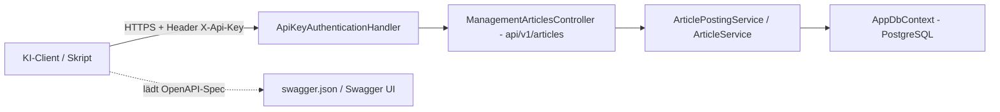

# Plan & Umsetzungsstand: Management-API für die Blog-Pflege

**Stand:** 2026-10-17 (überarbeitet während der Umsetzung)
**Status:** Umsetzung läuft — bewusst aufgeteilt in kleine, einzeln verifizierbare Teilschritte (Abschnitt 7)
**Ziel:** Artikel (Beiträge) des Blogs vollständig über eine HTTP-API pflegen — **anlegen**, **bearbeiten**, **löschen** — abgesichert über einen **statischen API-Key**, dokumentiert über **Swagger/OpenAPI** und so gestaltet, dass sie **von einer KI ferngesteuert** werden kann.

**Getroffene Entscheidungen des Auftraggebers:**
1. KI-Fernsteuerung über **OpenAPI/Swagger-Dokumentation** (ChatGPT Actions, Claude-Connectoren konsumieren die Spec direkt) — **kein** separater MCP-Server.
2. Authentifizierung über **einen einzelnen statischen Key** aus `.env`/Konfiguration mit konstantzeitlichem Vergleich — kein DB-basiertes Key-Management.

---

## 1. Architektur

Die API ist ein **zusätzlicher Zugangspfad** auf dieselbe Anwendungsschicht — die bestehenden Services ([`ArticlePostingService`](../src/BlogCms.Infrastructure/Content/ArticlePostingService.cs:31), [`ArticleService`](../src/BlogCms.Infrastructure/Content/ArticleService.cs:144)) und die Razor-Pages-Oberfläche bleiben unverändert.



Wiederverwendung statt Neubau: [`ArticlePostingService.CreateAsync()`](../src/BlogCms.Infrastructure/Content/ArticlePostingService.cs:56), [`ArticlePostingService.UpdateAsync()`](../src/BlogCms.Infrastructure/Content/ArticlePostingService.cs:115), [`ArticleService.SoftDeleteAsync()`](../src/BlogCms.Infrastructure/Content/ArticleService.cs:535), [`ArticleService.GetByIdAsync()`](../src/BlogCms.Infrastructure/Content/ArticleService.cs:311), [`ArticleService.GetForManagementAsync()`](../src/BlogCms.Infrastructure/Content/ArticleService.cs:329) und die fachlichen Regeln aus [`ArticleValidator.Validate()`](../src/BlogCms.Infrastructure/Content/ArticleValidator.cs:11) (BR-022 Titelbild-Pflicht, BR-032 Zukunftsdatum).

---

## 2. API-Design (`/api/v1`, verbindlich)

| Methode | Route | operationId | Erfolg | Fehler |
|---|---|---|---|---|
| `GET` | `/api/v1/articles` | `listArticles` | 200 + `PagedResponse<ArticleReadModel>` (Filter `status`, `query`, `page`, `pageSize`) | 401, 429 |
| `GET` | `/api/v1/articles/{id}` | `getArticle` | 200 + `ArticleReadModel` | 401, 404 |
| `POST` | `/api/v1/articles` | `createArticle` | 201 + `Location` + `ArticleReadModel` | 400, 401, 503 |
| `PUT` | `/api/v1/articles/{id}` | `updateArticle` | 200 + `ArticleReadModel` (Voll-Update, Statuswechsel) | 400, 401, 404 |
| `DELETE` | `/api/v1/articles/{id}` | `deleteArticle` | 204 (Soft-Delete) | 401, 404 |

**DTOs** (in [`src/BlogCms.Web/Models/Api/`](../src/BlogCms.Web/Models/Api)):
- [`ArticleWriteModel`](../src/BlogCms.Web/Models/Api/ArticleApiModels.cs:28): `title`, `slug?`, `excerpt?`, `contentMarkdown`, `category`, `accessLevel`, `status`, `scheduledAt?`, `titleImageUrl?`, `videoUrl?`, `tags[]`, `hashtags[]`, `uploadedImageIds[]` — bildet 1:1 auf [`ArticlePostRequest`](../src/BlogCms.Infrastructure/Content/ArticlePostRequest.cs:24) ab.
- [`ArticleReadModel`](../src/BlogCms.Web/Models/Api/ArticleApiModels.cs:103): inkl. `id`, `slug`, `contentMarkdown`, `tags[]`, `hashtags[]`, `mediaIds[]`, `authorId`, Zeitstempel.
- [`PagedResponse<T>`](../src/BlogCms.Web/Models/Api/ArticleApiModels.cs:177): `items[]`, `total`, `page`, `pageSize`.

**Fehlermuster** (einheitlich, KI-freundlich): RFC-7807-ProblemDetails (`application/problem+json`, camelCase) über [`ApiProblems`](../src/BlogCms.Web/Models/Api/ApiProblems.cs:44):
```json
{
  "type": "https://mentalversagen.de/problems/validation-error",
  "title": "Die Eingaben sind ungültig.",
  "status": 400,
  "errors": [ { "field": "Title", "message": "Titel ist erforderlich." } ]
}
```
`errors[]` entspricht exakt der [`PostError`](../src/BlogCms.Infrastructure/Content/ArticlePostRequest.cs:95)-Struktur des Schreib-Workflows. Typ-URLs in [`ProblemTypes`](../src/BlogCms.Web/Models/Api/ApiProblems.cs:8): `validation-error`, `unauthorized`, `not-found`, `rate-limit`, `not-configured`, `internal-error`.

**Semantik:** Soft-Delete analog Admin-Oberfläche; Statuswechsel über `PUT`/`status`; Autorenzuordnung über `Api:AuthorId` (503 bei fehlendem Wert); Validierung ausschließlich über [`ArticleValidator`](../src/BlogCms.Infrastructure/Content/ArticleValidator.cs:9) (keine parallele Regelimplementierung).

---

## 3. Authentifizierung (verbindlich)

- [`ApiKeyAuthenticationHandler`](../src/BlogCms.Web/Security/ApiKeyAuthenticationHandler.cs:28) mit Scheme `"ApiKey"`, Header **`X-Api-Key`** (Konstanten in [`ApiKeyDefaults`](../src/BlogCms.Web/Security/ApiKeyAuthenticationHandler.cs:9)).
- **Konstantzeitlicher Vergleich**: SHA-256 beider Seiten + [`CryptographicOperations.FixedTimeEquals`](../src/BlogCms.Web/Security/ApiKeyAuthenticationHandler.cs:117) — kein Timing-Leak über Länge/Zeichenpositionen. Key wird nie geloggt.
- **Fail-Closed:** Ohne konfigurierten `Api:Key` schlägt jeder Zugriff mit 401 fehl; beim Start wird eine Warnung geloggt.
- Challenge antwortet als ProblemDetails (401, `application/problem+json`).
- Kein `[ValidateAntiForgeryToken]` (API-Key ist keine Cookie-Auth → kein CSRF-Vektor).
- **Rate-Limiting**: Fixed-Window pro Client-IP über die Policy `api` ([`ApiOptions.RateLimitPolicy`](../src/BlogCms.Web/Configuration/ApiOptions.cs:17)), Standard 60/min (`Api:RateLimitPerMinute`), 429-Antwort als ProblemDetails.

---

## 4. Swagger/OpenAPI

**Paket:** [`Swashbuckle.AspNetCore`](../src/BlogCms.Web/BlogCms.Web.csproj) in Version **10.3.0** (installiert), mit **Microsoft.OpenApi 2.x** als Abhängigkeit.

**Wichtige Erkenntnisse aus der Umsetzung (Microsoft.OpenApi 2.x Breaking Changes):**
- Es gibt **keine** Namespaces `Microsoft.OpenApi.Models`/`Microsoft.OpenApi.Any` mehr — alle Typen liegen direkt in `Microsoft.OpenApi`.
- `AddSecurityRequirement` erwartet jetzt `Func<OpenApiDocument, OpenApiSecurityRequirement>` mit [`OpenApiSecuritySchemeReference`](../src/BlogCms.Web/Configuration/SwaggerSetup.cs:81) (Name + Dokument) statt `OpenApiReference`.
- `OpenApiSchema.Type` ist `JsonSchemaType?` (Enum), nicht mehr `string`; `OpenApiString`/`IOpenApiAny` entfallen.
- Die Properties [`SwaggerGenOptions`](../src/BlogCms.Web/Configuration/SwaggerSetup.cs) (`SwaggerDocs`, `SecurityDefinitions`, `CustomOperationIds`) sind **nicht mehr öffentlich auslesbar** — Tests prüfen stattdessen die **generierte Spec** über `ISwaggerProvider.GetSwagger()`.

**Inhalt** (in [`SwaggerSetup`](../src/BlogCms.Web/Configuration/SwaggerSetup.cs:22)):
- Dokument `v1` mit Titel und **KI-Kurzleitfaden** als Beschreibung (Ablauf `listArticles → getArticle → updateArticle`, Pflichtfelder BR-022/BR-032, Fehlerformat).
- SecurityDefinition „ApiKey" (`type: apiKey`, `in: header`, `name: X-Api-Key`) + SecurityRequirement auf allen Operationen.
- **`operationId`s** in camelCase über `CustomOperationIds` (Action-Name → camelCase).
- **XML-Kommentare** aller Controller/DTOs via `GenerateDocumentationFile` in [`BlogCms.Web.csproj`](../src/BlogCms.Web/BlogCms.Web.csproj:21) (`NoWarn: 1591`).
- **Enums als Strings** über `JsonStringEnumConverter` in den MVC-JsonOptions ([`Program.cs`](../src/BlogCms.Web/Program.cs:33)) — kein manuelles Schema-Mapping nötig.

**Erreichbarkeit:** `/swagger/v1/swagger.json` **immer** (das KI-Interface); Swagger UI unter `/swagger` in Development oder über `Api:SwaggerUiEnabled`.

---

## 5. Umsetzungsstand

### Erledigt
- [x] [`ApiOptions`](../src/BlogCms.Web/Configuration/ApiOptions.cs) — `Key`, `AuthorId`, `SwaggerUiEnabled`, `RateLimitPerMinute`, `IsConfigured`
- [x] [`ApiKeyAuthenticationHandler`](../src/BlogCms.Web/Security/ApiKeyAuthenticationHandler.cs) — Fixed-Time-Vergleich, Fail-Closed, Challenge-ProblemDetails
- [x] [`ApiProblems`](../src/BlogCms.Web/Models/Api/ApiProblems.cs) + [`ProblemTypes`](../src/BlogCms.Web/Models/Api/ApiProblems.cs:8) + [`ApiFieldError`](../src/BlogCms.Web/Models/Api/ApiProblems.cs:33) inkl. [`WriteAsync()`](../src/BlogCms.Web/Models/Api/ApiProblems.cs:52) für RFC-7807-Antworten außerhalb der MVC-Pipeline
- [x] [`ArticleApiModels`](../src/BlogCms.Web/Models/Api/ArticleApiModels.cs) — [`ArticleWriteModel`](../src/BlogCms.Web/Models/Api/ArticleApiModels.cs:28), [`ArticleReadModel`](../src/BlogCms.Web/Models/Api/ArticleApiModels.cs:103), [`PagedResponse<T>`](../src/BlogCms.Web/Models/Api/ArticleApiModels.cs:177)
- [x] [`ManagementArticlesController`](../src/BlogCms.Web/Controllers/ManagementArticlesController.cs:35) — fünf Endpunkte, `[Authorize(AuthenticationSchemes = "ApiKey")]`, Rate-Limit-Policy, XML-Doku
- [x] [`SwaggerSetup`](../src/BlogCms.Web/Configuration/SwaggerSetup.cs) — Doc, SecurityDefinition/-Requirement, CustomOperationIds, XML-Kommentare
- [x] [`Program.cs`](../src/BlogCms.Web/Program.cs) — ApiOptions-Binding, API-Key-Scheme, `AddProblemDetails()`, `InvalidModelStateResponseFactory` (einheitliches Fehlerformat), Rate-Limiter, Swagger-Pipeline, Start-Warnungen, `public partial class Program`
- [x] [`BlogCms.Web.csproj`](../src/BlogCms.Web/BlogCms.Web.csproj) — `Swashbuckle.AspNetCore 10.3.0`, `GenerateDocumentationFile`
- [x] [`appsettings.json`](../src/BlogCms.Web/appsettings.json) + [`.env.example`](../.env.example) — Sektion `Api` bzw. `Api__*`-Variablen
- [x] Tests: [`ApiKeyAuthenticationHandlerTests`](../tests/BlogCms.Tests/ApiKeyAuthenticationHandlerTests.cs), [`ManagementArticlesControllerTests`](../tests/BlogCms.Tests/ManagementArticlesControllerTests.cs), [`ApiOptionsTests`](../tests/BlogCms.Tests/ApiOptionsTests.cs), [`ApiDocumentationTests`](../tests/BlogCms.Tests/ApiDocumentationTests.cs)

### Abgeschlossen (Teilschritte 1–4, siehe Abschnitt 7)
- [x] Doku-Tests repariert: `IWebHostEnvironment`-Stub für die Spec-Generierung + präzisierte Security-Assertion — **153/153 Tests grün**
- [x] Nutzer-Dokumentation: [`docs/05-management-api.md`](../docs/05-management-api.md), [`RUNNING.md`](../RUNNING.md), [`docs/README.md`](../docs/README.md)
- [x] Abschluss-Verifikation: Gesamt-Build ohne Fehler, 153/153 Tests grün, Swagger-Smoke-Check über die laufende App bestanden (Spec 200 mit `X-Api-Key` + fünf `operationId`s + `security`; API ohne Key 401; Startseite und öffentliche `api/articles` unverändert 200)

---

## 6. Technische Hinweise für die Umsetzung

1. **RFC-7807 außerhalb MVC:** `Response.WriteAsJsonAsync` serialisiert ohne Optionen in PascalCase — [`ApiProblems.WriteAsync()`](../src/BlogCms.Web/Models/Api/ApiProblems.cs:52) erzwingt Web-Defaults (camelCase) und `application/problem+json` (betrifft Auth-Challenge, Rate-Limit-Rejection, Exception-Handler).
2. **Enum-Strings** entstehen über [`JsonStringEnumConverter`](../src/BlogCms.Web/Program.cs:33) in `AddJsonOptions` — konsistent zur Persistenz ([`AppDbContext.OnModelCreating`](../src/BlogCms.Infrastructure/Data/AppDbContext.cs:48)).
3. **Spec-Tests ohne HTTP-Host:** `ServiceCollection` + `AddControllers().AddApplicationPart(...)` + `AddSwaggerGen(SwaggerSetup.ConfigureGen)` → `ISwaggerProvider.GetSwagger("v1")`; **erfordert einen `IWebHostEnvironment`-Stub** (Swashbuckle 10 aktiviert `ConfigureSwaggerGeneratorOptions` damit).
4. **`public partial class Program { }`** am Ende von [`Program.cs`](../src/BlogCms.Web/Program.cs:391) — Voraussetzung für optionale `WebApplicationFactory<Program>`-Integrationstests.
5. **Build:** Es existiert [`src/BlogCms.slnx`](../src/BlogCms.slnx) (neues Solution-Format) — alternär direkt die Projekte bauen: `dotnet build src/BlogCms.Web/BlogCms.Web.csproj` bzw. `dotnet test tests/BlogCms.Tests/BlogCms.Tests.csproj`.
6. **Controller-Tests** nutzen [`TestDb.Create()`](../tests/BlogCms.Tests/TestDb.cs:8) (EF InMemory) mit realen Services plus Test-Doubles für [`IImageProcessor`](../src/BlogCms.Infrastructure/Media/ImageProcessor.cs)/[`IStorageService`](../src/BlogCms.Infrastructure/Media/IStorageService.cs:6)/[`IOEmbedService`](../src/BlogCms.Infrastructure/Media/OEmbedService.cs) — User-Entity **in derselben** DB anlegen wie den Controller (FK `AuthorId`).
7. **`AddSwaggerGen` nicht vergessen:** `UseSwagger()` allein reicht nicht — ohne [`builder.Services.AddSwaggerGen(SwaggerSetup.ConfigureGen)`](../src/BlogCms.Web/Program.cs) bleibt `ISwaggerProvider` unregistriert und `/swagger/v1/swagger.json` antwortet mit 500 (beim Smoke-Check entdeckt und behoben).

---

## 7. Verbleibende Teilschritte (klein, einzeln verifiziert)

1. **Doku-Tests reparieren:** `IWebHostEnvironment`-Stub in [`ApiDocumentationTests`](../tests/BlogCms.Tests/ApiDocumentationTests.cs) ergänzen, `dotnet test` ausführen — Ziel: **alle Tests grün**.
2. **Nutzer-Dokumentation:** `docs/05-management-api.md` erstellen — Einrichtung, Key-Erzeugung (`openssl rand -hex 32`), `curl`-Beispiele für alle fünf Endpunkte, Anbindung an KI-Tools (Spec-URL + `X-Api-Key`).
3. **Rest-Doku:** [`RUNNING.md`](../RUNNING.md) um `Api__*`-Variablen ergänzen, [`docs/README.md`](../docs/README.md) verlinken.
4. **Abschluss-Verifikation:** Gesamt-Build (0 Fehler), komplette Testsuite grün, manueller Smoke-Check `/swagger/v1/swagger.json` enthält `X-Api-Key` und die fünf `operationId`s.
5. **Optional (später):** `WebApplicationFactory`-Integrationstest für die echte HTTP-Pipeline (401-Ohne-Key, 200-Mit-Key).

---

## 8. Bewusste Entscheidungen

| Thema | Entscheidung |
|---|---|
| Key-Modell | Ein statischer Key aus Konfiguration (Auftraggeberentscheidung); DB-basierte Keys mit Scopes/Rotation sind Ausbaustufe |
| KI-Anbindung | Nur OpenAPI (kein MCP-Server) |
| Löschsemantik | Soft-Delete ([`ArticleService.SoftDeleteAsync()`](../src/BlogCms.Infrastructure/Content/ArticleService.cs:535)) — konsistent zur Admin-Oberfläche, Wiederherstellung möglich |
| Autorenzuordnung | Konfigurierter Benutzer `Api:AuthorId`; 503 beim Anlegen, falls nicht gesetzt |
| Update-Semantik | `PUT` (Voll-Update, entspricht [`UpdateAsync`](../src/BlogCms.Infrastructure/Content/ArticlePostingService.cs:115)); `PATCH` ist Ausbaustufe |
| Route | `api/v1/articles` — keine Kollision mit dem öffentlichen [`api/articles`](../src/BlogCms.Web/Controllers/ArticlesController.cs:12) |
| Swagger UI | In Produktion aus (`Api:SwaggerUiEnabled`), `swagger.json` bleibt erreichbar |

**Ausbaustufen (bewusst später):** MCP-Server, DB-basierte API-Keys, `POST /api/v1/media` (multipart), `PATCH`-Teilupdates, weitere Ressourcen (Kommentare, Linklisten), serverseitige Pagination.

---

## 9. Abnahmekriterien

- [x] Artikel lassen sich per `curl`/KI-Tool mit Header `X-Api-Key` anlegen, bearbeiten und (soft) löschen — verifiziert über [`ManagementArticlesControllerTests`](../tests/BlogCms.Tests/ManagementArticlesControllerTests.cs) (identischer Codepfad bis zur Datenbank).
- [x] Ohne bzw. mit falschem Key antwortet jeder `/api/v1`-Endpunkt mit 401 (Fail-Closed) — im Smoke-Check gegen die laufende App bestätigt.
- [x] `/swagger/v1/swagger.json` liefert eine gültige OpenAPI-Spec inkl. ApiKey-SecurityScheme und der fünf `operationId`s — im Smoke-Check bestätigt (200, `X-Api-Key`, `listArticles`/`getArticle`/`createArticle`/`updateArticle`/`deleteArticle`, `security`).
- [x] Validierungsfehler (BR-022 Titelbild, BR-032 Zukunftsdatum) kommen als ProblemDetails mit `errors[]` zurück — über [`ManagementArticlesControllerTests`](../tests/BlogCms.Tests/ManagementArticlesControllerTests.cs) verifiziert.
- [x] Die bestehende Oberfläche (Admin, Startseite, [`api/articles`](../src/BlogCms.Web/Controllers/ArticlesController.cs:12)) funktioniert unverändert weiter — Startseite und öffentliche API antworten mit 200.
- [x] `dotnet test` ist vollständig grün (153/153).
