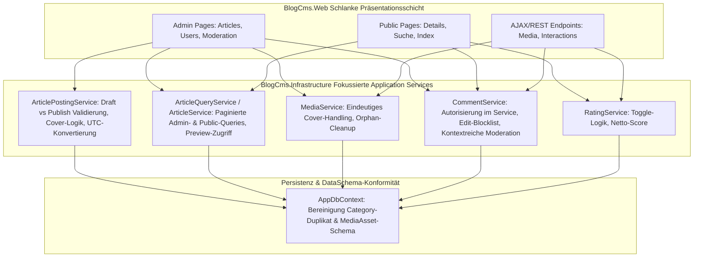

# Backend-Refactoring-Plan: Beitrags-Workflow, Verwaltung & Kommentarsystem

> **Status:** **ABGESCHLOSSEN (Phasen 1–4 umgesetzt, 113/113 Tests grün).**

**Stand:** Oktober 2026
**Bezug:** [`plans/technische-uebersicht-backend.md`](technische-uebersicht-backend.md), [`DataSchema.md`](../DataSchema.md), [`01-Content-Verwaltung.md`](../01-Content-Verwaltung.md), [`02-Kommentarfunktion.md`](../02-Kommentarfunktion.md), [`03-Medien-Upload-und-Embedding.md`](../03-Medien-Upload-und-Embedding.md)

---

## 1. Schonungslose Analyse der Unzulänglichkeiten (Ist-Zustand)

Bei der Durchsicht des Backends und der angrenzenden PageModels erklären sich unmittelbar, warum sich **das Posten von Beiträgen**, **die Verwaltung** und **die Kommentarfunktion** aktuell unrund, fehleranfällig und unprofessionell anfühlen.

### Bereich A: Posten & Bearbeiten von Beiträgen (`Content` & `Media`)

1. **Entwürfe (`Draft`) lassen sich nicht schnell zwischenspeichern (Blockade durch Pflichtfelder):**
   - [`ArticleInputModel`](../src/BlogCms.Web/Models/ArticleInputModel.cs:25) erzwingt `[Required]` für `Excerpt` und `ContentMarkdown` auf ModelState-Ebene, und [`ArticleValidator.Validate`](../src/BlogCms.Infrastructure/Content/ArticleValidator.cs:15) verlangt **immer** sofort ein Titelbild — selbst wenn der Autor nur auf **„Als Entwurf speichern"** klickt.
   - Laut [`01-Content-Verwaltung.md`](../01-Content-Verwaltung.md:81) gilt jedoch: *„Artikel ohne Category / Titelbild / Kurzbeschreibung können nicht **veröffentlicht** werden."* Ein Entwurf muss jederzeit auch unvollständig speicherbar sein!
2. **Kein Vorab-Check von `ModelState.IsValid` in `CreateModel` / `EditModel`:**
   - Weder [`CreateModel.PostAsync`](../src/BlogCms.Web/Pages/Admin/Articles/Create.cshtml.cs:55) noch [`EditModel.OnPostAsync`](../src/BlogCms.Web/Pages/Admin/Articles/Edit.cshtml.cs:93) prüfen `if (!ModelState.IsValid) return Page();`.
   - Wenn `Title` oder `Excerpt` leer sind (und clientseitige Validierung umgangen wird oder fehlschlägt), läuft der Request trotzdem in [`ArticlePostingService.CreateAsync`](../src/BlogCms.Infrastructure/Content/ArticlePostingService.cs:56) hinein und speichert im schlimmsten Fall leere Pflichtfelder in die Datenbank.
3. **Verlust hochgeladener Dateien & Ressourcen-Leaks (`Stream`-Disposal):**
   - [`ArticleInputModel.ToRequest()`](../src/BlogCms.Web/Models/ArticleInputModel.cs:98) öffnet Dateistreams via `OpenReadStream()`, die nirgendwo per `using` / `await using` geschlossen werden.
   - Schlägt die Validierung beim Posten fehl (z. B. `ScheduledAt` liegt in der Vergangenheit), geht der gerade ausgewählte Datei-Upload (`ImageUpload`) beim Neurendern des Formulars verloren, weil Browser `<input type="file">` aus Sicherheitsgründen leeren.
4. **Drei konkurrierende, widersprüchliche Mechanismen für das Titelbild:**
   - Es gibt (a) `Article.TitleImageUrl`, (b) `MediaAsset.IsCover` (nicht in [`DataSchema.md`](../DataSchema.md:113)!) und (c) den Fallback auf das älteste `MediaAsset` (`OrderBy(m => m.CreatedAt).FirstOrDefault()`).
   - Lädt man über das Feld „Titelbild hochladen" (`CoverUpload`) ein Bild hoch, setzt [`ArticlePostingService.ApplyMediaAsync`](../src/BlogCms.Infrastructure/Content/ArticlePostingService.cs:192) **weder** `IsCover = true` **noch** `TitleImageUrl`! Hat man im Editor zuvor bereits ein Inline-Bild für den Text hochgeladen, ist dieses Inline-Bild älter (`CreatedAt`) bzw. bekommt in [`AttachToArticleAsync`](../src/BlogCms.Infrastructure/Media/MediaService.cs:163) `IsCover = true` — und verdrängt das eigentliche Titelbild!
   - Zudem prüft [`DetailsModel.OnGetAsync`](../src/BlogCms.Web/Pages/Articles/Details.cshtml.cs:114) für `TitleImageAssetId` nur `OrderBy(m => m.CreatedAt).FirstOrDefault()`, ignoriert aber `IsCover` komplett.
5. **Kritisches Problem in [`Details.cshtml`](../src/BlogCms.Web/Pages/Articles/Details.cshtml:28): Artikel ohne Titelbild rendern überhaupt keinen Text!**
   - In [`Details.cshtml`](../src/BlogCms.Web/Pages/Articles/Details.cshtml:28) umschließt `@if (!string.IsNullOrWhiteSpace(Model.TitleImageUrl))` den **gesamten `<article>`-Block** (Zeilen 28–160)!
   - Wird bei einem veröffentlichten Artikel nachträglich in `Edit` das einzige Bild gelöscht, ist `Model.TitleImageUrl` leer — und die öffentliche Artikelseite zeigt nur noch den Header und die Kommentare, aber **keinen Artikelinhalt, keine Videos und keine Bewertungen mehr**!
6. **Bestehendes Video lässt sich beim Bearbeiten nicht mehr entfernen:**
   - In [`ArticlePostingService.ApplyMediaAsync`](../src/BlogCms.Infrastructure/Content/ArticlePostingService.cs:176) steht `if (!string.IsNullOrWhiteSpace(request.VideoUrl))`. Leert ein Autor im Edit-Formular das Feld `VideoUrl`, um ein eingebettetes Video zu löschen, wird `SetVideoEmbedAsync` gar nicht aufgerufen — das alte Video bleibt für immer am Artikel hängen.
7. **Zeitzonen-Bug bei geplanter Veröffentlichung (`ScheduledAt`):**
   - `<input type="datetime-local">` liefert eine Zeit ohne Zeitzone (`DateTimeKind.Unspecified`, vom Nutzer in lokaler Zeit `Europe/Berlin` gemeint).
   - [`ArticleValidator`](../src/BlogCms.Infrastructure/Content/ArticleValidator.cs:23) und [`ArticleSchedulerService`](../src/BlogCms.Infrastructure/Content/ArticleService.cs:500) vergleichen diesen Wert jedoch direkt mit `DateTime.UtcNow` (2 Stunden Versatz im Sommer!), und Npgsql wirft bei `timestamptz`-Spalten und `DateTimeKind.Unspecified` je nach Konfiguration Fehler oder speichert falsche Zeiten.
8. **Inkonsistente Bedienlogik zwischen `Create` und `Edit`:**
   - `Create` hat Buttons für „Sofort veröffentlichen" und „Als Entwurf speichern", während man im Formular gleichzeitig ein Dropdown `Status` hat (Verwirrung: Was passiert, wenn im Dropdown `Scheduled` steht und man auf „Als Entwurf speichern" klickt, oder umgekehrt?).
   - `Edit` hat dagegen nur „Änderungen speichern" und verlässt sich allein auf das Status-Dropdown, nutzt aber **nicht** `ArticleValidator.ResolveTargetStatus`.
   - Zudem ist die neue interaktive Editor-Bildergalerie (`_ArticleForm.cshtml`) beim Bearbeiten (`Edit`) leer, während die vorhandenen Bilder in einer zweiten, völlig anders funktionierenden Liste unterhalb des Formulars gerendert werden (Postback-Formulare, die ungespeicherte Textänderungen im Editor vernichten, wenn man auf „Alt-Text speichern" oder „Als Titelbild verwenden" klickt!).

---

### Bereich B: Artikel- und Content-Verwaltung (`Admin`)

1. **Keine Vorschau für Entwürfe (`Draft`) und geplante Beiträge (`Scheduled`):**
   - [`GetPublishedBySlugAsync`](../src/BlogCms.Infrastructure/Content/ArticleService.cs:260) lädt strikt nur `Status == Published`.
   - Ein Autor oder Admin kann seinen Entwurf oder geplanten Beitrag nirgendwo in der echten Blog-Ansicht (inkl. Titelbild-Layout, Video-Embed und Galerie) begutachten, bevor er live geht.
2. **Unvollständige Verwaltungsliste (`/Admin/Articles`):**
   - Keine Suche, keine Sortierung, keine Paginierung — es werden immer alle Artikel geladen und im RAM gefiltert ([`Index.cshtml.cs`](../src/BlogCms.Web/Pages/Admin/Articles/Index.cshtml.cs:38)).
   - Der Filter für `Archived` fehlt in der UI und im PageModel komplett.
   - Keine Schnell-Aktionen (z. B. „Archivieren", „Veröffentlichung zurückziehen / In Entwurf umwandeln", „Duplizieren") und keine Anzeige von Aufrufzahlen/Kommentaranzahl in der Tabelle.
3. **Verwaiste Medien-Dateien (`MediaAssets` ohne Artikel):**
   - Im Markdown-Editor hochgeladene Bilder haben zunächst `ArticleId = null`. Bricht der Autor das Erstellen ab, bleiben diese Dateien und DB-Einträge dauerhaft als Datenmüll liegen (kein Cleanup im Hintergrunddienst).
4. **Doppelte Kategorien-Wahrheit (`ArticleCategory`-Enum vs. `Category`-Tabelle):**
   - [`DataSchema.md`](../DataSchema.md:48) schreibt ein reines Enum vor. Die halbherzig eingebaute `Category`-Tabelle (`CategoryId` ist bei allen neuen Artikeln `null`) bläht Queries mit unnötigen `LEFT JOIN`s (`.Include(a => a.CategoryEntity)`) auf.
5. **Fehlende Benutzer- & Rollenverwaltung im Admin-Backend:**
   - Laut [`FeatureFix1.MD`](../FeatureFix1.MD:138) (BR-014) verwaltet der Administrator Benutzer und Rollen. Aktuell muss man laut Doku manuell per SQL in der Datenbank hantieren, um jemanden zum `Author` oder `Moderator` zu machen.

---

### Bereich C: Kommentarfunktion & Moderation (`Comments` & `Ratings`)

1. **Kommentieren und Bewerten auf geschützten Artikeln ohne Leseberechtigung möglich (Sicherheits-/Logiklücke):**
   - [`DetailsModel.OnPostAddCommentAsync`](../src/BlogCms.Web/Pages/Articles/Details.cshtml.cs:211) und [`OnPostRateArticleAsync`](../src/BlogCms.Web/Pages/Articles/Details.cshtml.cs:158) prüfen nur `User.Identity.IsAuthenticated`, rufen aber **nicht** `EvaluateAccessAsync` auf!
   - Zudem rendert [`Details.cshtml`](../src/BlogCms.Web/Pages/Articles/Details.cshtml:187) das Kommentarformular und die Bewertungsbuttons auch dann, wenn `Model.CanReadContent == false` ist (ein normaler `Reader` ohne Abo kann also unter einem gesperrten `Premium`-Artikel kommentieren und ihn bewerten!).
2. **Verfasser sieht keinen Hinweis, wenn sein Kommentar in der Moderation (`Pending` / `Flagged`) landet:**
   - Schlägt der Blocklist-Filter an (`Status = Flagged`) oder ist Pre-Moderation aktiv (`Status = Pending`), gibt [`DetailsModel.OnPostAddCommentAsync`](../src/BlogCms.Web/Pages/Articles/Details.cshtml.cs:256) trotzdem pauschal `"Kommentar gespeichert."` aus — der Kommentar taucht aber auf der Seite nicht auf. Der Nutzer denkt, das System sei kaputt, und postet ihn fünfmal hintereinander.
3. **Kommentar-Bearbeitung umgeht den Spam-/Wortfilter:**
   - [`CommentService.EditAsync`](../src/BlogCms.Infrastructure/Comments/CommentService.cs:171) prüft beim Bearbeiten eines Kommentars **nicht** erneut `DetermineInitialStatus(content)` / die Blocklist! Ein Nutzer kann einen harmlosen Kommentar posten (`Approved`) und ihn 10 Sekunden später in beleidigenden Spam abändern, ohne dass er als `Flagged` markiert wird.
4. **Antworten (Replies) haben im UI/Backend reduzierte Funktionen:**
   - In [`Details.cshtml`](../src/BlogCms.Web/Pages/Articles/Details.cshtml:396) fehlt bei Antworten (`reply`) die Möglichkeit zum **Bearbeiten** (obwohl der Backend-Service es erlauben würde), das **Antworten auf eine Antwort** sowie der **Bild-Upload** bei Antworten.
   - Zudem werden selbst eigene Kommentare nach Ablauf des Bearbeitungsfensters (`EditWindowMinutes`, Standard 15 Min.) im UI noch mit einem „Bearbeiten"-Formular angezeigt — erst nach dem Absenden kommt der Fehler.
5. **Bewertungen lassen sich nicht zurücknehmen (kein Toggle) & falsche `MostLiked`-Sortierung:**
   - Klickt ein Nutzer erneut auf 👍 (weil er seinen Like entfernen möchte), überschreibt [`RatingService.RateAsync`](../src/BlogCms.Infrastructure/Ratings/RatingService.cs:106) den Wert einfach wieder mit `ThumbUp`, statt die Bewertung zu löschen (Toggle-Verhalten).
   - In [`ArticleService.SearchPublishedAsync`](../src/BlogCms.Infrastructure/Content/ArticleService.cs:211) sortiert `ArticleSortOrder.MostLiked` nach `.OrderByDescending(a => a.Ratings.Count(r => r.Value == RatingValue.ThumbUp)).ThenByDescending(a => a.Ratings.Count(r => r.Value == RatingValue.ThumbDown))` — mehr Dislikes werden bei Gleichstand also **besser** sortiert statt nach dem Netto-Score (`ThumbUp - ThumbDown`)!
   - Außerdem wird bei jedem Klick auf 👍/👎 ein neuer Eintrag in `ActivityLogEntries` geschrieben, selbst wenn sich die Bewertung gar nicht geändert hat.
6. **Massives N+1-Query-Problem & fehlender Kontext in der Moderation (`/Moderation`):**
   - [`CommentService.GetOpenReportsAsync`](../src/BlogCms.Infrastructure/Comments/CommentService.cs:314) lädt erst alle offenen `Reports` in den Speicher, gruppiert sie in C# und feuert dann in einer `foreach`-Schleife für jeden gemeldeten Kommentar eine einzelne DB-Abfrage ab!
   - Dabei werden weder die **Meldegründe (`Reason`) und Freitext-Notizen (`Note`)** noch der **zugehörige Artikel (`Article`)** mitgeladen. Auf [`Moderation/Index.cshtml`](../src/BlogCms.Web/Pages/Moderation/Index.cshtml:23) sieht der Moderator nur den nackten Kommentartext und eine Zahl, weiß aber weder, **warum** gemeldet wurde, noch **zu welchem Artikel** der Kommentar gehört!
   - Wenn ein Kommentar in der Moderation freigegeben wird (`OnPostApproveAsync`), bleiben offene Meldungen (`Reports`) auf `Open` stehen, sodass der Kommentar sofort wieder in der Meldeliste auftaucht!
7. **Autoren-Moderation (BR-063) hat ein gefährliches Sicherheitsloch in `DetailsModel`:**
   - In [`DetailsModel`](../src/BlogCms.Web/Pages/Articles/Details.cshtml.cs:88) ist `IsArticleAuthor` definiert als `Article is not null && Article.AuthorId == CurrentUserId`.
   - Bei einem POST-Request auf `OnPostDeleteCommentAsync` ist die Property `Article` aber **`null`** (weil `Article` nur in `OnGetAsync` geladen wird)! Dadurch ist `IsArticleAuthor` beim POST **immer `false`** — ein `Author` kann Kommentare unter seinen eigenen Beiträgen überhaupt nicht löschen!
   - Noch schlimmer: Würde man `isModerator: true` übergeben, prüft [`CommentService.SoftDeleteAsync`](../src/BlogCms.Infrastructure/Comments/CommentService.cs:210) gar nicht, zu welchem Artikel die `commentId` gehört. Die Berechtigungsprüfung gehört zwingend in den `CommentService` (analog zu `SetHighlightAsync`).
8. **Page-Reload bei jeder kleinen Kommentar-/Rating-Aktion & Springen zum Seitenanfang:**
   - Jedes Bewerten, Melden, Löschen oder Kommentieren macht einen vollen POST-Redirect auf `/Articles/Details?slug=...` **ohne Anker (`#comments` oder `#comment-{id}`)**, sodass der Leser nach jeder Interaktion wieder ganz oben beim Titelbild landet.

---

## 2. Zielarchitektur des Backend-Refactorings

---

## 3. Konkreter Maßnahmenplan (Arbeitspakete für das Refactoring)

### Phase 1: Datenmodell-Bereinigung & `DataSchema.md`-Konformität
1. **`Category`-Wildwuchs bereinigen:**
   - Entfernen der ungenutzten Entität `Category` und des verwaisten Fremdschlüssels `Article.CategoryId` per EF-Migration, sodass `Article.Category` (Enum) wieder alleinige Single Source of Truth gemäß [`DataSchema.md`](../DataSchema.md:48) ist.
2. **Titelbild-Datenmodell vereinheitlichen:**
   - Klärung & Konsolidierung von `Article.TitleImageUrl` und `MediaAsset`: Entweder wird `MediaAsset.IsCover` offiziell in [`DataSchema.md`](../DataSchema.md:113) aufgenommen und durchgängig im `MediaService` gepflegt, oder `TitleImageUrl` + erstes Asset bleibt die einzige Regel gemäß `DataSchema.md` (Empfehlung: `IsCover` sauber in `DataSchema.md` ergänzen oder konsequent durch explizite Zuweisung auf `TitleImageUrl` ablösen).

### Phase 2: Refactoring „Beiträge posten & bearbeiten" (`Content` & `Media`)
1. **Zweistufige Validierung (Entwurf vs. Veröffentlichung):**
   - Für `Status == Draft` ist nur `Title` (und `Category`) Pflicht. `Excerpt`, `ContentMarkdown` und das Titelbild (`HasTitleImageSource`) werden im [`ArticleValidator`](../src/BlogCms.Infrastructure/Content/ArticleValidator.cs:11) erst erzwungen, wenn `Status` auf `Published` oder `Scheduled` gesetzt wird!
   - `ModelState.IsValid` wird in `CreateModel` und `EditModel` sauber vor dem Service-Aufruf geprüft; `[Required]` auf `Excerpt` und `ContentMarkdown` im `ArticleInputModel` wird durch die zustandsabhängige Validierung im `ArticleValidator` ersetzt.
2. **Sauberes Stream-Management & sofortiger Cover-Upload:**
   - `ArticleUpload`-Streams werden in `ArticlePostingService` deterministisch per `await using` geschlossen (`IAsyncDisposable` / `IDisposable`).
   - Vereinheitlichung der Bildverwaltung zwischen `Create` und `Edit`: Beide Seiten nutzen dieselbe AJAX-basierte Medien-Galerie im Formular (kein separater Postback-Block unter dem Formular in `Edit` mehr, der ungespeicherten Text im Editor verwirft!).
3. **Video-Löschung & Titelbild-Synchronisation beim Bearbeiten:**
   - In [`ArticlePostingService.ApplyMediaAsync`](../src/BlogCms.Infrastructure/Content/ArticlePostingService.cs:176) wird bei leerer `request.VideoUrl` ein eventuell vorhandenes `VideoEmbed` des Artikels zuverlässig gelöscht.
   - Wird ein neues `CoverUpload` hochgeladen, wird es eindeutig als Titelbild markiert.
4. **Zeitzonen-Sicherheit für `ScheduledAt`:**
   - Konvertierung der lokalen Eingabezeit (`Europe/Berlin` bzw. konfigurierbare Blog-Zeitzone) in echtes UTC vor der Validierung und Speicherung sowie Rückkonvertierung für die Anzeige im Formular.
5. **Defensive Darstellung in `Details.cshtml`:**
   - Entkopplung des `<article>`-Inhalts vom `@if (!string.IsNullOrWhiteSpace(Model.TitleImageUrl))`-Block, sodass ein Beitrag selbst dann vollständig gerendert wird, wenn das Titelbild fehlt oder gelöscht wurde.

### Phase 3: Refactoring „Artikel- und Blog-Verwaltung" (`Admin`)
1. **Vorschau-Modus für Entwürfe & geplante Beiträge:**
   - Erweiterung von `DetailsModel` (oder eigener Preview-Handler), sodass der Autor eines Beitrags und Admins auch Artikel im Status `Draft`, `Scheduled` und `Archived` mit einem sichtbaren „VORSCHAU"-Banner ansehen können.
2. **Serverseitige Filterung, Suche & Schnell-Aktionen in `/Admin/Articles`:**
   - Verlagerung der Filterung (`All`, `Published`, `Draft`, `Scheduled`, **`Archived`**) sowie einer Textsuche und Paginierung in den `ArticleService` (`GetForManagementAsync`), statt alle Artikel in den Speicher zu laden.
   - Ergänzung von Schnell-Aktionen direkt in der Verwaltungstabelle: Statuswechsel (Veröffentlichen / Zurück auf Entwurf / Archivieren).
3. **Automatische Bereinigung verwaister Editor-Uploads:**
   - Erweiterung eines Hintergrunddienstes, der unzugeordnete `MediaAssets` (`ArticleId == null && CommentId == null`), die älter als 24 Stunden sind, aus Storage und DB entfernt.
4. **Kompakte Admin-Benutzerverwaltung (`/Admin/Users`):**
   - Übersicht der registrierten Nutzer mit Möglichkeit für `Admin`, Rollen (`Reader`, `Author`, `Moderator`, `Premium`, `Admin`) per UI zuzuweisen (Synchronisation von Identity-Rollen und `User.Role`-Feld, Erfüllung von BR-014).

### Phase 4: Refactoring „Kommentarfunktion, Bewertungen & Moderation" (`Comments` & `Ratings`)
1. **Autorisierung & Besitzprüfung vollständig in `CommentService` verlagern:**
   - Fix des Bugs, durch den Autoren Kommentare unter ihren eigenen Artikeln nicht löschen konnten (`IsArticleAuthor` war beim POST `null`). `SoftDeleteAsync(commentId, actorUserId, isAdmin, isModerator)` prüft direkt in der DB, ob `actorUserId` Verfasser des Kommentars, Autor des zugehörigen Artikels oder Moderator/Admin ist.
   - Sperren von `AddComment` und `RateArticle` / `RateComment`, wenn der Nutzer keinen Lesezugriff (`CanReadContent`) auf den geschützten Artikel hat.
2. **Vollständiger Lebenszyklus für Kommentare & Antworten:**
   - Erneute Prüfung der `Blocklist` (`DetermineInitialStatus`) auch bei `EditAsync`!
   - Differenzierte Rückmeldung nach dem Absenden: Wird ein Kommentar als `Pending` oder `Flagged` eingestuft, erhält der Nutzer den klaren Hinweis: *„Dein Kommentar wurde gespeichert und wird vor der Veröffentlichung moderiert."*
   - Antworten (`Replies`) erhalten im UI ebenfalls die Bearbeiten-Funktion (solange das Zeitfenster `EditWindowMinutes` offen ist) sowie das korrekte Ausblenden des Bearbeiten-Buttons nach Ablauf der Frist.
3. **Professionelles Moderations-Cockpit (`/Moderation`):**
   - Beseitigung des N+1-Problems in `GetOpenReportsAsync` durch eine einzige projizierte EF-Core-Abfrage.
   - Laden und Anzeigen von **Artikel-Titel (mit Link)**, **Meldegründen (`Reason`)** und **Meldungs-Notizen (`Note`)** in der Moderationsübersicht.
   - Beim Freigeben (`Approve`) eines gemeldeten Kommentars werden dessen offene Meldungen automatisch auf `Reviewed` gesetzt, damit er aus der Warteschlange verschwindet.
4. **Rating-Toggle & korrekte Netto-Sortierung:**
   - Ein erneuter Klick auf denselben Daumen (👍 oder 👎) nimmt die Bewertung zurück (löscht den `Rating`-Datensatz).
   - Korrektur von `ArticleSortOrder.MostLiked` auf den echten Netto-Score (`ThumbUp - ThumbDown`).
5. **Sprungmarken / flüssige UX nach Kommentar-Aktionen:**
   - Redirects nach Kommentar- und Bewertungsaktionen springen per Fragment (`#comments` bzw. `#comment-{id}`) direkt wieder an die richtige Stelle im Artikel.
