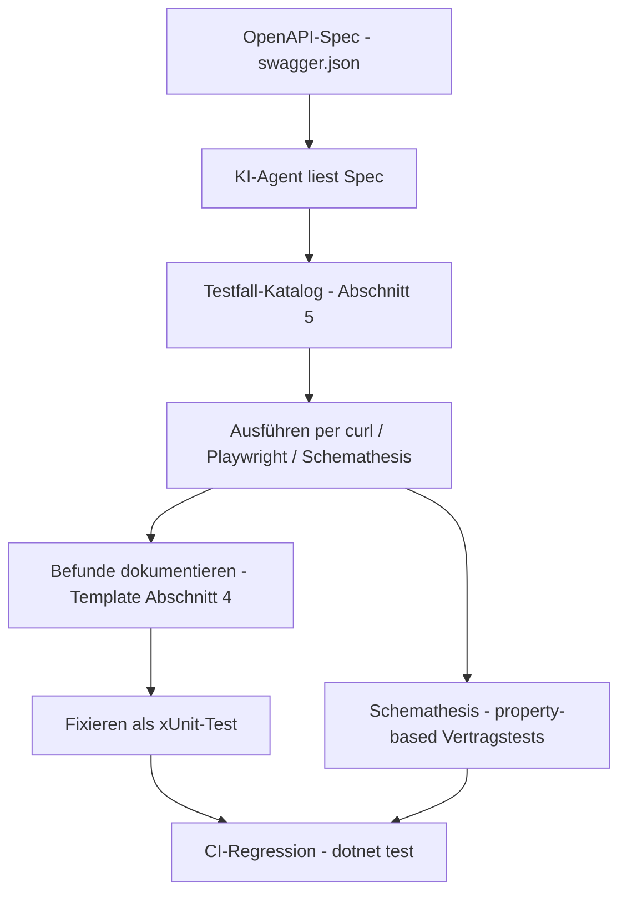

# Plan: KI-gestütztes Testen der Blogmodul-API

**Stand:** 2026-10-17
**Ziel:** Die Management-API (`/api/v1/articles`, fünf `operationId`s) **ausführlich über KI testen** — explorativ, spezgetreu und dauerhaft automatisiert. Enthält die Tool-Empfehlungen für die bestehende Toolchain und ist nachziehbar für jede Anwendung mit dem Blogmodul (siehe [`plans/blogmodul-api-vorlage.md`](blogmodul-api-vorlage.md)).

**Geprüft gegen aktuelle Quellen (Context7 + Marktüberblick 2026):** Schemathesis (property-based Tests aus der OpenAPI-Spec, CLI mit API-Key-Header und Stateful-Testing), Playwright `request`-Fixture (API-Tests ohne Browser), sowie KI-Testplattformen (Keploy, Postman Postbot/MCP, QA Wolf) als optionale Markt-Ergänzung.

---

## 1. Testverständnis: KI als Tester

„Über KI testen" heißt hier nicht, Tests „glauben zu müssen", sondern einen **Test-Funnel** zu fahren:

1. **KI-Exploration** — ein KI-Agent (VS Code: Copilot/Claude/Cursor/Zoo) liest die OpenAPI-Spec, generiert systematisch Testfälle (Happy Path, Fehlerpfade, Edge Cases, Security) und führt sie live aus (curl/HTTP).
2. **Befunde dokumentieren** — jedes Findings wird reproduzierbar festgehalten (Endpoint, Request, erwartet, ist).
3. **Fixierung als Code** — belastbare Befunde werden zu automatisierten Tests (xUnit/Playwright) und fließen in die Regression ein.
4. **Vertragsprüfung** — zusätzlich maschinell ohne KI: Schemathesis generiert hunderte Fälle direkt aus der Spec (property-based) und deckt ab, was die KI übersieht.



---

## 2. Tool-Empfehlungen für deine Toolchain

Deine Toolchain: **VS Code (Linux), .NET 10 / ASP.NET Core, xUnit, EF Core + PostgreSQL (Docker), curl, Playwright-MCP im Agenten, KI-Agent in VS Code, Budget-bewusst (Ein-Personen-Betrieb)**.

### 2.1 Kern-Toolkit (passt direkt, überwiegend bereits vorhanden)

| Tool | Rolle | Passung | Integration |
|---|---|---|---|
| **KI-Agent in VS Code** (Copilot/Claude/Cursor/Zoo) | Haupt-Tester: liest Spec, generiert Testfälle + curl-Aufrufe, wertet Antworten aus, schreibt Tests | ★★★ vorhanden | Spec-URL + Key als Kontext übergeben (Abschnitt 6) |
| **Schemathesis** (Open Source, Python via `uvx`) | Property-based Contract-Tests: generiert automatisch hunderte Fälle aus `swagger.json`, findet Edge Cases/500er, JUnit-Report | ★★★ 1 CLI-Befehl, kein Code | `uvx schemathesis run <spec-url> --header "X-Api-Key: <KEY>" --report junit` |
| **xUnit + `WebApplicationFactory`** (.NET) | Regression: was die KI findet, wird als Integrationstest fixiert | ★★★ vorhanden ([`BlogCms.Tests`](../tests/BlogCms.Tests)) | KI generiert die Testklassen, `dotnet test` führt aus |
| **curl + jq** | Schnelle Ad-hoc-Checks und Reproduktion von Befunden | ★★★ vorhanden | direkt im VS-Code-Terminal des Agenten |
| **Playwright `request`-Fixture** (TypeScript) | API-Tests ohne Browser, falls TS-Tests gewünscht — isolierter `APIRequestContext` pro Test, `expect(response).toBeOK()` | ★★☆ ergänzend | `@playwright/test` mit `request.post('/api/v1/articles', { data: {...} })` |
| **Playwright-MCP** (im Agenten vorhanden) | Swagger-UI/„Authorize"-Button im Browser prüfen, UI-nahes Verhalten | ★★☆ ergänzend | über die MCP-Werkzeuge des Agenten |

### 2.2 Optionale Markt-Tools (nur wenn gewünscht)

| Tool | Nutzen | Für dich |
|---|---|---|
| **Keploy** | KI-Testgenerator: nimmt OpenAPI-Spec/Postman/cURL entgegen, erzeugt Regressionstests mit Response-Assertions; kann auch echten Traffic aufzeichnen | interessant als „Test-Autopilot", aber zusätzliche Infrastruktur |
| **Postman + Postbot** | KI-Testgenerierung im Client, MCP-Unterstützung (APIs direkt an LLMs), Newman-CLI für CI | gut für manuelle Exploration, Lizenz ab ca. 14 $/User |
| **QA Wolf** | generiert deterministischen Playwright-Code aus natürlicher Sprache | für E2E/UI, für reine API-Tests overkill |
| **k6** | Last-/Stresstests, z. B. Rate-Limit-Verhalten (429) und Antwortzeiten | optional für Abschnitt 5 E |
| **Dredd** | Contract-Test: vergleicht Spec mit realen Antworten (Breaking-Change-Detektor) | optionaler Ersatz/Ergänzung zu Schemathesis |
| **Bruno / Insomnia** | manuelle Exploration, git-freundliche Collections | optional, curl des Agenten deckt das meist ab |

**Empfehlung:** Das Kern-Toolkit (2.1) reicht vollständig — KI-Agent + Schemathesis + xUnit + curl decken Exploration, Vertrag und Regression ab. Die Markt-Tools sind nur bei wachsendem Team/Umfang sinnvoll.

---

## 3. Test-Ebenen

| Ebene | Werkzeug | Ziel | Frequenz |
|---|---|---|---|
| 1. Unit | xUnit (vorhanden) | Fachlogik ([`ArticleValidator`](../src/BlogCms.Infrastructure/Content/ArticleValidator.cs:9), Mapping) | bei jedem Build |
| 2. Integration | xUnit + `WebApplicationFactory` | Endpunkte bis zur DB (Auth, Statuscodes, Fehlerformat) | bei jedem Build |
| 3. Vertrag | Schemathesis (property-based) | Spec vs. Realität, Edge Cases, unbekannte 500er | täglich/CI |
| 4. KI-Exploration | KI-Agent + curl | Security, Robustheit, API-UX (Beschreibungen, Fehlerhilfen) | vor Releases, nach API-Änderungen |
| 5. Last (optional) | k6 | Rate-Limit, Antwortzeiten unter Last | gelegentlich |

---

## 4. KI-gestützter Testablauf

1. **Spec beschaffen:** `GET /swagger/v1/swagger.json` der laufenden Anwendung (lokal: `http://localhost:5088/swagger/v1/swagger.json`).
2. **Testkatalog anwenden** (Abschnitt 5) — der KI-Agent generiert daraus konkrete Fälle inkl. Payloads.
3. **Ausführen** per curl (sofort), Playwright `request` (als Testcode) oder Schemathesis (Massenfälle).
4. **Befunde dokumentieren** — je Finding eine Zeile:

| Feld | Beispiel |
|---|---|
| Endpoint / `operationId` | `updateArticle` |
| Request | `PUT /api/v1/articles/{id}` mit `{"title": ""}` |
| Erwartet | 400 + `errors[]` mit Feld `Title` |
| Ist | 500 mit Stacktrace |
| Schweregrad | hoch/mittel/niedrig |
| Reproduktion | curl-Befehl |
| Fix-Status | gefunden → als xUnit-Test fixiert |

5. **Fixieren:** Jedes Finding wird als Regressionstest ergänzt (z. B. in [`ManagementArticlesControllerTests`](../tests/BlogCms.Tests/ManagementArticlesControllerTests.cs)).
6. **Wiederholen:** Nach jeder API-Änderung laufen Ebenen 2–3 automatisch, Ebene 4 wird gezielt nachgezogen.

---

## 5. Testfall-Katalog (für `/api/v1/articles`)

### A. Authentifizierung (Fail-Closed)
- Ohne `X-Api-Key` → `401` + `application/problem+json`.
- Mit falschem Key → `401`; **ohne konfigurierten `Api:Key` → `401` auch bei „richtigem" Header** (Fail-Closed).
- Key-Leak-Check: Key taucht in keiner Response, keiner Fehlerseite, keinem Log auf.
- Rate-Limit: mehr als `Api:RateLimitPerMinute` Requests → `429` mit `rate-limit`-ProblemDetails.

### B. CRUD-Workflow
- `createArticle` → `201` + `Location` + `id`/`slug`; `getArticle` → `200`; `updateArticle` → `200` (Änderung sichtbar); `deleteArticle` → `204`; `getArticle` danach → `404`.
- Soft-Delete: gelöschter Artikel ist in `listArticles` nicht mehr enthalten.
- `listArticles` mit Filtern `status`/`query`/`page`/`pageSize` — Pagination (`total`, `page`, `pageSize`) korrekt.

### C. Validierung (fachliche Regeln)
- `status = Published` ohne `excerpt`/`contentMarkdown`/Titelbild → `400` mit `errors[]` und genau den Feldern `Excerpt`/`ContentMarkdown`/`ImageUpload`.
- `status = Scheduled` mit vergangenem `scheduledAt` → `400`, Feld `ScheduledAt`.
- Leerer `title` → `400`, Feld `Title`.
- `Api:AuthorId` fehlt → `503` mit `not-configured` (nur beim Anlegen).

### D. Edge Cases
- Sehr lange Strings (z. B. 10.000 Zeichen `title`), leere Listen, `null` vs. `""`.
- Unicode/Emojis/Umlaute in `title`/`contentMarkdown`; Slug-Generierung daraus.
- **XSS-Payloads** im Markdown (`<script>alert(1)</script>`, ``) — Speicherung erlaubt, aber Rendering muss sanitisiert sein (bei Nutzung der UI prüfen).
- Ungültige Enum-Werte (`category: "Foo"`), ungültige UUIDs im Pfad, falsche Datumsformate (`scheduledAt: "morgen"`).
- Unbekannte JSON-Felder (werden ignoriert?), ungültiges JSON (→ sauberes `400` statt `500`).
- Oversized Payload (z. B. 10 MB Body) → saubere Ablehnung.

### E. Security
- SQL-/NoSQL-Injection-Versuche über `query` (`'; DROP TABLE`, `%27`), Pfad-Traversal in IDs.
- Mass-Assignment: `id`/`authorId`/`createdAt` im POST-Body werden **nicht** übernommen.
- Auth-Bypass-Versuche: leerer Key, `Bearer`-Header statt `X-Api-Key`, Key in URL/Body.
- Rate-Limit-Bypass (wechselnde IPs simulieren ist nicht nötig — Ziel ist nur das korrekte 429-Verhalten).

### F. Vertrag (Spec vs. Realität)
- Antworten enthalten genau die Spec-Felder; Enums als **Strings** (`"Published"`), JSON in **camelCase**.
- `security`-Requirement in der Spec gesetzt (global oder pro Operation).
- Die fünf `operationId`s (`listArticles`, `getArticle`, `createArticle`, `updateArticle`, `deleteArticle`) sind in der Spec vorhanden und stabil.
- Fehler-Antworten sind `application/problem+json` mit `type`/`title`/`status` und bei Validierung `errors[]`.

### G. Robustheit
- Doppeltes `deleteArticle` → zweites Mal `404`.
- `updateArticle` auf gelöschten Artikel → `404`.
- Parallele Edits (zwei `PUT` schnell nacheinander) — kein 500, letzter Stand gewinnt.
- `GET /api/v1/articles` während `createArticle` läuft → kein Fehler.

---

## 6. Prompt-Bausteine für KI-Tester

**Exploration (Hauptprompt):**
> Du bist API-Tester. Lies die OpenAPI-Spec unter `<URL>` und teste alle fünf Operationen der Management-API unter `http://localhost:5088/api/v1/articles` mit Header `X-Api-Key: <KEY>`. Gehe den Testfall-Katalog aus `plans/blogmodul-api-testing.md` Abschnitt 5 systematisch durch (A–G). Führe jeden Fall per curl aus, dokumentiere Befunde im Template aus Abschnitt 4 und schlage für jedes Finding einen xUnit-Regressionstest vor. Bestanden gilt nur mit dokumentierter Antwort.

**Security-Review:**
> Prüfe die API gezielt auf Fail-Closed-Verhalten, Key-Leaks in Responses/Logs, Injection über `query`, Mass-Assignment und Rate-Limit. Nutze die Spec, um alle Parameter zu identifizieren. Bewerte jeden Befund mit Schweregrad.

**Contract-Check:**
> Vergleiche reale API-Antworten Feld für Feld mit dem OpenAPI-Schema: Feldnamen, Enums als Strings, camelCase, Pflichtfelder, Fehlerformat (`type`/`title`/`status`/`errors[]`). Liste alle Abweichungen auf.

**Regression fixieren:**
> Erzeuge aus dem Befund `<Befund>` einen xUnit-Test im Stil der bestehenden `ManagementArticlesControllerTests` (EF-InMemory, reale Services) und lasse `dotnet test` laufen.

---

## 7. Automatisierung und CI

### 7.1 Schemathesis (Vertrag + Edge Cases, kein Code)
```bash
# Property-based Tests gegen die laufende API inkl. Auth-Header
uvx schemathesis run http://localhost:5088/swagger/v1/swagger.json \
  --header "X-Api-Key: $API_KEY" \
  --report junit --report-junit-path schemathesis-junit.xml

# Stateful Workflows (create → update → delete verkettet), mehr Beispiele:
# Python-Setup mit schema.as_state_machine() und before_call für den Key-Header,
# settings(max_examples=200, stateful_step_count=10)
```
- `--header` kann mehrfach genutzt werden; der Key kommt aus der Umgebungsvariable (nie im Befehl hardcodieren).
- JUnit-XML direkt in CI als Testergebnis einlesbar.

### 7.2 xUnit-Integrationstests (Regression)
- Testklassen aus Abschnitt 5 als [`WebApplicationFactory<Program>`](../src/BlogCms.Web/Program.cs:391)-Tests (InMemory-DB wie in [`TestDb`](../tests/BlogCms.Tests/TestDb.cs:8)) bzw. Controller-Tests mit realen Services.
- `dotnet test` in CI — bereits eingerichtet.

### 7.3 Smoke-Script (curl-Kette, 30 Sekunden)
```bash
# 1. Spec erreichbar + enthält Pflichtinhalte
curl -sf http://localhost:5088/swagger/v1/swagger.json | grep -q '"X-Api-Key"'
# 2. Fail-Closed
test "$(curl -s -o /dev/null -w '%{http_code}' http://localhost:5088/api/v1/articles)" = "401"
# 3. CRUD-Fluss mit Key (create → update → delete)
# ... siehe docs/05-management-api.md für die vollständigen curl-Beispiele
```

### 7.4 Playwright (optional, als TS-Testdatei)
```typescript
test('createArticle liefert 201 und eine id', async ({ request }) => {
  const response = await request.post('/api/v1/articles', {
    headers: { 'X-Api-Key': process.env.BLOG_API_KEY! },
    data: {
      title: 'KI-Testbeitrag', excerpt: 'Teaser', contentMarkdown: '# Test',
      category: 'Politik', accessLevel: 'Public', status: 'Published',
      titleImageUrl: 'https://example.com/cover.jpg'
    }
  });
  expect(response.ok()).toBeTruthy();
  const article = await response.json<{ id: string; slug: string }>();
  expect(article.id).toBeTruthy();
});
```

---

## 8. Nachzieh-Checkliste pro Anwendung

1. Spec-URL und Key bereitstellen (lokal: `http://localhost:5088/swagger/v1/swagger.json`, Produktion: `https://<domain>/swagger/v1/swagger.json`).
2. **KI-Exploration** mit dem Hauptprompt (Abschnitt 6) gegen die Testfälle A–G fahren; Befunde sammeln.
3. **Schemathesis-Lauf** (Abschnitt 7.1) ausführen; 500er und Schema-Verletzungen sichten.
4. Findings als **xUnit-Regressionstests** fixieren; `dotnet test` grün bekommen.
5. **Smoke-Script** in die CI/Deployment-Pipeline hängen.
6. Ergebnis dokumentieren: `docs/management-api-test.md` mit Befund-Tabelle und Testabdeckung.
7. Bei API-Änderungen: Schritte 2–4 wiederholen, Schemathesis läuft automatisch weiter.

---

## 9. Abnahmekriterien

- [ ] KI-Exploration wurde gegen alle fünf `operationId`s gefahren; Befunde sind im Template dokumentiert (auch „keine Befunde" ist ein Ergebnis).
- [ ] Schemathesis-Lauf ist ohne unerwartete 500er durchgelaufen; JUnit-Report liegt vor.
- [ ] Alle Befunde sind als xUnit-Tests fixiert; `dotnet test` ist grün.
- [ ] Fail-Closed, Fehlerformat (`errors[]`), Enums als Strings und Spec-Inhalte sind per Test belegt.
- [ ] Das Smoke-Script läuft in der CI und schlägt bei Abweichung fehl.
