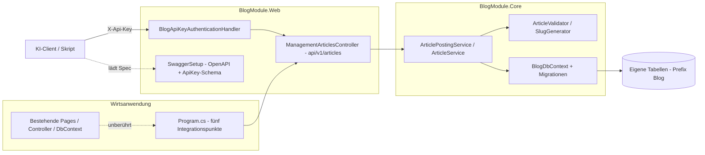

# Vorlage: Blogmodul mit Management-API für ASP.NET-Webanwendungen

**Stand:** 2026-10-17
**Status:** Generischer Nachzieh-Plan — wird pro Zielanwendung Schritt für Schritt umgesetzt (Abschnitt 8).
**Ziel:** Bestehende ASP.NET-Webanwendungen um ein **Blogmodul** (Artikel anlegen/bearbeiten/löschen/lesen) samt **Management-API** (statischer API-Key, OpenAPI/Swagger, KI-fähig) erweitern — **ohne die Wirtsanwendung umzubauen**.

**Verteilungsform (Entscheidung):** Wiederverwendbare Class Libraries `BlogModule.Core` (Datenmodell + Services) und `BlogModule.Web` (API-Controller, Auth, Swagger) — **ohne UI**. Jede Zielanwendung referenziert beide Projekte und ergänzt wenige klar benannte Bausteine.

**Referenzimplementierung:** Das Blog-CMS MentalVersagen — dort ist die API bereits produktiv umgesetzt und verifiziert (Konzept und Ist-Stand: [`plans/api-artikelverwaltung.md`](api-artikelverwaltung.md)). Dieser Plan abstrahiert die Erfahrungen daraus auf eine übertragbare Form; Code-Verweise auf die Referenz dienen als Beispiel, die Snippets hier sind aber eigenständig.

**Geprüft gegen die offizielle Microsoft-Dokumentation (Zweitmeinung):**
- Custom `AuthenticationHandler<TOptions>` mit `HandleAuthenticateAsync`/`AuthenticationTicket` ist der dokumentierte Weg für API-Key-Authentifizierung.
- Security-Schemes in der OpenAPI-Spec werden über `OpenApiSecuritySchemeReference` + `operation.Security` gesetzt — sowohl bei Swashbuckle als auch beim .NET-10-nativen `AddOpenApi` (dort über `IOpenApiDocumentTransformer`).
- Controller aus Class Libraries werden über `AddApplicationPart(assembly)` registriert; EF-Core-DbContexts über `AddDbContext` — beides offizielle Patterns.

---

## 1. Prinzipien

1. **Additive Integration:** Die Wirtsanwendung wird nur an genau fünf Stellen berührt (Abschnitt 4) — Rest bleibt unverändert.
2. **Keine Abhängigkeit von Identity:** Das Modul speichert `AuthorId` als losen `Guid?` **ohne** Fremdschlüssel auf ein Benutzersystem. So bleibt es in jeder Anwendung nutzbar (mit oder ohne ASP.NET Core Identity).
3. **Eigener DbContext, eigene Tabellen:** `BlogDbContext` mit Tabellen-Prefix `Blog` — keine Kollision mit dem Datenmodell der Wirtsanwendung, keine Änderung an deren Migrationen.
4. **Eine Quelle der Wahrheit für Regeln:** Validierung und Workflow liegen im Modul — die API ist nur ein weiterer Zugangspfad.
5. **Fail-Closed & KI-freundlich:** Ohne konfigurierten API-Key bleibt die API zu; die OpenAPI-Spec ist maschinenlesbar, mit einheitlichem Fehlerformat.

---

## 2. Modul-Architektur



### Projektstruktur des Moduls

```
modules/BlogModule/
  BlogModule.Core/                    # net10.0, referenziert EF Core
    Entities/                          BlogArticle, BlogTag, BlogArticleTag,
                                       BlogHashtag, BlogArticleHashtag
    Enums/                             ArticleStatus, ArticleCategory, ArticleAccessLevel
    Content/                           ArticlePostRequest, PostError, PostResult,
                                       ArticleValidator, SlugGenerator,
                                       IArticlePostingService, ArticlePostingService,
                                       IArticleService, ArticleService
    Data/                              BlogDbContext, Configurations/, Migrations/,
                                       BlogDbContextDesignFactory
    BlogModuleOptions.cs
    ServiceCollectionExtensions.cs     AddBlogModule(...)
  BlogModule.Web/                     # net10.0, FrameworkReference Microsoft.AspNetCore.App
    Controllers/                       ManagementArticlesController
    Security/                          BlogApiKeyDefaults, BlogApiKeyAuthenticationHandler
    Models/Api/                        ArticleWriteModel, ArticleReadModel,
                                       PagedResponse<T>, ApiProblems, ApiFieldError
    SwaggerSetup.cs                    AddBlogModuleSwagger(...)
    ServiceCollectionExtensions.cs     AddBlogModuleApi(...)
  BlogModule.Tests/                   # xUnit: Handler-, Controller-, Spec-, Options-Tests
```

Die Bausteine sind inhaltlich 1:1 aus der Referenz übernehmbar — [`ApiOptions`](../src/BlogCms.Web/Configuration/ApiOptions.cs), [`ApiKeyAuthenticationHandler`](../src/BlogCms.Web/Security/ApiKeyAuthenticationHandler.cs), [`ApiProblems`](../src/BlogCms.Web/Models/Api/ApiProblems.cs), [`ArticleApiModels`](../src/BlogCms.Web/Models/Api/ArticleApiModels.cs), [`ManagementArticlesController`](../src/BlogCms.Web/Controllers/ManagementArticlesController.cs) und [`SwaggerSetup`](../src/BlogCms.Web/Configuration/SwaggerSetup.cs) — jeweils mit Namespace-Anpassung und ersetzt [`ArticlePostRequest`](../src/BlogCms.Infrastructure/Content/ArticlePostRequest.cs:24)/[`ArticleValidator`](../src/BlogCms.Infrastructure/Content/ArticleValidator.cs:9) als generische Modul-Klassen.

---

## 3. Datenmodell (generischer Kern)

| Entität | Felder | Hinweis |
|---|---|---|
| `BlogArticle` | `Id` (Guid), `Title`, `Slug`, `Excerpt?`, `ContentMarkdown`, `Category`, `AccessLevel`, `Status`, `ScheduledAt?`, `PublishedAt?`, `TitleImageUrl?`, `VideoUrl?`, `AuthorId?` (**Guid, kein FK**), `CreatedAt`, `UpdatedAt`, `DeletedAt?` | Soft-Delete über `DeletedAt` (Query-Filter `== null`) |
| `BlogTag` / `BlogArticleTag` | `Name`, `Slug` + n:m-Verknüpfung | Schlagwörter |
| `BlogHashtag` / `BlogArticleHashtag` | `Name`, `Slug` + n:m-Verknüpfung | `#`-Hashtags |

- **Enums:** `ArticleStatus` (`Draft`, `Scheduled`, `Published`, `Archived`), `ArticleCategory` (anwendungsspezisch erweiterbar — als String-Enum mit offenem Default), `ArticleAccessLevel` (`Public`, `Registered`, `Premium`).
- **Tabellen-Prefix `Blog`:** Konfigurierbar über `BlogModuleOptions.TablePrefix`, Standard `Blog` — vermeidet Kollisionen in der Wirts-Datenbank.
- **Kein Identity-Bezug:** `AuthorId` ist ein loser Identifikator. Die Wirtsanwendung trägt beim Anlegen über die API ihre Benutzer-Guid ein (Konfiguration `Api:AuthorId`) und kann sie bei Bedarf auflösen.
- **Migrationen liegen im Modul** ([`BlogDbContextDesignFactory`](../src/BlogCms.Infrastructure/Data/Migrations) als Muster für Design-Time-Services): Damit bringen alle Anwendungen denselben Schema-Stand mit; Updates erfolgen über eine neue Modul-Version + `MigrateAsync()`.

---

## 4. Schnittstelle zur Wirtsanwendung (die fünf Eingriffe)

### 4.1 Projekt-Referenzen
```xml
<ItemGroup>
  <ProjectReference Include="..\modules\BlogModule\BlogModule.Core\BlogModule.Core.csproj" />
  <ProjectReference Include="..\modules\BlogModule\BlogModule.Web\BlogModule.Web.csproj" />
</ItemGroup>
```

### 4.2 [`Program.cs`](../src/BlogCms.Web/Program.cs) — Dienste registrieren
```csharp
// Blogmodul: Datenmodell, Services, Migrationen (eigener DbContext, eigene Tabellen).
builder.Services.AddBlogModule(builder.Configuration);

// Blogmodul-API: Auth-Handler, ProblemDetails, Rate-Limiter, Swagger.
builder.Services.AddBlogModuleApi(builder.Configuration);
```

### 4.3 [`Program.cs`](../src/BlogCms.Web/Program.cs) — Pipeline
```csharp
// Controller des Moduls (falls MapControllers nicht bereits vorhanden).
app.MapControllers();

// Modul-Controller im Application-Model sichtbar machen (falls AddControllers
// in der Wirtsanwendung ohne ApplicationParts läuft):
// builder.Services.AddControllers().AddApplicationPart(typeof(ManagementArticlesController).Assembly);
```

### 4.4 Start: Migration anwenden (idempotent)
```csharp
using (var scope = app.Services.CreateScope())
{
    var blogDb = scope.ServiceProvider.GetRequiredService<BlogDbContext>();
    await blogDb.Database.MigrateAsync();
}
```

### 4.5 Konfiguration (`appsettings.json` + `.env`)
```json
"Blog": { "ConnectionName": "DefaultConnection", "TablePrefix": "Blog" },
"Api": {
  "Key": "", "AuthorId": "", "SwaggerUiEnabled": false,
  "RateLimitPerMinute": 60, "HeaderName": "X-Api-Key"
}
```
```bash
Api__Key=<openssl rand -hex 32>
Api__AuthorId=<Guid des Autors in der Wirtsanwendung>
```

Damit ist die Wirtsanwendung im Übrigen **unverändert**. Bestehende Authentifizierung (Cookies, JWT, Identity) bleibt exakt wie sie ist — das Modul nutzt ein eigenes Scheme (`BlogApi`).

---

## 5. Bausteine im Detail

### 5.1 API-Key-Authentifizierung (`BlogModule.Web/Security`)
Übernehmbar aus [`ApiKeyAuthenticationHandler`](../src/BlogCms.Web/Security/ApiKeyAuthenticationHandler.cs:28). Wesentliche Punkte:
- `AuthenticationHandler<AuthenticationSchemeOptions>` mit `HandleAuthenticateAsync`; Erfolg = `AuthenticationTicket(new ClaimsPrincipal(identity), Scheme.Name)`.
- **Konstantzeitlicher Vergleich** über SHA-256 + `CryptographicOperations.FixedTimeEquals` — kein Timing-Leak, Key nie loggen.
- **Fail-Closed:** Ohne konfigurierten `Api:Key` schlägt jeder Zugriff fehl (401); Warnung beim Start.
- **Challenge als ProblemDetails** (RFC 7807, `application/problem+json`) — siehe [`ApiProblems.WriteAsync()`](../src/BlogCms.Web/Models/Api/ApiProblems.cs:52): `Response.WriteAsJsonAsync` serialisiert ohne Optionen in PascalCase, daher Web-Defaults (camelCase) explizit übergeben!
- Registrierung im Modul-Setup (nicht in der Wirtsanwendung):
```csharp
services.AddAuthentication()
    .AddScheme<AuthenticationSchemeOptions, BlogApiKeyAuthenticationHandler>(
        BlogApiKeyDefaults.AuthenticationScheme, _ => { });
```
- Der Controller verlangt das Scheme explizit: `[Authorize(AuthenticationSchemes = BlogApiKeyDefaults.AuthenticationScheme)]` — die Auth der Wirtsanwendung bleibt unberührt. **Kein** `[ValidateAntiForgeryToken]` (API-Key ist keine Cookie-Auth → kein CSRF-Vektor).

### 5.2 Management-API (`BlogModule.Web/Controllers`)
Übernehmbar aus [`ManagementArticlesController`](../src/BlogCms.Web/Controllers/ManagementArticlesController.cs:35) — fünf Endpunkte unter `api/v1/articles`:

| Methode | Route | operationId | Erfolg | Fehler |
|---|---|---|---|---|
| `GET` | `/api/v1/articles` | `listArticles` | 200 + `PagedResponse<ArticleReadModel>` | 401, 429 |
| `GET` | `/api/v1/articles/{id}` | `getArticle` | 200 + `ArticleReadModel` | 401, 404 |
| `POST` | `/api/v1/articles` | `createArticle` | 201 + `Location` + `ArticleReadModel` | 400, 401, 503 |
| `PUT` | `/api/v1/articles/{id}` | `updateArticle` | 200 + `ArticleReadModel` (Voll-Update) | 400, 401, 404 |
| `DELETE` | `/api/v1/articles/{id}` | `deleteArticle` | 204 (Soft-Delete) | 401, 404 |

Kernregeln:
- Mapping DTO → `ArticlePostRequest` → `ArticlePostingService.CreateAsync/UpdateAsync` — **eine** Implementierung der Fachregeln (Validierung, Slug, Tags/Hashtags, Statuswechsel/`Scheduled`).
- Fehler: RFC-7807-ProblemDetails mit `errors[]` = `{ field, message }` (aus `PostError`) — einheitlich auch für Model-Binding-Fehler über `ApiBehaviorOptions.InvalidModelStateResponseFactory`.
- `Api:AuthorId` fehlt → 503 nur beim Anlegen; Lesen/Bearbeiten/Löschen funktionieren weiter.
- Rate-Limiting pro Client-IP (ASP.NET-Core-Rate-Limiter, Policy `api`), 429 als ProblemDetails.

### 5.3 Services (`BlogModule.Core/Content`)
Aus der Referenz übernehmbar: [`ArticlePostingService`](../src/BlogCms.Infrastructure/Content/ArticlePostingService.cs:31) (Transaktion, Validierung, Slug, Tags/Hashtags), [`ArticleService`](../src/BlogCms.Infrastructure/Content/ArticleService.cs:144) (Queries, `SoftDeleteAsync`, `GetForManagementAsync`), [`ArticleValidator`](../src/BlogCms.Infrastructure/Content/ArticleValidator.cs:9) (Pflichtfelder bei `Published`/`Scheduled`, Zukunftsdatum bei Planung), [`SlugGenerator`](../src/BlogCms.Infrastructure/Content/SlugGenerator.cs).
Registrierung gebündelt in `AddBlogModule(...)`:
```csharp
public static IServiceCollection AddBlogModule(
    this IServiceCollection services, IConfiguration configuration)
{
    services.Configure<BlogModuleOptions>(configuration.GetSection("Blog"));
    var options = configuration.GetSection("Blog").Get<BlogModuleOptions>() ?? new();
    services.AddDbContext<BlogDbContext>(db => db.UseNpgsql(
        configuration.GetConnectionString(options.ConnectionName)));
    services.AddSingleton<ISlugGenerator, SlugGenerator>();
    services.AddScoped<IArticleService, ArticleService>();
    services.AddScoped<IArticlePostingService, ArticlePostingService>();
    return services;
}
```

### 5.4 OpenAPI/Swagger (`BlogModule.Web/SwaggerSetup`)
Zwei mögliche Wege — die Wahl wird hinter `AddBlogModuleSwagger(...)` gekapselt:

| Weg | Paket | Setup | Wann |
|---|---|---|---|
| **A. Swashbuckle** (empfohlen bei gemischten .NET-Versionen) | `Swashbuckle.AspNetCore` (10.x) | `AddSwaggerGen(SwaggerSetup.ConfigureGen)` + `UseSwagger()` + `UseSwaggerUI()` | Breit kompatibel (ab .NET 8), UI eingebaut — in der Referenz verifiziert |
| **B. Natives OpenAPI** (.NET 9/10-Standard laut Microsoft-Doku) | `Microsoft.AspNetCore.OpenApi` + UI-Paket (Swashbuckle.SwaggerUI oder Scalar) | `AddOpenApi()` + `MapOpenApi()` + `IOpenApiDocumentTransformer` fürs ApiKey-Schema | Reine .NET-9/10-Landschaft, ohne Fremdpaket |

Inhalt beider Wege (identisch):
- **SecurityDefinition** „ApiKey" (`type: apiKey`, `in: header`, `name: X-Api-Key`) + SecurityRequirement — bei Swashbuckle:
```csharp
options.AddSecurityRequirement(document => new OpenApiSecurityRequirement
{
    [new OpenApiSecuritySchemeReference("ApiKey", document)] = []
});
```
  bei Weg B über `IOpenApiDocumentTransformer` (`document.Components.SecuritySchemes` setzen, `operation.Security ??= []` befüllen — Muster aus der Microsoft-Doku).
- **`operationId`s** in camelCase (`listArticles`, `getArticle`, `createArticle`, `updateArticle`, `deleteArticle`) — viele KI-Tools arbeiten damit stabiler.
- **XML-Kommentare** aller Controller/DTOs (`GenerateDocumentationFile` in der Web-Library; fehlende Kommentare mit `NoWarn 1591` abfedern).
- **Enums als Strings** über `JsonStringEnumConverter` in `AddJsonOptions` — konsistent zur Persistenz und gut lesbar für automatisierte Clients.
- **KI-Kurzleitfaden** als Beschreibung im `OpenApiInfo` (Ablauf `listArticles → getArticle → updateArticle`, Pflichtfelder, Fehlerformat).
- **Erreichbarkeit:** Die Spec (`/swagger/v1/swagger.json`) bleibt **immer** erreichbar (das KI-Interface); die interaktive UI ist über `Api:SwaggerUiEnabled` zuschaltbar.

**Wichtig (aus der Referenz gelernt):** `UseSwagger()` ohne `AddSwaggerGen()` ergibt einen 500er auf der Spec (fehlender `ISwaggerProvider`) — beides gehört zusammen in `AddBlogModuleSwagger`/`UseBlogModuleSwagger`.

---

## 6. Erfahrungen und Fallen (aus der Referenzumsetzung)

1. **Swashbuckle 10.x = Microsoft.OpenApi 2.x:** keine Namespaces `Microsoft.OpenApi.Models`/`.Any` mehr (alles flach in `Microsoft.OpenApi`); `OpenApiReference` entfällt zugunsten `OpenApiSecuritySchemeReference(Name, Document)`; `OpenApiSchema.Type` ist `JsonSchemaType?`.
2. **`SwaggerGenOptions`-Properties sind nicht mehr öffentlich auslesbar** (`SwaggerDocs`, `SecurityDefinitions`, `CustomOperationIds`) — Tests prüfen die **generierte Spec** über `ISwaggerProvider.GetSwagger(...)`.
3. **Spec-Tests ohne HTTP-Host** brauchen einen `IWebHostEnvironment`-Stub (Swashbuckle aktiviert `ConfigureSwaggerGeneratorOptions` damit).
4. **`Response.WriteAsJsonAsync`** serialisiert ohne Optionen in PascalCase — für RFC-7807-camelCase Web-Defaults explizit übergeben (zentrale Helfermethode `ApiProblems.WriteAsync`).
5. **`AddSwaggerGen` nicht vergessen** (siehe oben) — im Smoke-Check gegen die laufende App entdeckt.
6. **`public partial class Program { }`** am Ende der Wirts-`Program.cs` setzen, wenn `WebApplicationFactory`-Integrationstests gewünscht sind.
7. **Enum-Binding:** Der `JsonStringEnumConverter` sorgt für Klartextwerte in JSON **und** Spec — kein manuelles Schema-Mapping nötig.
8. **Smoke-Check nach jeder Integration:** Spec (`200`, enthält `X-Api-Key` + fünf `operationId`s), API ohne Key (`401`), API mit Key (`200`/`201`), Wirtsanwendung unverändert (`200` auf deren Startseite).

---

## 7. Teststrategie (im `BlogModule.Tests` pro Modulstand)

| Testklasse | Abdeckung |
|---|---|
| `BlogApiKeyAuthenticationHandlerTests` | gültiger Key → authentifiziert; falscher Key/fehlender Header → Fail; **kein konfigurierter Key → Fail-Closed**; Challenge → 401 + ProblemDetails |
| `ManagementArticlesControllerTests` | Create/Update/Delete/Get/List gegen reale Services mit EF-InMemory (`TestDb`); Feldfehler → 400 + `errors[]`; fehlende `AuthorId` → 503; unbekannte ID → 404; Soft-Delete-Semantik |
| `OpenApiDocumentTests` | Spec über `ISwaggerProvider` erzeugen (mit `IWebHostEnvironment`-Stub): ApiKey-Schema, fünf `operationId`s, SecurityRequirement (global oder pro Operation), KI-Leitfaden in der Beschreibung |
| `BlogModuleOptionsTests` | Konfigurationsbindung (`Api`, `Blog`) |

Die Testklassen sind aus der Referenz übernehmbar: [`ApiKeyAuthenticationHandlerTests`](../tests/BlogCms.Tests/ApiKeyAuthenticationHandlerTests.cs), [`ManagementArticlesControllerTests`](../tests/BlogCms.Tests/ManagementArticlesControllerTests.cs), [`ApiDocumentationTests`](../tests/BlogCms.Tests/ApiDocumentationTests.cs), [`ApiOptionsTests`](../tests/BlogCms.Tests/ApiOptionsTests.cs).

---

## 8. Nachzieh-Checkliste pro Zielanwendung

1. **Modul einbinden:** `modules/BlogModule/` in das Zielrepo übernehmen (Kopie als einfachste Variante; alternär zentrales Repo + `ProjectReference`/Git-Submodule) und die beiden Projekte referenzieren (Abschnitt 4.1).
2. **Program.cs:** die vier Integrationsblöcke einfügen (Abschnitt 4.2–4.4) — `AddBlogModule`, `AddBlogModuleApi`, `MapControllers`/`AddApplicationPart`, `MigrateAsync`.
3. **Swagger-Weg wählen:** `AddBlogModuleSwagger` mit Weg A (Swashbuckle) oder Weg B (`AddOpenApi`) — je nach .NET-Version der Wirtsanwendung (Abschnitt 5.4).
4. **Konfiguration** ergänzen: `Blog`- und `Api`-Sektion in `appsettings.json`, `Api__*`-Variablen in `.env` bzw. Umgebungsvariablen (Abschnitt 4.5).
5. **Key erzeugen** (`openssl rand -hex 32`) und `Api:AuthorId` auf eine gültige Benutzer-Guid der Wirtsanwendung setzen (oder beim Anlegen später übergeben).
6. **Bauen und Migration anwenden:** `dotnet build` + App starten — `MigrateAsync()` legt die `Blog*`-Tabellen an.
7. **Modul-Tests** übernehmen und `dotnet test` ausführen.
8. **Smoke-Check** (curl, siehe Abschnitt 6 Punkt 8): Spec 200 mit `X-Api-Key` und fünf `operationId`s; API ohne Key 401; mit Key `createArticle → 201`, `updateArticle → 200`, `deleteArticle → 204`; Startseite der Wirtsanwendung unverändert 200.
9. **Dokumentation** pro Anwendung: `docs/management-api.md` nach dem Muster von [`docs/05-management-api.md`](../docs/05-management-api.md) (Einrichtung, curl-Beispiele, KI-Anbindung: Spec-URL + `X-Api-Key`).

---

## 9. Abnahmekriterien je Zielanwendung

- [ ] Die Wirtsanwendung baut und startet unverändert (ihre Seiten antworten wie zuvor).
- [ ] Die `Blog*`-Tabellen existieren; das Modul ist ausschließlich über die fünf Integrationspunkte angebunden.
- [ ] Artikel lassen sich per `curl`/KI-Tool mit Header `X-Api-Key` anlegen, bearbeiten und (soft) löschen.
- [ ] Ohne/falschen Key antwortet `/api/v1/*` mit 401 (Fail-Closed) — auch ohne konfigurierten Key.
- [ ] `/swagger/v1/swagger.json` liefert eine gültige Spec inkl. ApiKey-Schema, fünf `operationId`s und KI-Leitfaden.
- [ ] Validierungsfehler kommen als ProblemDetails mit `errors[]` ({field, message}) zurück.
- [ ] `dotnet test` ist grün (Modul-Tests + Wirtsanwendungstests).

---

## 10. Offene Punkte / Ausbaustufen

- **Medien-Upload** (`POST /api/v1/media`, multipart) — in der Referenz bewusst offen; Titelbilder laufen über `titleImageUrl`.
- **Kommentare/Newsletter/Zusatzfunktionen** — nicht Teil des Modulkerns; als separate Module nach demselben Muster möglich.
- **DB-basierte API-Keys** (Scopes, Rotation, Widerruf) statt statischem Key — Ausbaustufe des Auth-Bausteins.
- **PATCH-Teilupdates** und serverseitige Pagination — Komfort-Ausbau der API.
- **NPM-/NuGet-Verteilung** des Moduls, sobald mehrere Anwendungen im Regelbetrieb sind.
