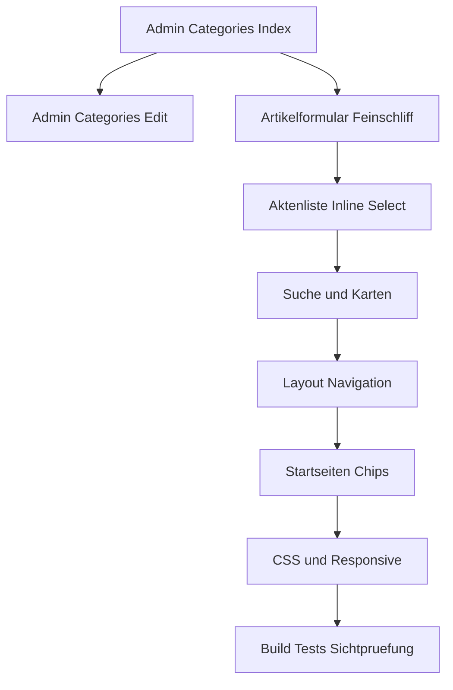

# Dynamische Kategorien – Frontend-Plan

## 1. Ausgangslage nach dem Backend

Das Backend liefert bereits:

- `ICategoryService` mit `GetAllAsync`, `GetByIdAsync`, `GetBySlugAsync`, `CreateAsync`, `UpdateAsync`, `DeleteAsync`, `AssignArticleAsync` und `CountArticlesAsync`.
- `Article.CategoryId` inkl. `Category`-Navigation; `undefined` ist die geschützte Systemkategorie.
- Migration `AddDynamicCategories` mit Datenübernahme der drei bisherigen Enum-Werte.
- API: `category` wird als Slug gelesen und als Slug/Name/ID ausgeliefert.
- Die öffentliche Suche, Artikelkarten, Detailseite und der RSS-Feed rendern bereits den dynamischen Kategorienamen.

Der folgende Plan beschreibt die noch fehlende UI und die Verfeinerung der bereits umgestellten Stellen.

---

## 2. Admin: Kategorienverwaltung

### 2.1 Route und Zugriff

- `src/BlogCms.Web/Pages/Admin/Categories/Index.cshtml` + `.cshtml.cs`
- `src/BlogCms.Web/Pages/Admin/Categories/Edit.cshtml` + `.cshtml.cs`
- `[Authorize(Policy = Policies.RequireAdmin)]`

### 2.2 Übersichtsseite `Admin/Categories/Index`

Aufbau analog zu [`Admin/LinkLists/Index.cshtml`](../src/BlogCms.Web/Pages/Admin/LinkLists/Index.cshtml:14):

1. `_PageHeader` mit Titel „Kategorien“ und Untertitel „Themengebiete und redaktionelle Kennzeichnung pflegen.“
2. TempData-Meldungen (`Message` / `Error`) im bestehenden `mv-teaser`-Stil.
3. Zweispaltiges Layout:
   - links (ca. 7/12): Tabelle aller Kategorien.
   - rechts (ca. 5/12): Karte „Neue Kategorie“ mit Formular.
4. Tabellenspalten:
   - **Name** (mit Pill „SYSTEM“ bei `undefined`)
   - **Slug** (mono, z. B. `politik`)
   - **Artikel** (Anzahl)
   - **Reihenfolge**
   - **Disclaimer** (Ja/Nein bzw. gekürzter Text)
   - **Aktionen**: „Bearbeiten“ (Link auf `Edit`) und „Löschen“ (POST mit Bestätigung).
5. `undefined`-Zeile: kein Bearbeiten-/Löschen-Button, stattdessen Hinweis „Nicht löschbar“.
6. Löschen-Bestätigung nennt die betroffene Artikelanzahl:
   `Kategorie „X“ löschen? 12 Artikel werden zu „undefined“ verschoben.`
7. Leerer Zustand: „Noch keine Kategorien vorhanden.“ (praktisch nie sichtbar, da `undefined` immer existiert).

### 2.3 Anlegen (auf der Übersichtsseite)

Formularfelder:

| Feld | Pflicht | Hinweis |
|---|---|---|
| Name | ja | max. 100 Zeichen |
| Slug | nein | automatisch aus Name; stabil bei späterer Umbenennung |
| Beschreibung | nein | interne Notiz, max. 500 Zeichen |
| Disclaimer | nein | Hinweistext auf der Artikelseite, max. 1000 Zeichen |
| Reihenfolge | nein | leer = automatisch ans Ende |

- POST-Handler `Create`.
- Bei Erfolg: `TempData["Message"]`, Redirect auf `Index`.
- Bei Fehler: `TempData["Error"]` oder ModelState, Formularwerte bleiben erhalten.

### 2.4 Bearbeiten `Admin/Categories/Edit`

- Lädt die Kategorie über `GetByIdAsync`.
- Formular wie beim Anlegen, zusätzlich:
  - Bei `IsSystem`: Name und Slug `readonly`/`disabled`, sichtbarer Hinweis „Die Systemkategorie kann nicht umbenannt werden.“; Beschreibung, Disclaimer und Reihenfolge bleiben editierbar.
- POST-Handler `Save`.
- Löschen ist auf der Edit-Seite nicht zusätzlich nötig; bleibt in der Liste.
- „Zurück zur Übersicht“-Link.

### 2.5 Ergonomie und Sicherheit

- Destruktive Aktion mit `onsubmit="return confirm(...)"`.
- Antiforgery ist durch Razor-Formulare automatisch vorhanden.
- Buttons mit klaren Texten statt reiner Icons.
- `aria-describedby` für Hilfetexte, `aria-label` für die Aktionsspalten.
- Tabellen in `table-responsive`; auf kleinen Screens horizontal scrollbar.

---

## 3. Artikelformular

Datei: [`_ArticleForm.cshtml`](../src/BlogCms.Web/Pages/Admin/Articles/_ArticleForm.cshtml:30)

- Dropdown bleibt dynamisch aus `Model.Categories`.
- Reihenfolge: reguläre Kategorien nach `DisplayOrder`/Name, `undefined` zuletzt.
- Default beim Anlegen: `CategoryIds.Undefined` (wird im `CreateModel.OnGetAsync` gesetzt).
- Hilfetext: „Ohne Auswahl wird der Beitrag unter ‚undefined‘ einsortiert.“
- Wenn keine Kategorien geladen werden konnten: Warnhinweis und verstecktes Feld mit `undefined`, damit das Speichern nicht blockiert.
- Das Feld bleibt optional; die Validierung erzwingt keine Kategorie mehr.

---

## 4. Aktenliste `Admin/Articles/Index`

Datei: [`Admin/Articles/Index.cshtml`](../src/BlogCms.Web/Pages/Admin/Articles/Index.cshtml:91)

- Für Autoren: neutrale Pille mit Kategorienamen.
- Für Admins: kleines `<select>` in der Zeile.
  - Optionen aus `Model.Categories`.
  - `onchange="this.form.submit()"` für schnellen Wechsel.
  - `<noscript>`-Fallback-Button.
  - POST-Handler `ChangeCategory` (bereits im PageModel vorhanden), nur für Admins.
- Nach dem Wechsel: `TempData["Message"]` und Redirect mit erhaltenem `Filter`/`Search`.
- CSS-Klasse für die Select-Breite, z. B. `.mv-admin-category-select { min-width: 11rem; }`.

---

## 5. Öffentliche Seiten

### 5.1 Suche

Datei: [`Suche.cshtml`](../src/BlogCms.Web/Pages/Suche.cshtml:29)

- Dropdown aus `Model.AllCategories`; Wert = Slug.
- „Alle Kategorien“ bleibt die erste Option.
- `undefined` erscheint als eigene Option, damit nicht zugeordnete Beiträge auffindbar sind.
- Pagination-Links übernehmen `asp-route-category="@Model.CategorySlug"`.
- Alte URLs mit Enum-Namen (`?category=Satire`) funktionieren weiter, weil `GetBySlugAsync` den Slug normalisiert.

### 5.2 Artikelkarte

Datei: [`_ArticleCard.cshtml`](../src/BlogCms.Web/Pages/Shared/_ArticleCard.cshtml:26)

- Kopfzeile: `ARCHIV <Kategoriename>` über `CategoryDisplay.Name(article.Category)`.
- Fallback bei fehlender Navigation: `undefined`.

### 5.3 Detailseite

Datei: [`Articles/Details.cshtml`](../src/BlogCms.Web/Pages/Articles/Details.cshtml:43)

- Disclaimer aus `article.Category?.Disclaimer`.
- Meta-Zeile mit Kategorienamen.
- Keine Sonderfälle für Satire/Verschwörung mehr im Code; die Texte kommen aus der Datenbank.

### 5.4 RSS und öffentliche Artikel-API

- [`FeedController`](../src/BlogCms.Web/Controllers/FeedController.cs:54): `<category>` = Anzeigename.
- [`ArticlesController`](../src/BlogCms.Web/Controllers/ArticlesController.cs:64): `category` = Slug, `categoryLabel` = Anzeigename.
- [`site.js`](../src/BlogCms.Web/wwwroot/js/site.js:246): `renderCard` nutzt bevorzugt `article.categoryLabel`, sonst `article.category`, sonst `undefined`.

---

## 6. Navigation und Startseite

### 6.1 Admin-Dropdown

Datei: [`_Layout.cshtml`](../src/BlogCms.Web/Pages/Shared/_Layout.cshtml:97)

- Eintrag „Kategorien“ zwischen „Kurieren“ und „Benutzer“.
- Nur für `UserRole.Admin` sichtbar.

### 6.2 Kategorie-Chips auf der Startseite

Datei: [`Index.cshtml`](../src/BlogCms.Web/Pages/Index.cshtml:26)

- `IndexModel` injiziert `ICategoryService` und lädt `AllCategories` (ohne `IsSystem`).
- Unter den Hero-Tools erscheint eine Chip-Reihe:
  - `Politik`, `Satire`, `Verschwörungstheorien`, weitere dynamische Kategorien.
  - Link auf `/Suche?category={slug}`.
  - Stil: `btn btn-outline-secondary btn-sm`, Container `mv-category-chips`.
- Bei keinen regulären Kategorien wird die Reihe nicht gerendert.

---

## 7. Styling

- Bestehende Design-Tokens und Klassen wiederverwenden: `mv-doc`, `mv-case`, `mv-pill`, `mv-teaser`, `meta-mono`, `form-control`, `form-select`, `btn`.
- Neue, minimale CSS-Regeln in `wwwroot/css/site.css`:
  - `.mv-category-chips` – Flex-Wrap mit Abstand.
  - `.mv-admin-category-select` – Mindestbreite für das Inline-Select.
  - `.mv-category-system` – gedämpfte Darstellung der `undefined`-Zeile.
- Keine neue Farbpalette; Systemkategorie bleibt neutral/gedämpft.
- Fokus-Sichtbarkeit nicht entfernen; bestehende Bootstrap-Fokuszustände beibehalten.

---

## 8. Zustände und Fehlerfälle

| Situation | UI-Verhalten |
|---|---|
| Keine Kategorien geladen | Hinweis + Fallback auf `undefined` |
| Kategorie im Formular gelöscht | Posting-Service liefert Fehler „Die gewählte Kategorie existiert nicht.“; Formular bleibt stehen |
| Löschen von `undefined` | Button fehlt; serverseitig zusätzlich abgelehnt |
| Umbenennen von `undefined` | Name/Slug gesperrt; serverseitig zusätzlich abgelehnt |
| Doppelter Name | Fehlermeldung im Formular |
| Slug-Kollision | automatisches Suffix (`-2`, `-3`, …) |
| Artikel werden umgehängt | Bestätigung zeigt Anzahl; nach Löschen Erfolgsmeldung |

---

## 9. Umsetzungsreihenfolge UI

1. `Admin/Categories/Index` inkl. Anlegen und Löschen.
2. `Admin/Categories/Edit`.
3. Artikelformular-Hinweise und Fallback.
4. Aktenliste: Inline-Select für Admins.
5. Suche, Karten, Detailseite und `site.js` verfeinern.
6. Navigation und Startseiten-Chips.
7. CSS, Responsive und Barrierefreiheit.
8. Build, Tests und manuelle Sichtprüfung.