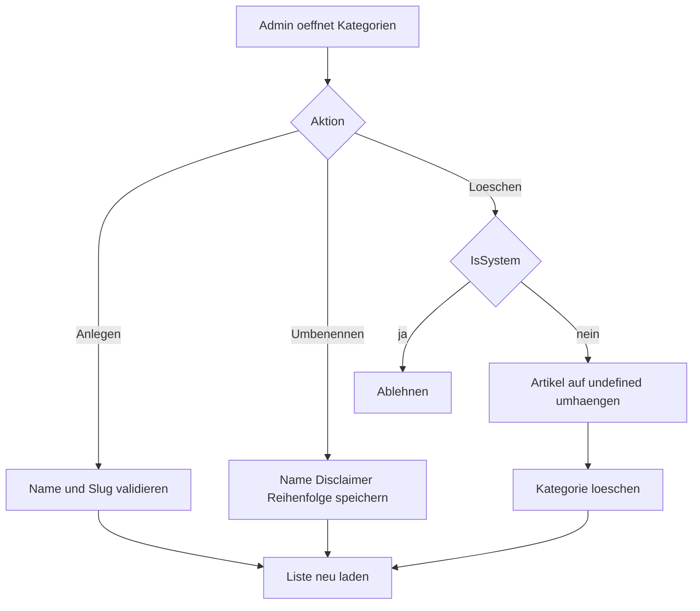
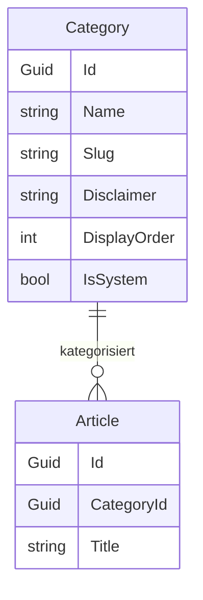

# Dynamische Kategorien – Plan

## 1. Ist-Zustand

Kategorien sind derzeit ein festes Enum und keine eigene Entität:

- [`ArticleCategory`](../src/BlogCms.Domain/Enums/ArticleCategory.cs:7) mit `Politik`, `Satire`, `Verschwoerungstheorien`.
- [`Article.Category`](../src/BlogCms.Domain/Entities/Article.cs:29) speichert das Enum als String-Spalte.
- [`CategoryDisplay`](../src/BlogCms.Web/Content/CategoryDisplay.cs:10) mappt Enum-Werte auf Label, Badge und Disclaimer.
- [`Suche.cshtml`](../src/BlogCms.Web/Pages/Suche.cshtml:31) und [`Suche.cshtml.cs`](../src/BlogCms.Web/Pages/Suche.cshtml.cs:36) filtern über das Enum.
- [`_ArticleForm.cshtml`](../src/BlogCms.Web/Pages/Admin/Articles/_ArticleForm.cshtml:34) rendert ein Enum-Dropdown.
- [`ArticleInputModel`](../src/BlogCms.Web/Models/ArticleInputModel.cs:29) erzwingt `[Required]` auf der Kategorie.
- [`ArticlePostRequest`](../src/BlogCms.Infrastructure/Content/ArticlePostRequest.cs:30), [`ArticlePostingService`](../src/BlogCms.Infrastructure/Content/ArticlePostingService.cs:77) und [`ArticleService`](../src/BlogCms.Infrastructure/Content/ArticleService.cs:51) führen das Enum durch den gesamten Schreib-/Lesepfad.
- API ([`ArticleApiModels`](../src/BlogCms.Web/Models/Api/ArticleApiModels.cs:46)), RSS ([`FeedController`](../src/BlogCms.Web/Controllers/FeedController.cs:54)), öffentliche Artikel-API ([`ArticlesController`](../src/BlogCms.Web/Controllers/ArticlesController.cs:64)) und [`site.js`](../src/BlogCms.Web/wwwroot/js/site.js:246) nutzen ebenfalls das Enum.
- Eine frühere `Category`-Tabelle wurde mit Migration `20261017073838_RemoveCategoryTable` wieder entfernt, weil sie halbherzig und ungenutzt war.

**Fazit:** Kategorien sind heute nicht administrierbar, nicht umbenennbar und nicht löschbar. Die drei Werte sind im Code hart verdrahtet.

---

## 2. Soll-Konzept

### 2.1 Datenmodell

Neue Entität `Category` in `src/BlogCms.Domain/Entities/Category.cs`:

| Feld | Typ | Bedeutung |
|---|---|---|
| `Id` | `Guid` | PK, aus `EntityBase` |
| `Name` | `string` | Anzeigename, Pflicht, max. 100, eindeutig |
| `Slug` | `string` | URL-/Filter-Segment, Pflicht, max. 100, eindeutig, stabil bei Umbenennung |
| `Description` | `string?` | optionale interne Beschreibung |
| `Disclaimer` | `string?` | optionaler Hinweistext, der auf der Artikelseite erscheint |
| `DisplayOrder` | `int` | Sortierung in Auswahllisten |
| `IsSystem` | `bool` | `true` nur für `undefined`; schützt vor Löschen/Umbenennen |
| `CreatedAt` | `DateTime` | aus `EntityBase` |
| `Articles` | `ICollection<Article>` | Rücknavigation |

`Article` erhält:

- `Guid CategoryId` (non-nullable FK, Default = `CategoryIds.Undefined`)
- `Category? Category` (Navigation)
- Das bisherige Enum-Property `Category` entfällt.

Feste, im Code definierte IDs in `CategoryIds`:

| Konstante | GUID | Slug | Name |
|---|---|---|---|
| `Undefined` | `00000000-0000-0000-0000-000000000001` | `undefined` | `undefined` |
| `Politik` | `00000000-0000-0000-0000-000000000002` | `politik` | `Politik` |
| `Satire` | `00000000-0000-0000-0000-000000000003` | `satire` | `Satire` |
| `Verschwoerungstheorien` | `00000000-0000-0000-0000-000000000004` | `verschwoerungstheorien` | `Verschwörungstheorien` |

Die festen IDs sind notwendig, damit die Migration bestehende Enum-Werte eindeutig zuordnen kann und Tests ohne Datenbank-Seeding reproduzierbar bleiben.

### 2.2 Fachliche Regeln

1. `undefined` wird beim Start idempotent angelegt und ist immer vorhanden.
2. `undefined` ist die einzige Kategorie mit `IsSystem = true`; sie kann weder gelöscht noch umbenannt werden.
3. Ein Beitrag kann vom Autor einer Kategorie zugeordnet werden. Wählt er keine, wird `CategoryId = CategoryIds.Undefined` gesetzt.
4. Der Admin kann Kategorien anlegen, umbenennen (Name, Slug, Beschreibung, Disclaimer, Reihenfolge) und löschen.
5. Beim Löschen einer Kategorie werden alle zugehörigen Artikel zuerst auf `undefined` umgehängt, danach wird die Kategorie gelöscht. Das geschieht transaktional im `CategoryService`.
6. Der Admin kann die Kategorie eines Beitrags nachträglich ändern – im Bearbeitungsformular und zusätzlich direkt in der Aktenliste.
7. Umbenennen einer Kategorie wirkt automatisch auf alle Artikel, weil nur der FK gespeichert ist.
8. Der öffentliche Kategorie-Filter zeigt alle Kategorien inklusive `undefined`.
9. Der Disclaimer wird aus `Category.Disclaimer` gelesen; die bisherigen Texte für `Satire` und `Verschwörungstheorien` werden bei der Migration als Startwerte gesetzt.

### 2.3 Datenbank-Migration

Eine neue EF-Migration `AddDynamicCategories` führt folgende Schritte aus:

1. Tabelle `Categories` anlegen (Name, Slug, Description, Disclaimer, DisplayOrder, IsSystem, CreatedAt).
2. Vier Seed-Zeilen mit den festen GUIDs einfügen.
3. `Articles.CategoryId` als nullable `uuid` hinzufügen.
4. Bestehende Werte per SQL zuordnen:
   - `Politik` → `...0002`
   - `Satire` → `...0003`
   - `Verschwoerungstheorien` → `...0004`
   - alles andere / `NULL` → `...0001` (`undefined`)
5. `CategoryId` auf `NOT NULL` setzen, Default `...0001`.
6. Alte Spalte `Articles.Category` droppen.
7. Index `IX_Articles_CategoryId` und FK mit `OnDelete(DeleteBehavior.Restrict)` anlegen.
8. Unique-Indizes auf `Categories.Name` und `Categories.Slug`.

Die `Down`-Migration stellt die alte Enum-Spalte wieder her und mappt die drei bekannten Slugs zurück; `undefined` wird zu `Politik` als technischer Fallback.

### 2.4 Backend-Komponenten

| Datei | Änderung |
|---|---|
| `src/BlogCms.Domain/Entities/Category.cs` | **neu**: Entität |
| `src/BlogCms.Domain/Content/CategoryIds.cs` | **neu**: feste GUIDs und Slugs |
| `src/BlogCms.Domain/Entities/Article.cs` | Enum-Property durch `CategoryId` + Navigation ersetzen |
| `src/BlogCms.Domain/Enums/ArticleCategory.cs` | **löschen** |
| `src/BlogCms.Infrastructure/Data/Configurations/CategoryConfiguration.cs` | **neu**: Constraints, Indizes, FK |
| `src/BlogCms.Infrastructure/Data/AppDbContext.cs` | `DbSet<Category>` ergänzen |
| `src/BlogCms.Infrastructure/Data/Migrations/..._AddDynamicCategories.cs` | **neu**: Migration inkl. Datenübernahme |
| `src/BlogCms.Infrastructure/Categories/ICategoryService.cs` | **neu**: Schnittstelle |
| `src/BlogCms.Infrastructure/Categories/CategoryService.cs` | **neu**: CRUD, Löschen mit Umhängen, Slug-Eindeutigkeit |
| `src/BlogCms.Infrastructure/Categories/CategorySeeder.cs` | **neu**: idempotentes Anlegen von `undefined` und der drei Startkategorien |
| `src/BlogCms.Infrastructure/Content/ArticleService.cs` | `ArticleQuery.CategoryId` statt Enum; `Include(a => a.Category)`; Filter über `CategoryId` |
| `src/BlogCms.Infrastructure/Content/ArticlePostRequest.cs` | `Guid CategoryId` statt Enum |
| `src/BlogCms.Infrastructure/Content/ArticlePostingService.cs` | Kategorie prüfen und setzen; Fallback `undefined` |
| `src/BlogCms.Infrastructure/Content/ArticleValidator.cs` | Kategorie existiert; keine Pflicht mehr |
| `src/BlogCms.Web/Program.cs` | `ICategoryService` registrieren; `CategorySeeder` beim Start ausführen |

`ICategoryService` (Vorschlag):

```csharp
Task<IReadOnlyList<Category>> GetAllAsync(CancellationToken ct = default);
Task<Category?> GetByIdAsync(Guid id, CancellationToken ct = default);
Task<Category?> GetBySlugAsync(string slug, CancellationToken ct = default);
Task<Category> GetUndefinedAsync(CancellationToken ct = default);
Task<CategoryResult> CreateAsync(CategoryInput input, CancellationToken ct = default);
Task<CategoryResult> UpdateAsync(Guid id, CategoryInput input, CancellationToken ct = default);
Task<CategoryResult> DeleteAsync(Guid id, CancellationToken ct = default);
Task<CategoryResult> AssignArticleAsync(Guid articleId, Guid categoryId, CancellationToken ct = default);
Task<int> CountArticlesAsync(Guid categoryId, CancellationToken ct = default);
```

`CategoryInput` enthält `Name`, `Slug?`, `Description?`, `Disclaimer?`, `DisplayOrder`.

### 2.5 API-Anpassung

- `ArticleWriteModel.Category` wird von Enum zu `string?` (Slug). Aus Gründen der Abwärtskompatibilität werden auch die alten Enum-Namen `Politik`, `Satire`, `Verschwoerungstheorien` akzeptiert und auf den passenden Slug aufgelöst. Leer/null → `undefined`.
- `ArticleReadModel` liefert:
  - `category` (Slug, string)
  - `categoryName` (Anzeigename)
  - `categoryId` (Guid)
- Die Management-API bleibt sonst unverändert; die Kategorie-Auflösung passiert zentral im `CategoryService`.
- Optional, aber nicht Teil des Pflichtumfangs: eigene Kategorie-Endpunkte unter `/api/v1/categories`. Der Plan sieht sie als spätere Erweiterung vor.

### 2.6 Frontend-Plan

**Admin: Kategorienverwaltung**

- Neue Razor-Page `src/BlogCms.Web/Pages/Admin/Categories/Index.cshtml` + `.cshtml.cs`.
- Zugriff: `[Authorize(Policy = Policies.RequireAdmin)]`.
- Aufbau analog zu [`Admin/LinkLists/Index.cshtml`](../src/BlogCms.Web/Pages/Admin/LinkLists/Index.cshtml:14):
  - Kopfbereich mit `_PageHeader` (Titel „Kategorien“, Untertitel „Themengebiete pflegen“).
  - Tabelle aller Kategorien mit Name, Slug, Artikelanzahl, Disclaimer-Kennzeichen, Reihenfolge.
  - Zeilenaktionen: „Bearbeiten“ (öffnet Inline-Formular oder eigene Edit-Seite) und „Löschen“ mit Bestätigungsdialog.
  - `undefined`-Zeile: kein Löschen-/Umbenennen-Button, stattdessen Pille „SYSTEM“.
  - Formular „Neue Kategorie“ mit Name, Slug (optional), Beschreibung, Disclaimer, Reihenfolge.
- Löschen zeigt vorab die Anzahl betroffener Artikel und den Hinweis, dass sie auf `undefined` wandern.

**Artikelformular**

- `_ArticleForm.cshtml`: Kategorie-Dropdown aus `ICategoryService.GetAllAsync()`; `undefined` ist vorausgewählt, wenn keine Kategorie gesetzt ist.
- Label „Kategorie (optional)“; Hilfetext „Ohne Auswahl wird der Beitrag unter undefined einsortiert.“
- `ArticleInputModel.CategoryId` als `Guid?`; `ToRequest` setzt `CategoryIds.Undefined`, wenn leer.

**Aktenliste**

- [`Admin/Articles/Index.cshtml`](../src/BlogCms.Web/Pages/Admin/Articles/Index.cshtml:91): Kategorie-Pille durch ein kleines Dropdown ersetzen, das nur Admins sehen. Änderung per POST-Handler `ChangeCategory`; Autoren sehen weiterhin die Pille.
- Dadurch kann der Admin die Kategorie ohne Öffnen des Bearbeitungsformulars neu setzen.

**Öffentliche Seiten**

- [`Suche.cshtml`](../src/BlogCms.Web/Pages/Suche.cshtml:31): Dropdown aus dynamischen Kategorien; Wert = Slug; „Alle Kategorien“ bleibt.
- [`_ArticleCard.cshtml`](../src/BlogCms.Web/Pages/Shared/_ArticleCard.cshtml:26): `article.Category?.Name` statt `CategoryDisplay.Label`.
- [`Articles/Details.cshtml`](../src/BlogCms.Web/Pages/Articles/Details.cshtml:44): Disclaimer aus `article.Category?.Disclaimer`; Meta-Zeile mit Kategorienamen.
- [`ArticlesController`](../src/BlogCms.Web/Controllers/ArticlesController.cs:64): `category` = Slug, `categoryLabel` = Name.
- [`FeedController`](../src/BlogCms.Web/Controllers/FeedController.cs:54): Kategoriename aus der Navigation.
- [`site.js`](../src/BlogCms.Web/wwwroot/js/site.js:246): nutzt bereits `article.category`; die API liefert künftig den Slug, zusätzlich `categoryLabel` für die Anzeige.
- Startseite: optional eine Chip-Reihe mit den Kategorien unterhalb der Hero-Tools, die auf `/Suche?category={slug}` verlinkt. Das entspricht dem Design-Konzept und verbessert die Auffindbarkeit.

**Navigation**

- [`_Layout.cshtml`](../src/BlogCms.Web/Pages/Shared/_Layout.cshtml:97): im Admin-Dropdown „Kategorien“ ergänzen, z. B. zwischen „Kurieren“ und „Benutzer“.

**Design und Ergonomie**

- Bestehende Klassen `mv-doc`, `mv-case`, `mv-pill`, `mv-create`, `mv-teaser`, `meta-mono` wiederverwenden.
- Tabellen responsiv in `table-responsive`.
- Formulare mit sichtbaren Labels, `aria-describedby` für Hilfetexte und Fehlermeldungen.
- Destruktive Aktionen mit `confirm()` und klarer Folgenbeschreibung.
- Keine neue Farbsystematik; Kategorie-Pillen bleiben neutral, `undefined` erhält eine gedämpfte Darstellung.
- Mobile: Tabelle bricht in gestapelte Karten um bzw. bleibt horizontal scrollbar; Formularfelder full-width.

### 2.7 Teststrategie

- Neue Tests für `CategoryService`:
  - `undefined` wird angelegt und ist nicht löschbar/umbenennbar.
  - Anlegen mit automatischem Slug und Kollisionsauflösung.
  - Umbenennen ändert den Slug nicht.
  - Löschen hängt Artikel auf `undefined` um und löscht die Kategorie.
  - `AssignArticleAsync` setzt die Kategorie.
- Bestehende Tests: `ArticleCategory.Politik` durch `CategoryIds.Politik` ersetzen; `TestDb.Create()` um Kategorie-Seeding erweitern.
- `ArticlePostingTests`: Kategorie-Fallback auf `undefined` prüfen.
- `ManagementArticlesControllerTests`: API-Auflösung von Slug und Legacy-Enum-Namen prüfen.
- Build und komplette Testsuite am Ende.

---

## 3. Ablauf





---

## 4. Umsetzungsreihenfolge

### Phase A – Backend

1. `Category`-Entität, `CategoryIds` und `Article`-Umbau.
2. EF-Konfiguration, `AppDbContext`, Migration inkl. Datenübernahme.
3. `ICategoryService`/`CategoryService` und `CategorySeeder`.
4. `ArticleService`, `ArticlePostRequest`, `ArticlePostingService`, `ArticleValidator` auf `CategoryId` umstellen.
5. API-Modelle und Controller anpassen.
6. DI und Start-Seeding in `Program.cs`.
7. Tests aktualisieren und Backend-Build/Tests grün stellen.

### Phase B – Frontend-Plan

8. Detaillierten Frontend-Plan in `plans/dynamische-kategorien-frontend.md` schreiben (Seiten, Komponenten, CSS, Zustände, Fehlerfälle).

### Phase C – UI

9. Admin-Seite `Admin/Categories` inkl. CRUD und Löschbestätigung.
10. Artikelformular und Aktenliste (Inline-Kategoriewechsel).
11. Öffentliche Suche, Karten, Detailseite, RSS und JS.
12. Navigation und optionale Kategorie-Chips auf der Startseite.
13. Abschließender Build, Tests und Sichtprüfung des Layouts.
