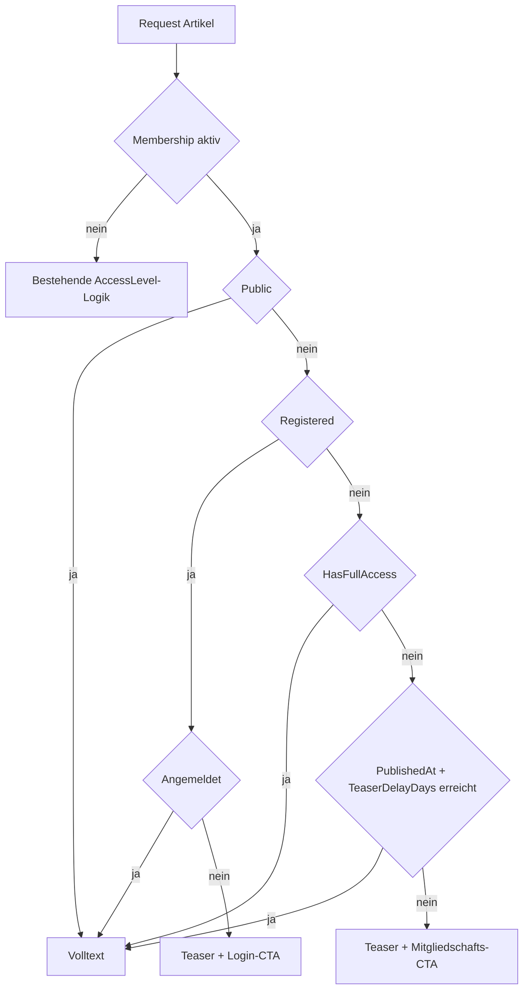
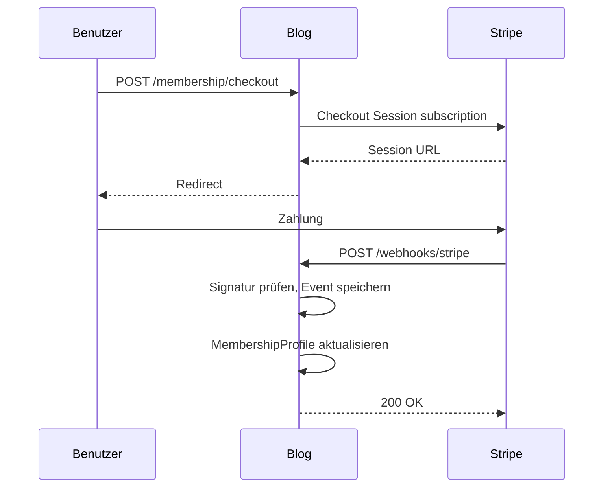

# Stripe-Mitgliedschaft – Umsetzungsplan

> **Hinweis:** Die ursprüngliche Koexistenz-Entscheidung wurde durch
> [`plans/refactoring-mitgliedschaft-und-abo.md`](refactoring-mitgliedschaft-und-abo.md)
> ersetzt. Der alte Abo-Flow wurde entfernt; `MembershipProfile` ist die einzige
> Abo-Quelle.

Grundlage: [`Pflichtenheft_Blog_Mitgliedschaft.md`](../Pflichtenheft_Blog_Mitgliedschaft.md)

## 1. Architektur-Entscheidungen

1. **Konsolidierung:** `MembershipProfile` ist die einzige Abo-Quelle. Der alte
   `Subscription`-Workflow wurde entfernt.
2. **Feld-Mapping:** `Summary` → `Article.Excerpt`, `MainImageUrl` →
   `Article.TitleImageUrl`, `PublishedAt` bleibt `Article.PublishedAt`.
   Keine Duplikate, keine Migration für diese Felder.
3. **Stripe.net:** Wird für die neue Funktion eingeführt. Die bestehende
   Raw-REST-Integration bleibt für den alten Flow bestehen.
4. **Feature-Flag:** `Membership:Enabled` ist unabhängig von
   `Features:MonetizationEnabled` und standardmäßig `false`.

## 2. Phase 1 — Vorbereitung ohne Stripe

**Ziel:** Konfiguration, Datenmodell und Zugriffslogik, alles standardmäßig aus.

### Dateien

| Datei | Inhalt |
|---|---|
| `src/BlogCms.Infrastructure/Membership/MembershipOptions.cs` | Options-Klasse mit allen Feldern aus Pflichtenheft §3 |
| `src/BlogCms.Domain/Enums/MembershipStatus.cs` | `None`, `Incomplete`, `Trialing`, `Active`, `PastDue`, `Canceled`, `Unpaid` |
| `src/BlogCms.Domain/Entities/MembershipProfile.cs` | Profil inkl. `IsComplimentary`, `ComplimentaryUntil`, `LastSyncedAt` |
| `src/BlogCms.Domain/Entities/StripeEvent.cs` | Idempotenz-Tabelle |
| `src/BlogCms.Domain/Entities/MembershipAuditLog.cs` | Audit-Tabelle |
| `src/BlogCms.Infrastructure/Data/Configurations/MembershipProfileConfiguration.cs` | Unique `UserId`, Indizes |
| `src/BlogCms.Infrastructure/Data/Configurations/StripeEventConfiguration.cs` | Unique `StripeEventId` |
| `src/BlogCms.Infrastructure/Data/Configurations/MembershipAuditLogConfiguration.cs` | Indizes |
| `src/BlogCms.Infrastructure/Data/AppDbContext.cs` | drei neue `DbSet`s |
| `src/BlogCms.Infrastructure/Data/Migrations/..._AddMembership.cs` | Migration |
| `src/BlogCms.Infrastructure/Membership/IMembershipService.cs` | Schnittstelle |
| `src/BlogCms.Infrastructure/Membership/MembershipService.cs` | Zugriffslogik, Profil-CRUD, Freigaben |
| `src/BlogCms.Web/appsettings.json` | `Membership`-Abschnitt mit `Enabled: false` |
| `src/BlogCms.Web/Program.cs` | Options binden, Service registrieren |
| `tests/BlogCms.Tests/MembershipAccessTests.cs` | Unit-Tests der Zugriffslogik |

### `IMembershipService` (Vorschlag)

```csharp
Task<MembershipProfile?> GetProfileAsync(Guid userId, CancellationToken ct = default);
Task<bool> HasFullAccessAsync(User? user, DateTime now, CancellationToken ct = default);
Task<bool> IsArticleFullyVisibleAsync(Article article, User? user, DateTime now, CancellationToken ct = default);
Task<MembershipResult> GrantComplimentaryAsync(Guid targetUserId, Guid actorId, DateTime? until, string? note, CancellationToken ct = default);
Task<MembershipResult> RevokeComplimentaryAsync(Guid targetUserId, Guid actorId, string? note, CancellationToken ct = default);
Task<IReadOnlyList<MembershipProfile>> GetForAdminAsync(string? search, MembershipFilter filter, CancellationToken ct = default);
```

### Tests

- Funktion aus → `HasFullAccess` und `IsArticleFullyVisible` liefern `true`.
- Admin → immer `true`.
- Freigabe mit Ablauf → vor Ablauf `true`, danach `false`.
- Freigabe ohne Ablauf → dauerhaft `true`.
- Aktives Abo → innerhalb und außerhalb der Kulanzzeit.
- Gekündigtes Abo → bis Periodenende + Kulanz.
- `PastDue` → bis Periodenende + Kulanz.
- Premium-Artikel vor/nach `TeaserDelayDays`.
- `Public`/`Registered` behalten ihre Semantik.

**Abnahme:** Build grün, Tests grün, Blog verhält sich bei `Enabled = false` unverändert.

## 3. Phase 2 — Teaser und Wartezeit

### Dateien

| Datei | Änderung |
|---|---|
| `src/BlogCms.Web/Pages/Articles/Details.cshtml.cs` | `IMembershipService` injizieren; bei aktivierter Funktion `IsArticleFullyVisibleAsync` verwenden; `ContentHtml` nur bei Sichtbarkeit setzen; `TeaserAvailableAt` und `RequiresMembership` bereitstellen |
| `src/BlogCms.Web/Pages/Articles/Details.cshtml` | Teaser-UI mit Hinweis auf Freischaltzeitpunkt und CTA „Mitglied werden“; kein Volltext im HTML |
| `src/BlogCms.Web/Pages/Shared/_ArticleCard.cshtml` | unverändert; Listen nutzen weiterhin nur Excerpt/Bild |
| `src/BlogCms.Web/Pages/Index.cshtml` | unverändert |
| `src/BlogCms.Web/Pages/Suche.cshtml` | unverändert |

### Caching

- Es gibt aktuell keinen Output-/Response-Cache für Artikelseiten.
- Kein neuer Cache wird eingeführt.
- Falls später Caching ergänzt wird, muss der Schlüssel die Zugriffsstufe enthalten.

### Tests

- T01: Funktion aus, anonymer Besucher → Volltext.
- T02: Funktion an, anonym, frischer Premium-Artikel → Teaser, kein Volltext im HTML.
- T03: Funktion an, anonym, Premium-Artikel nach `TeaserDelayDays` → Volltext.
- T04: Funktion an, angemeldeter Nicht-Mitglied, frischer Premium-Artikel → Teaser.
- T15: Funktion an, aktives Mitglied → Volltext.

**Abnahme:** T01–T04 und T15 bestanden; Volltext ist bei eingeschränktem Zugriff nicht im Antwort-HTML.

## 4. Phase 3 — Admin-Freigaben

### Dateien

| Datei | Inhalt |
|---|---|
| `src/BlogCms.Web/Pages/Admin/Memberships/Index.cshtml` | Liste, Suche, Filter, Freischalten/Entziehen, manueller Sync-Platzhalter |
| `src/BlogCms.Web/Pages/Admin/Memberships/Index.cshtml.cs` | `[Authorize(Policy = Policies.RequireAdmin)]`, Handler, Audit-Log |
| `src/BlogCms.Web/Pages/Shared/_Layout.cshtml` | Menüpunkt „Mitgliedschaften“ nur bei aktivierter Funktion und Admin-Rolle |
| `src/BlogCms.Infrastructure/Membership/MembershipService.cs` | Freigabe/Entzug inkl. Audit-Log |

### Regeln

- Bei `Membership:Enabled = false`: Menüpunkt ausblenden, Seite liefert 404.
- Jede Änderung schreibt `MembershipAuditLog` mit Admin-ID, Aktion, Zeitpunkt, Details.
- Serverseitige Autorisierung, nicht nur Menü-Sichtbarkeit.

### Tests

- T05: Freigabe mit Ablaufdatum.
- T06: Entzug + Audit-Log.

**Abnahme:** T05/T06 bestanden, Audit-Log wird geschrieben.

## 5. Phase 4 — Stripe-Checkout und Webhooks

### Dateien

| Datei | Inhalt |
|---|---|
| `src/BlogCms.Infrastructure/BlogCms.Infrastructure.csproj` | NuGet `Stripe.net` |
| `src/BlogCms.Infrastructure/Membership/StripeMembershipService.cs` | Checkout, Portal, Webhook-Verifikation, Abo-Abruf |
| `src/BlogCms.Infrastructure/Membership/IStripeMembershipService.cs` | Schnittstelle |
| `src/BlogCms.Web/Controllers/MembershipController.cs` | `POST /membership/checkout`, `POST /membership/portal` |
| `src/BlogCms.Web/Controllers/MembershipWebhookController.cs` | `POST /webhooks/stripe` |
| `src/BlogCms.Infrastructure/Membership/MembershipWebhookHandler.cs` | Event-Verarbeitung, Idempotenz, Profil-Update |
| `src/BlogCms.Web/Program.cs` | `StripeConfiguration.ApiKey`, DI |

### Checkout

- Nur angemeldet.
- `Membership:Enabled = false` → 404.
- `mode = subscription`.
- `ClientReferenceId` und `Metadata["userId"]` = Benutzer-ID.
- Preis-ID aus `PriceIdMonthly`/`PriceIdYearly`.
- Redirect zur Stripe-URL.
- Erfolgsseite ändert keinen Status.

### Webhook

- Rohtext lesen.
- `Stripe.EventUtility.ConstructEvent` mit `WebhookSecret`.
- Ungültige Signatur → 400.
- Idempotenz über `StripeEvent.StripeEventId`.
- Zuordnung nur über `ClientReferenceId`/`Metadata["userId"]`.
- Events: `checkout.session.completed`, `customer.subscription.created`,
  `customer.subscription.updated`, `customer.subscription.deleted`,
  `invoice.paid`, `invoice.payment_failed`.
- Bei deaktivierter Funktion → 404.

### Tests

- T07: Checkout-Session korrekt.
- T08: Ungültige Signatur → 400, keine Statusänderung.
- T09: `checkout.session.completed` → Profil aktiv, Stripe-IDs gespeichert.

**Abnahme:** T07–T09 bestanden (Stripe CLI/Testkarte).

## 6. Phase 5 — Portal, Login-Sync und Tagesabgleich

### Dateien

| Datei | Inhalt |
|---|---|
| `src/BlogCms.Web/Pages/Account/Manage/Index.cshtml` | Status und Laufzeitende anzeigen |
| `src/BlogCms.Web/Pages/Account/Manage/Index.cshtml.cs` | `MembershipProfile` laden |
| `src/BlogCms.Web/Pages/Account/Login.cshtml.cs` | Login-Sync anstoßen |
| `src/BlogCms.Infrastructure/Membership/MembershipSyncService.cs` | `BackgroundService`, Batch-Abgleich |
| `src/BlogCms.Web/Program.cs` | `AddHostedService<MembershipSyncService>` |

### Regeln

- Portal nur mit `StripeCustomerId`.
- Login-Sync nur bei veraltetem `LastSyncedAt`.
- Fehler beim Sync: letzten Status behalten, loggen.
- Hintergrundjob läuft nicht bei deaktivierter Funktion.
- Batches max. 50.

### Tests

- T10: Portal-Session.
- T11: Login-Sync aktualisiert.
- T12: Login-Sync-Fehler behält Status.
- T13: Hintergrundabgleich aktualisiert.
- T14: Hintergrundabgleich bei deaktivierter Funktion.

**Abnahme:** T10–T14 bestanden.

## 7. Phase 6 — Härtung und Abschluss

1. Autorisierung aller neuen Endpunkte prüfen.
2. Eingabevalidierung prüfen.
3. Keine Stripe-Geheimnisse in Repository, Logs oder Fehlermeldungen.
4. Vollständiger Testlauf im Stripe-Testmodus inkl. Kündigung, fehlgeschlagener
   Zahlung und verpasstem Webhook.
5. Betriebsdokumentation: Konfiguration, Stripe-Dashboard, Tagesjob,
   Fehlerbehebung.
6. Abnahmeliste T01–T15 mit Ergebnis.

## 8. Teststrategie

- **Unit-Tests:** Zugriffslogik, Kulanzzeit, Freigaben, Teaser-Zeitpunkt.
- **Integrationstests:** Webhook-Idempotenz, Checkout-Mapping, Admin-Audit.
- **Manuell:** Stripe CLI, Testkarte, Testuhr, Kündigung, `invoice.payment_failed`.
- **Sicherheit:** Signaturprüfung, 404 bei deaktivierter Funktion, Admin-Rollen.

## 9. Ablauf





## 10. Risiken und Gegenmaßnahmen

| Risiko | Gegenmaßnahme |
|---|---|
| Zwei parallele Abo-Modelle | Klare Trennung, Feature-Flag, spätere Konsolidierung dokumentieren |
| Stripe.net-Kompatibilität | Paketversion beim Build prüfen, notfalls Raw-REST-Fallback |
| Zeitzonen | Alle Zeiten UTC speichern und vergleichen |
| Caching | Kein Output-Cache für Artikelseiten; bei späterer Einführung Access-Level im Schlüssel |
| Geheimnisse | User Secrets, leere Platzhalter, Log-Review |
