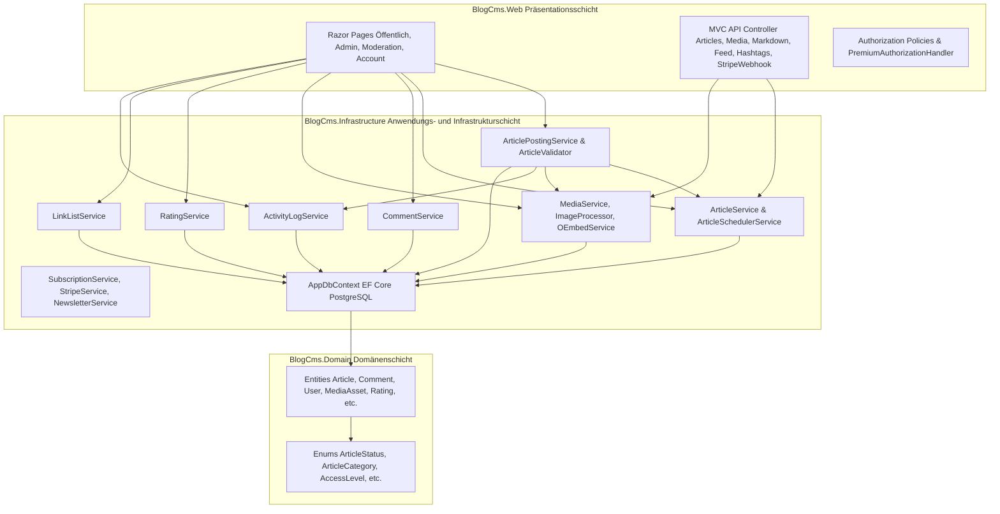

# Technische Übersicht — Backend & Systemarchitektur (Ist-Zustand)

**Stand:** Oktober 2026  
**Referenzbasis (Single Point of Truth):** [`DataSchema.md`](../DataSchema.md), [`FeatureFix1.MD`](../FeatureFix1.MD), [`00-Uebersicht.md`](../00-Uebersicht.md) bis [`05-Benutzerverwaltung-Auth.md`](../05-Benutzerverwaltung-Auth.md)

---

## 1. Systemarchitektur im Überblick

Das Projekt **MentalVersagen / BlogCms** ist als klassische Drei-Schichten-Anwendung auf Basis von **.NET 10**, **ASP.NET Core (Razor Pages + API-Controller)**, **Entity Framework Core** und **PostgreSQL** aufgebaut.

### Projektstruktur (`src/`)
1. **[`BlogCms.Domain`](../src/BlogCms.Domain/BlogCms.Domain.csproj)**: Reine POCO-Entitäten und Enums ohne externe Infrastrukturabhängigkeiten (bis auf `Microsoft.Extensions.Identity.Stores` für [`User`](../src/BlogCms.Domain/Entities/User.cs:8)).
2. **[`BlogCms.Infrastructure`](../src/BlogCms.Infrastructure/BlogCms.Infrastructure.csproj)**: Beinhaltet sowohl die **Datenzugriffsschicht** ([`AppDbContext`](../src/BlogCms.Infrastructure/Data/AppDbContext.cs:13), EF-Configurations, Migrationen) als auch sämtliche **Application Services** (Content, Comments, Media, Ratings, Payments, Email, Activity).
3. **[`BlogCms.Web`](../src/BlogCms.Web/BlogCms.Web.csproj)**: Razor Pages für Server-Side-Rendering, ergänzende JSON/REST-Controller für dynamische UI-Interaktionen (Markdown-Editor-Upload, Startseiten-Filterung) sowie Authentifizierungs-/Autorisierungs-Konfiguration in [`Program.cs`](../src/BlogCms.Web/Program.cs:1).

---

## 2. Datenmodell & Persistenz (`AppDbContext` vs. `DataSchema.md`)

Die Datenbankanbindung erfolgt über [`AppDbContext`](../src/BlogCms.Infrastructure/Data/AppDbContext.cs:13) (`IdentityDbContext<User, IdentityRole<Guid>, Guid>`). Alle Enums werden bei relationalen Datenbanken (PostgreSQL) automatisch per `EnumToStringConverter` als lesbare Strings persistiert ([`AppDbContext.OnModelCreating`](../src/BlogCms.Infrastructure/Data/AppDbContext.cs:48)).

### 2.1 Übersicht der Entitäten
| Entität | Tabelle / DbSet | Soft-Delete / QueryFilter | Besonderheiten im Code |
|---|---|---|---|
| [`User`](../src/BlogCms.Domain/Entities/User.cs:8) | `AspNetUsers` | `DeletedAt` (ohne globalen Filter) | Erweitert `IdentityUser<Guid>`; führt `Role` (Enum) **parallel** zu Identity-Rollen (`AspNetUserRoles`) |
| [`Article`](../src/BlogCms.Domain/Entities/Article.cs:9) | `Articles` | `DeletedAt == null` ([`ArticleConfiguration`](../src/BlogCms.Infrastructure/Data/Configurations/ArticleConfiguration.cs:40)) | Besitzt `Category` (Enum) **und** `CategoryId` (FK auf `Categories`) |
| [`Category`](../src/BlogCms.Domain/Entities/Category.cs:7) | `Categories` | Nein | **Abweichung zu `DataSchema.md`:** Eigene Tabelle, wird in [`Program.cs`](../src/BlogCms.Web/Program.cs:262) geseedet |
| [`Tag`](../src/BlogCms.Domain/Entities/Tag.cs:6) / [`ArticleTag`](../src/BlogCms.Domain/Entities/ArticleTag.cs:6) | `Tags`, `ArticleTags` | Nein | n:m-Verknüpfung für Schlagwörter |
| [`Hashtag`](../src/BlogCms.Domain/Entities/Hashtag.cs:7) / [`ArticleHashtag`](../src/BlogCms.Domain/Entities/ArticleHashtag.cs:6) | `Hashtags`, `ArticleHashtags` | Nein | n:m-Verknüpfung für `#`-Hashtags |
| [`Comment`](../src/BlogCms.Domain/Entities/Comment.cs:9) | `Comments` | `DeletedAt` (bewusst kein globaler Filter) | Selbstreferenzierend über `ParentCommentId`; `IsHighlighted` für Auszeichnungen |
| [`MediaAsset`](../src/BlogCms.Domain/Entities/MediaAsset.cs:9) | `MediaAssets` | Nein (Hard-Delete inkl. Storage) | Polymorph (`OwnerType`: Article/Comment); enthält **undokumentiertes Feld `IsCover`** |
| [`VideoEmbed`](../src/BlogCms.Domain/Entities/VideoEmbed.cs:8) | `VideoEmbeds` | Nein | Speichert Plattform, `OriginalUrl`, `EmbedHtml`, `ThumbnailUrl` |
| [`Rating`](../src/BlogCms.Domain/Entities/Rating.cs:9) | `Ratings` | Nein | Polymorph über `ArticleId` oder `CommentId`; Unique-Index pro User + Ziel |
| [`Report`](../src/BlogCms.Domain/Entities/Report.cs:8) | `Reports` | Nein | Meldungen zu Kommentaren (`Open`, `Reviewed`, `Dismissed`) |
| [`LinkList`](../src/BlogCms.Domain/Entities/LinkList.cs:7) / [`LinkListItem`](../src/BlogCms.Domain/Entities/LinkListItem.cs:6) | `LinkLists`, `LinkListItems` | Nein | Geordnete Empfehlungslisten über `Position` |
| [`ActivityLogEntry`](../src/BlogCms.Domain/Entities/ActivityLogEntry.cs:9) | `ActivityLogEntries` | Nein (Append-only) | Erfasst Views, Artikel-Erstellung, Kommentare, Artikel-Ratings |
| [`Subscription`](../src/BlogCms.Domain/Entities/Subscription.cs:8) / [`Donation`](../src/BlogCms.Domain/Entities/Donation.cs:8) | `Subscriptions`, `Donations` | Nein | Monetarisierungs-Entitäten (Stripe / PayPal) |
| [`NewsletterSubscriber`](../src/BlogCms.Domain/Entities/NewsletterSubscriber.cs:6) | `NewsletterSubscribers` | Nein (`UnsubscribedAt`) | Double-Opt-In mit `ConfirmationToken` und `UnsubscribeToken` |

### 2.2 Festgestellte Schema-Divergenzen (Code vs. `DataSchema.md`)
1. **`Category`-Entität vs. `ArticleCategory`-Enum:** Laut [`DataSchema.md`](../DataSchema.md:48) ist `Category` bewusst ein festes Enum (`Politik`, `Satire`, `Verschwoerungstheorien`). In Migration `20260928144832_AddCategoryEntity` wurde jedoch zusätzlich eine Tabelle `Categories` und der optionale FK `Article.CategoryId` eingeführt. Aktuell wird `CategoryId` beim Speichern von Artikeln **nicht mehr gesetzt**, in Queries aber per `.Include(a => a.CategoryEntity)` geladen.
2. **`MediaAsset.IsCover`:** In [`MediaAsset.cs`](../src/BlogCms.Domain/Entities/MediaAsset.cs:40) existiert das Boolean-Feld `IsCover`, das in [`DataSchema.md`](../DataSchema.md:113) nicht verzeichnet ist. Es wird nur in [`MediaService.AttachToArticleAsync`](../src/BlogCms.Infrastructure/Media/MediaService.cs:158) gesetzt, aber nicht beim regulären Cover-Upload über [`ArticlePostingService`](../src/BlogCms.Infrastructure/Content/ArticlePostingService.cs:192).
3. **Rollen-Redundanz an `User`:** [`User.Role`](../src/BlogCms.Domain/Entities/User.cs:12) ist als Spalte in `AspNetUsers` vorhanden, die Autorisierung in ASP.NET Core prüft jedoch über `User.IsInRole(...)` die Identity-Join-Tabelle `AspNetUserRoles`.

---

## 3. Analyse der Kern-Subsysteme im Backend

### 3.1 Beitrags-Posting & Artikel-Workflow (`Content`)
Die Beitrags-Erstellung und -Bearbeitung ist auf zwei Services aufgeteilt:
- **[`ArticlePostingService`](../src/BlogCms.Infrastructure/Content/ArticlePostingService.cs:31)**: Orchestriert den Schreib-Workflow (`CreateAsync`, `UpdateAsync`) innerhalb einer DB-Transaktion:
  1. Validiert über [`ArticleValidator.Validate`](../src/BlogCms.Infrastructure/Content/ArticleValidator.cs:11) (Titelbild-Pflicht BR-022, Zukunftsdatum bei `Scheduled` BR-032).
  2. Erzeugt/Aktualisiert die [`Article`](../src/BlogCms.Domain/Entities/Article.cs:9)-Entität via [`ArticleService.PrepareCreateAsync`](../src/BlogCms.Infrastructure/Content/ArticleService.cs:404) bzw. [`PrepareUpdateAsync`](../src/BlogCms.Infrastructure/Content/ArticleService.cs:433) (Slug-Generierung, `PublishedAt`-Logik, Tag-/Hashtag-Synchronisation).
  3. Verarbeitet Video-URLs via [`OEmbedService`](../src/BlogCms.Infrastructure/Media/OEmbedService.cs:17) und lädt Dateien (`CoverUpload`, `ContentUploads`) über [`MediaService.UploadAsync`](../src/BlogCms.Infrastructure/Media/MediaService.cs:62) hoch.
  4. Verknüpft vorab im Markdown-Editor hochgeladene Bilder via [`MediaService.AttachToArticleAsync`](../src/BlogCms.Infrastructure/Media/MediaService.cs:140).
  5. Schreibt bei Neuanlage einen Eintrag in [`ActivityLogService`](../src/BlogCms.Infrastructure/Activity/ActivityLogService.cs:24).
- **[`ArticleSchedulerService`](../src/BlogCms.Infrastructure/Content/ArticleSchedulerService.cs:13)**: Ein `BackgroundService`, der periodisch [`ArticleService.PublishDueScheduledAsync`](../src/BlogCms.Infrastructure/Content/ArticleService.cs:498) aufruft und fällige `Scheduled`-Beiträge auf `Published` setzt.

### 3.2 Artikel-Verwaltung & Abfragen (`ArticleService`)
- **[`ArticleService`](../src/BlogCms.Infrastructure/Content/ArticleService.cs:132)** dient gleichzeitig als Query-Service für das Frontend (`SearchPublishedAsync`, `GetPublishedBySlugAsync`, `GetPublishedHashtagsAsync`), als Abfrage-Service für das Admin-Backend (`GetForAdminAsync`, `GetForAuthorAsync`) und als Persistenz-Helfer für Slugs, Tags, Hashtags und Soft-Deletes.
- In der Verwaltungsübersicht ([`Pages/Admin/Articles/Index.cshtml.cs`](../src/BlogCms.Web/Pages/Admin/Articles/Index.cshtml.cs:36)) werden **alle** Artikel eines Autors bzw. des gesamten Blogs ungefiltert in den Arbeitsspeicher geladen und erst dort nach Status (`Published`, `Draft`, `Scheduled`) gefiltert; `Archived` fehlt als Filteroption ganz.

### 3.3 Medien-Verwaltung (`Media`)
- **[`MediaService`](../src/BlogCms.Infrastructure/Media/MediaService.cs:43)** prüft Dateigrößen (`ArticleMaxBytes` vs. `CommentMaxBytes`), verarbeitet Bilder über [`MagickImageProcessor`](../src/BlogCms.Infrastructure/Media/ImageProcessor.cs:27) (Format-Validierung anhand des tatsächlichen Inhalts, proportionale Verkleinerung ohne Upscaling, WebP-Konvertierung, EXIF-Entfernung via `Strip()`) und speichert sie über [`IStorageService`](../src/BlogCms.Infrastructure/Media/IStorageService.cs:6) (`LocalDiskStorageService` unter `wwwroot/uploads` oder `S3StorageService`).
- **Titelbild-Auflösung ([`ArticleDisplay.ResolveTitleImage`](../src/BlogCms.Web/Content/ArticleDisplay.cs:14)):** Prüft in dieser Reihenfolge:
  1. `article.TitleImageUrl` (externe URL oder vom Button „Als Titelbild verwenden" gesetzte interne URL)
  2. `article.MediaAssets.FirstOrDefault(m => m.IsCover)`
  3. `article.MediaAssets.OrderBy(m => m.CreatedAt).FirstOrDefault()`

### 3.4 Kommentarfunktion, Moderation & Bewertungen (`Comments` & `Ratings`)
- **[`CommentService`](../src/BlogCms.Infrastructure/Comments/CommentService.cs:56)** steuert:
  - Das Erstellen von Kommentaren und Antworten (`AddAsync`) inkl. DB-basiertem Rate-Limiting (`MaxCommentsPerMinute`) und Wortfilter (`Blocklist` → setzt Status auf `Flagged`, sonst `Approved` bei Post-Moderation bzw. `Pending` bei Pre-Moderation).
  - Das zeitlich begrenzte Bearbeiten eigener Kommentare (`EditAsync` innerhalb `EditWindowMinutes`).
  - Das Soft-Delete (`SoftDeleteAsync`: setzt `DeletedAt`, leert `ContentText` und setzt `Status = Rejected`, damit Kind-Antworten im Baum erhalten bleiben).
  - Das Melden (`ReportAsync`) und die Moderations-Abfragen (`GetOpenReportsAsync`, `GetPendingAndFlaggedAsync`, `ModerateAsync`).
  - Das Auszeichnen (`SetHighlightAsync`) durch Admins oder den Beitragsautor.
- **[`RatingService`](../src/BlogCms.Infrastructure/Ratings/RatingService.cs:48)** verwaltet `ThumbUp`/`ThumbDown`-Stimmen für Artikel und Kommentare.

---

## 4. Zusammenfassung der Stärken und Schwächen des Ist-Zustands

### Was bereits gut gelöst ist:
- Klare Trennung von externen Diensten über Interfaces (`IStorageService`, `IStripeService`, `IAppEmailSender`, `IOEmbedService`) mit lokalen Dev-Fallbacks.
- Sicheres Markdown-Rendering (Markdig + HtmlSanitizer) und XSS-freies Video-Embedding über strikte Video-ID-Extraktion + Sandboxed-Iframes.
- Solide Testabdeckung der Grundfunktionen über xUnit.

### Wo die Architektur aktuell bricht (Ursachen für die unzufriedene UX/Funktionsweise):
Die Probleme beim **Posten von Beiträgen**, in der **Verwaltung** und bei der **Kommentarfunktion** resultieren aus einer Mischung aus **unvollständigen Backend-Workflows**, **widersprüchlichen Zustandslogiken** (z. B. rund um Titelbilder, Entwürfe und Edit-Aktionen) und **Architektur-Brüchen zwischen Web- und Infrastrukturschicht**.

Eine detaillierte Auflistung aller identifizierten Schwachstellen sowie der konkrete Refactoring-Plan befinden sich in [`plans/backend-refactoring-plan.md`](backend-refactoring-plan.md).
