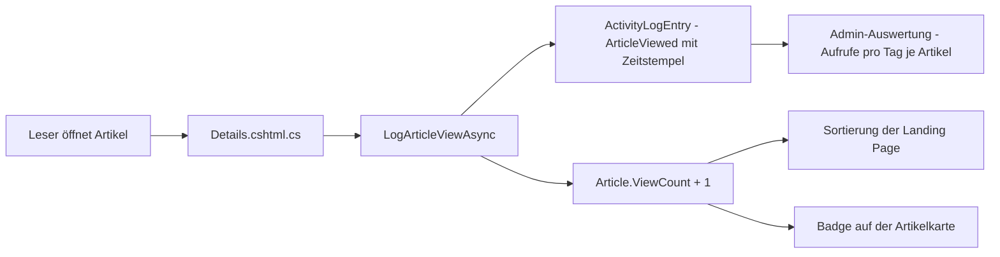

# Plan: View-Statistik & Sortierung der Landing Page

**Stand:** 2026-10-17
**Status:** Entwurf zur Freigabe — keine Code-Änderungen enthalten.
**Ziel:**
1. **Statistik** „wie oft und wann wurde ein Beitrag aufgerufen" — Summe pro Beitrag + Verlauf (Aufrufe pro Tag je Artikel).
2. **Sortierbare Listenansicht** der Landing Page mit Umschalter für: Erstelldatum (neu/alt zuerst), Views (ab/aufsteigend), Likes (ab/aufsteigend), Daumen runter (ab/aufsteigend). **Standard: neueste Beiträge zuerst.**
3. **Zahlen sichtbar:** Views, Likes und Daumen runter als **Badges auf den Artikelkarten** der Landing Page (Entscheidung des Auftraggebers); der Verlauf „wann aufgerufen" erscheint in der **Admin-Auswertung**.

---

## 1. Ausgangslage — vieles ist schon da

| Baustein | Stand | Wo |
|---|---|---|
| View-Erfassung | ✅ vorhanden — jeder Aufruf einer Artikelseite schreibt ein [`ArticleViewed`](../src/BlogCms.Domain/Enums/ActivityEventType.cs:10)-Event (mit Zeitstempel) | [`Details.cshtml.cs`](../src/BlogCms.Web/Pages/Articles/Details.cshtml.cs:124) → [`LogArticleViewAsync()`](../src/BlogCms.Infrastructure/Activity/IActivityLogService.cs:34) |
| „Wann"-Rohdaten | ✅ vorhanden — [`ActivityLogEntry`](../src/BlogCms.Domain/Entities/ActivityLogEntry.cs:9) speichert jeden Aufruf mit `CreatedAt` | Tabelle `ActivityLogEntries` |
| Blogweite Tagesübersicht | ✅ vorhanden — [`DailyActivity`](../src/BlogCms.Infrastructure/Activity/IActivityLogService.cs:13) (Views/Comments/ArticlesCreated pro Tag) in der Admin-Auswertung | [`/Admin/Activity`](../src/BlogCms.Web/Pages/Admin/Activity/Index.cshtml.cs:42) |
| Sortier-Logik | ⚠️ teilweise — [`ArticleSortOrder`](../src/BlogCms.Infrastructure/Content/ArticleService.cs:10) kennt `Newest`, `Oldest`, `MostUpvoted`, `MostDownvoted` u. a.; **fehlend: Views-Sortierung und die aufsteigenden Varianten** | [`SearchPublishedAsync()`](../src/BlogCms.Infrastructure/Content/ArticleService.cs:226) |
| Sortier-UI | ⚠️ teilweise — Dropdown [`mv-sort__select`](../src/BlogCms.Web/Pages/Index.cshtml:52) rendert alle Enum-Werte, [`site.js`](../src/BlogCms.Web/wwwroot/js/site.js:194) übergibt `sort` an die API (Neuladen-freies Nachladen) | [`Index.cshtml`](../src/BlogCms.Web/Pages/Index.cshtml:55) |
| Like/Dislike-Summen | ⚠️ nur als Aggregation — [`Rating`](../src/BlogCms.Domain/Entities/Rating.cs:9) (ThumbUp/ThumbDown), Sortierung per `Ratings.Count(...)` existiert, **Badges/Zahlen in den Kartendaten fehlen** | [`ArticlesController`](../src/BlogCms.Web/Controllers/ArticlesController.cs:52) |
| **View-Summe pro Artikel** | ❌ fehlt — Views liegen nur als Events im Log, es gibt keinen Zähler am Artikel | — |

---

## 2. Konzept

### 2.1 View-Summe pro Artikel: denormalisierter Zähler

Die Sortierung braucht eine **schnell sortierbare Summe**. Da [`ActivityLogEntry`](../src/BlogCms.Domain/Entities/ActivityLogEntry.cs:9) mit jedem Aufruf wächst (und ohne Rückwärts-Navigation zum Artikel), wird die Summe als Feld am Artikel geführt:

- Neues Property **`ViewCount`** (int) auf [`Article`](../src/BlogCms.Domain/Entities/Article.cs:9).
- **Inkrement** in [`ActivityLogService.LogArticleViewAsync()`](../src/BlogCms.Infrastructure/Activity/ActivityLogService.cs) — dieselbe Stelle, die heute schon das Event schreibt: ein Aufruf = ein Event **und** `ViewCount + 1` (atomar in derselben Transaktion).
- **Migration mit Backfill:** die bestehenden `ArticleViewed`-Events werden bei der Migration in die Zähler übernommen (`UPDATE "Articles" SET "ViewCount" = COUNT aus "ActivityLogEntries" WHERE "EventType" = 'ArticleViewed'`).

> **Alternative verworfen:** Aggregation der Events pro Abfrage — keine Migration, aber die Sortierung würde bei wachsendem Log spürbar langsamer; die Event-Tabelle bleibt für den Verlauf zuständig.

### 2.2 Zahlen für die Badges: Views, Likes, Daumen runter

- **Views:** `Article.ViewCount` (aus 2.1).
- **Likes/Daumen runter:** Summen aus [`Rating`](../src/BlogCms.Domain/Entities/Rating.cs:9) (`Count(r => r.Value == ThumbUp)` / `ThumbDown`) — dieselbe Aggregation, die die Sortierung [`MostUpvoted`](../src/BlogCms.Infrastructure/Content/ArticleService.cs:242)/[`MostDownvoted`](../src/BlogCms.Infrastructure/Content/ArticleService.cs:246) bereits nutzt. Damit die Karten die Zahlen anzeigen können, werden die Summen in die Kartendaten aufgenommen (Projection bzw. `Include(a => a.Ratings)` in [`SearchPublishedAsync()`](../src/BlogCms.Infrastructure/Content/ArticleService.cs:264)).
- Die JSON-Antwort von [`api/articles`](../src/BlogCms.Web/Controllers/ArticlesController.cs:26) (liefert das Grid an [`site.js`](../src/BlogCms.Web/wwwroot/js/site.js)) und das serverseitige Kartenmodell [`ArticleCardModel`](../src/BlogCms.Web/Models/ArticleCardModel.cs) erhalten je **`views`**, **`likes`**, **`thumbsDown`**.

### 2.3 Sortierung: 8 Optionen auf der Landing Page

Erweiterung von [`ArticleSortOrder`](../src/BlogCms.Infrastructure/Content/ArticleService.cs:10) um die fehlenden Richtungen (Neu/Alt sowie Likes/Daumen-absteigend existieren bereits):

| Dropdown-Option | Enum-Wert | Status | Sortierbasis |
|---|---|---|---|
| Neueste zuerst | `Newest` | vorhanden | `PublishedAt` absteigend — **Standard** |
| Älteste zuerst | `Oldest` | vorhanden | `PublishedAt` aufsteigend |
| Meiste Aufrufe | `MostViewed` | **neu** | `ViewCount` absteigend |
| Wenigste Aufrufe | `LeastViewed` | **neu** | `ViewCount` aufsteigend |
| Meiste Likes | `MostUpvoted` | vorhanden | `Ratings.Count(ThumbUp)` absteigend |
| Wenigste Likes | `LeastUpvoted` | **neu** | `Ratings.Count(ThumbUp)` aufsteigend |
| Meiste Daumen runter | `MostDownvoted` | vorhanden | `Ratings.Count(ThumbDown)` absteigend |
| Wenigste Daumen runter | `LeastDownvoted` | **neu** | `Ratings.Count(ThumbDown)` aufsteigend |

- Die vier neuen Fälle ergänzen den `switch` in [`SearchPublishedAsync()`](../src/BlogCms.Infrastructure/Content/ArticleService.cs:226) — jeweils mit stabilem Tie-Break (`ThenByDescending(a => a.PublishedAt)` etc., wie die vorhandenen Fälle).
- Das Dropdown auf der Landing Page zeigt **genau diese acht Optionen in der oben stehenden Reihenfolge** (explizite Optionsliste statt `Enum.GetValues` — [`Index.cshtml`](../src/BlogCms.Web/Pages/Index.cshtml:55) rendert aktuell alle Enum-Werte inkl. Zusatzwerte wie `Title`/`Popular`/`MostCommented`; diese bleiben im Enum und über die Suche-Seite [`Suche.cshtml`](../src/BlogCms.Web/Pages/Suche.cshtml) nutzbar, erscheinen aber nicht mehr im Landing-Dropdown).
- Labels laufen über [`SortDisplay.Label()`](../src/BlogCms.Web/Content) — dort die vier neuen Werte beschriften.
- **Standard bleibt `Newest`** (bereits so umgesetzt in [`Index.cshtml`](../src/BlogCms.Web/Pages/Index.cshtml:57) und als Default in [`ArticleQuery`](../src/BlogCms.Infrastructure/Content/ArticleService.cs:45)).
- Das bestehende JS (`.mv-sort__select` → [`loadArticles()`](../src/BlogCms.Web/wwwroot/js/site.js:431)) überträgt den Wert ohne Änderungen — die neue Optionenliste wirkt sich nur auf die dargestellten `<option>`s aus.

> **Hinweis „Erstelldatum":** Die Sortierung läuft weiter über `PublishedAt` (das für Leser sichtbare Datum), wie es `Newest`/`Oldest` seit jeher tun. Soll wirklich das interne Anlage-Datum `CreatedAt` gemeint sein, ist das ein Einzeiler im `switch` — die Bezeichnung im Dropdown kann entsprechend „Datum" lauten.

### 2.4 Verlauf „wann aufgerufen" in der Admin-Auswertung

Erweiterung von [`/Admin/Activity`](../src/BlogCms.Web/Pages/Admin/Activity/Index.cshtml.cs:15) um eine **pro-Artikel-Aufrufstatistik**:

- Neue Methode in [`IActivityLogService`](../src/BlogCms.Infrastructure/Activity/IActivityLogService.cs:32):
  `GetArticleViewHistoryAsync(DateTime fromUtc, DateTime toUtc)` → Liste aus `Artikel`, `ViewCount`, `letzter Aufruf` und **Aufrufen pro Tag** (GROUP BY `ArticleId`, `DATE(CreatedAt)` auf den `ArticleViewed`-Events).
- Darstellung: neue Tabelle „Aufrufe je Artikel" in der Admin-Seite — Zeile pro Artikel mit Gesamt-Aufrufen, letztem Aufruf und einem kompakten Tagesverlauf (z. B. 30 Tages-Bars oder Spalten „Datum | Aufrufe" für einen ausgewählten Artikel).
- Die vorhandene blogweite [`DailyActivity`](../src/BlogCms.Infrastructure/Activity/IActivityLogService.cs:13)-Ansicht bleibt unverändert.

---

## 3. UI & Design

- **Badges auf der Artikelkarte** ([`_ArticleCard.cshtml`](../src/BlogCms.Web/Pages/Shared/_ArticleCard.cshtml)): dezente Zeile im Karten-Footer — z. B. `👁 128 · 👍 14 · 👎 2`. Da das Icon-Font (FontAwesome) laut [`RUNNING.md`](../RUNNING.md) nur auf den Admin-Artikel-Seiten lädt, werden die Symbole als **Unicode/Inline-Elemente** umgesetzt (kein zusätzliches Font-Paket).
- Gestaltung angepasst an das vorhandene Dark-Glow-Design ([`site.css`](../src/BlogCms.Web/wwwroot/css/site.css), siehe [`plans/done/design-refinement-glow.md`](done/design-refinement-glow.md)): gedeckte Badge-Fläche, kleiner Text (`0.8rem`), Glow-Akzent nur beim Hover — konsistent zu den bestehenden `.mv-*`-Klassen.
- Das Sort-Dropdown (`.mv-sort__select`) behält sein vorhandenes Styling; nur die Optionsliste und die Reihenfolge ändern sich. Reihenfolge entspricht der Nutzervorgabe (Datum neu → Datum alt → Views ab → Views auf → Likes ab → Likes auf → Daumen ab → Daumen auf).
- **Mobile:** Badges stapeln/umfließen sauber in der Kartenbreite (flex row, gap); Dropdown bleibt vollbreit nutzbar.

---

## 4. Technische Umsetzung (Datei für Datei)

| # | Datei | Änderung |
|---|---|---|
| 1 | [`Article.cs`](../src/BlogCms.Domain/Entities/Article.cs:9) | Property `ViewCount` (int, Default 0) ergänzen |
| 2 | EF-Migration (neu) | Spalte `ViewCount` + **Backfill** aus `ActivityLogEntries` (`EventType = 'ArticleViewed'`) |
| 3 | [`ActivityLogService`](../src/BlogCms.Infrastructure/Activity/ActivityLogService.cs) | In [`LogArticleViewAsync()`](../src/BlogCms.Infrastructure/Activity/IActivityLogService.cs:34) `article.ViewCount += 1` in derselben Transaktion wie das Event |
| 4 | [`ArticleSortOrder`](../src/BlogCms.Infrastructure/Content/ArticleService.cs:10) | `MostViewed`, `LeastViewed`, `LeastUpvoted`, `LeastDownvoted` ergänzen |
| 5 | [`SearchPublishedAsync()`](../src/BlogCms.Infrastructure/Content/ArticleService.cs:226) | Vier neue `switch`-Fälle mit stabilen Tie-Breaks; `Include(a => a.Ratings)` für die Badge-Summen |
| 6 | [`SortDisplay`](../src/BlogCms.Web/Content) | Labels für die vier neuen Werte |
| 7 | [`Index.cshtml`](../src/BlogCms.Web/Pages/Index.cshtml:55) | Dropdown auf die 8 gewünschten Optionen in Vorgabereihenfolge beschränken |
| 8 | [`ArticlesController`](../src/BlogCms.Web/Controllers/ArticlesController.cs:52) | JSON-Items um `views`, `likes`, `thumbsDown` erweitern |
| 9 | [`ArticleCardModel`](../src/BlogCms.Web/Models/ArticleCardModel.cs) + [`_ArticleCard.cshtml`](../src/BlogCms.Web/Pages/Shared/_ArticleCard.cshtml) | Drei Zahlen aufnehmen und als Badge-Zeile rendern |
| 10 | [`IActivityLogService`](../src/BlogCms.Infrastructure/Activity/IActivityLogService.cs:32) + [`ActivityLogService`](../src/BlogCms.Infrastructure/Activity/ActivityLogService.cs) | `GetArticleViewHistoryAsync(...)` (Aufrufe pro Tag je Artikel) |
| 11 | [`Admin/Activity/Index`](../src/BlogCms.Web/Pages/Admin/Activity/Index.cshtml.cs:15) + View | Neue Tabelle „Aufrufe je Artikel" mit Tagesverlauf |
| 12 | Tests | Sortierungstests (neue Werte) in [`ContentTests`](../tests/BlogCms.Tests/ContentTests.cs); Inkrement-/Backfill-Test in [`ActivityLogTests`](../tests/BlogCms.Tests/ActivityLogTests.cs); Badge-Summen im API-JSON |

---

## 5. Umsetzungsschritte (Reihenfolge)

1. **Datenmodell:** `ViewCount` an [`Article`](../src/BlogCms.Domain/Entities/Article.cs:9) + Migration mit Backfill.
2. **Erfassung:** Inkrement in [`LogArticleViewAsync()`](../src/BlogCms.Infrastructure/Activity/IActivityLogService.cs:34).
3. **Sortierung:** Enum + [`SearchPublishedAsync()`](../src/BlogCms.Infrastructure/Content/ArticleService.cs:226) + [`SortDisplay`](../src/BlogCms.Web/Content) + Dropdown-Liste in [`Index.cshtml`](../src/BlogCms.Web/Pages/Index.cshtml:55).
4. **Zahlen liefern:** [`ArticlesController`](../src/BlogCms.Web/Controllers/ArticlesController.cs:52)-JSON + [`ArticleCardModel`](../src/BlogCms.Web/Models/ArticleCardModel.cs) um Views/Likes/Daumen erweitern.
5. **Badges:** [`_ArticleCard.cshtml`](../src/BlogCms.Web/Pages/Shared/_ArticleCard.cshtml) + [`site.css`](../src/BlogCms.Web/wwwroot/css/site.css) (`.mv-card__stats`).
6. **Admin-Verlauf:** `GetArticleViewHistoryAsync()` + neue Tabelle auf [`/Admin/Activity`](../src/BlogCms.Web/Pages/Admin/Activity/Index.cshtml.cs:15).
7. **Tests** (Schritt 12 der Tabelle) und manuelle Abnahme (Sortier-Dropdown durchklicken, Badges prüfen, Admin-Verlauf).

---

## 6. Abnahmekriterien

- [ ] Das Landing-Page-Dropdown zeigt genau die 8 Optionen in der Vorgabereihenfolge; **Standard ist „Neueste zuerst"**.
- [ ] Jede Sortierung wirkt sofort (ohne Seiten-Neuladen, wie bisher über [`site.js`](../src/BlogCms.Web/wwwroot/js/site.js:194)) und ist stabil bei Gleichstand.
- [ ] Die Karten zeigen Views/Likes/Daumen-runter als Badges; die Zahlen stimmen mit der Admin-Auswertung überein.
- [ ] Nach der Migration sind die historischen Aufrufe im `ViewCount` enthalten (Backfill).
- [ ] Die Admin-Auswertung zeigt „Aufrufe je Artikel" inkl. Tagesverlauf („wann aufgerufen").
- [ ] `dotnet test` ist grün; die bestehenden Sortier- und Activity-Tests laufen weiter durch.

---

## 7. Offene Punkte / bewusste Entscheidungen

| Thema | Entscheidung |
|---|---|
| View-Summe | Denormalisiertes `ViewCount` am Artikel (performante Sortierung), Verlauf bleibt im Activity-Log |
| Sortierbasis Datum | `PublishedAt` (öffentlich sichtbares Datum) statt `CreatedAt` — abweichbar per Einzeiler |
| Likes/Dislike-Summen | Aggregation aus [`Rating`](../src/BlogCms.Domain/Entities/Rating.cs:9) (keine weiteren Zählerfelder — Bewertungen sind änderbar, die Aggregation bleibt immer korrekt) |
| Zusatz-Sortierwerte (`Title`, `Popular`, `MostCommented`, `MostLiked`) | bleiben im Enum und über die Suche-Seite nutzbar, verschwinden aber aus dem Landing-Dropdown |
| Badge-Symbole | Unicode statt Icon-Font (kein zusätzliches Paket nötig) |
